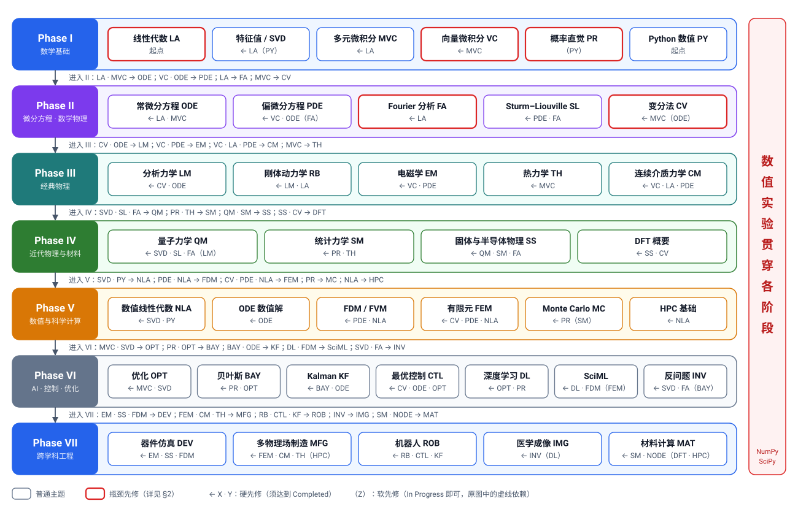
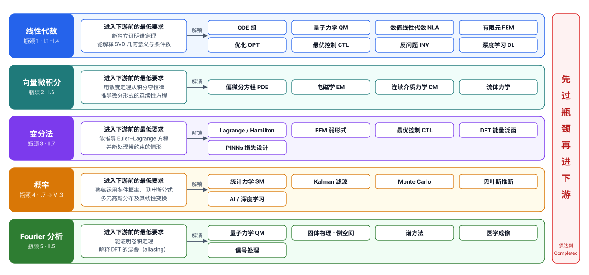

# 先修关系图（Prerequisite Map）

> 本文件描述 Phase I–VII 各主题之间的依赖关系，识别**关键路径（critical path）**与**瓶颈先修（bottleneck prerequisites）**。
> 主题 ID 与 [`ROADMAP.md`](../ROADMAP.md) 保持一致。

---

## 1. 全局依赖 DAG（Global Dependency DAG）

每张卡片下方的 `← A · B` 表示"学习该主题之前必须掌握 A、B"（硬先修）；括号内为"有帮助但非必需"的软先修。红框为 §2 的瓶颈先修；带状之间的箭头列出进入下一阶段的主干依赖。

---

## 2. 瓶颈先修（Bottleneck Prerequisites）

"瓶颈"指出度（out-degree）高、一旦薄弱就会同时阻塞多个下游分支的主题。**这些主题值得投入超出平均水平的时间，并且必须达到 `Completed` 才可进入下游。**

| 瓶颈 | 直接阻塞的下游 | 为什么是瓶颈 | 进入下游前的最低要求 |
|---|---|---|---|
| **线性代数**（I.1–I.4） | ODE 组、QM、NLA、FEM、优化、控制、反问题、DL | 几乎所有离散化后的问题都化为 $A\mathbf{x}=\mathbf{b}$ 或 $A\mathbf{x}=\lambda\mathbf{x}$；QM 本质上是无穷维线性代数 | 能独立证明谱定理；能解释 SVD 的几何意义与条件数 |
| **向量微积分**（I.6） | PDE、EM、连续介质、流体 | 所有守恒律的推导都依赖散度定理把积分形式转化为微分形式 | 能用散度定理从积分守恒律推导出微分形式的连续性方程 |
| **变分法**（II.7） | Lagrange/Hamilton 力学、FEM、最优控制、DFT、PINNs 的损失函数设计 | "求泛函驻点"是力学、数值离散、控制与量子化学的共同语言 | 能推导 Euler–Lagrange 方程，并能处理带约束的情形 |
| **概率**（I.7 → VI.3） | 统计力学、Kalman 滤波、MC、贝叶斯推断、DL | 随机性贯穿物理（热涨落）、估计（噪声）、计算（采样）与学习（泛化） | 熟练运用条件概率、贝叶斯公式、多元高斯分布及其线性变换 |
| **Fourier 分析**（II.5） | QM、固体物理（倒空间）、谱方法、医学成像、信号处理 | 平移不变系统的对角化工具；连接 PDE、晶体与成像 | 能证明卷积定理并解释 DFT 的混叠（aliasing） |

---

## 3. 关键路径（Critical Paths）

以下每条路径代表通往某个 Phase VII 综合项目的最短必修链。路径上任一节点滞后，都会直接延误该项目。

| 目标项目 | 关键路径 | 链长 |
|---|---|---|
| VII.1 器件仿真 | LA → VC → PDE → EM → (QM → SS) → NLA → FDM → **DEV** | 8 |
| VII.2 多物理场制造 | LA → VC → PDE → CM / TH → CV → NLA → FEM → **MFG** | 8 |
| VII.3 机器人 | LA → MVC → ODE → CV → LM → RB → OPT → CTL / KF → **ROB** | 9 |
| VII.4 医学成像 | LA → SVD → FA → INV → (DL) → **IMG** | 5–6 |
| VII.5 神经算子 | LA → MVC → OPT → DL → (PDE → FDM) → SCIML | 6–7 |
| VII.6 材料计算 | LA → SL → QM → (PR → SM) → SS → DFT → NODE → **MAT** | 8 |

**结论**：

1. **LA 是所有关键路径的起点**，Phase I 中线性代数的质量决定整个项目的上限。
2. **机器人路径最长**（9 步），且依赖变分法 → 力学 → 控制的串行链；若计划以机器人为主攻方向，应在 Phase III 中优先完成刚体动力学。
3. **医学成像路径最短**，可在 Phase VI 中期作为第一个综合项目的"早期回报（early win）"。

---

## 4. 结构化先修表（Structured Prerequisite Table）

| 主题 | ROADMAP ID | 硬先修（必须 `Completed`） | 软先修（`In Progress` 即可） | 解锁的下游 |
|---|---|---|---|---|
| 线性代数 | I.1–I.4 | — | Python 基础 | 几乎全部 |
| 多元/向量微积分 | I.5–I.6 | 一元微积分（假定已有） | LA | ODE、PDE、EM、CM、OPT |
| 概率直觉 | I.7 | — | Python 基础 | SM、MC、BAY、DL |
| ODE | II.1–II.2 | LA、MVC | — | PDE、LM、KF、CTL、NODE |
| PDE 与分离变量 | II.3–II.4 | VC、ODE | FA | EM、CM、QM、FDM、FEM |
| Fourier 分析 | II.5 | LA（内积空间） | MVC | SL、QM、SS、INV |
| 变分法 | II.7 | MVC | ODE | LM、FEM、CTL、DFT |
| Lagrange/Hamilton 力学 | III.1–III.2 | CV、ODE | LA | RB、QM（Hamilton 形式） |
| 电磁学 | III.4–III.5 | VC、PDE | Green 函数 | DEV |
| 连续介质力学 | III.7–III.8 | VC、LA（张量） | PDE | MFG |
| 量子力学 | IV.1–IV.3 | SVD/谱定理、SL、FA | Hamilton 力学 | SS、DFT |
| 统计力学 | IV.4 | PR、TH | — | SS、MC、MAT |
| 固体与半导体物理 | IV.5–IV.6 | QM、SM | FA | DEV、DFT |
| 数值线性代数 | V.2 | SVD | Python | FDM、FEM、HPC |
| FDM / FVM | V.4–V.5 | PDE、NLA | — | DEV、SCIML |
| FEM | V.6 | CV、PDE、NLA | 泛函分析初步 | MFG |
| 优化 | VI.1–VI.2 | MVC、SVD | — | BAY、CTL、DL |
| Kalman 滤波 | VI.4 | BAY、ODE | — | ROB |
| 最优控制 | VI.5 | CV、ODE、OPT | — | ROB |
| SciML | VI.7 | DL、FDM | FEM | VII.5 |
| 反问题 | VI.8 | SVD、FA | BAY | IMG |

---

## 5. 使用建议

- **开始新主题前**：在本表中检查硬先修是否均为 `Completed`；若有缺口，优先补缺，而不是"边学边补"。
- **软先修可并行**：例如学习 PDE 时，Fourier 分析可同步推进。
- **每个 Phase 结束时**：用本图检查下一个 Phase 的入口节点是否全部就绪。
