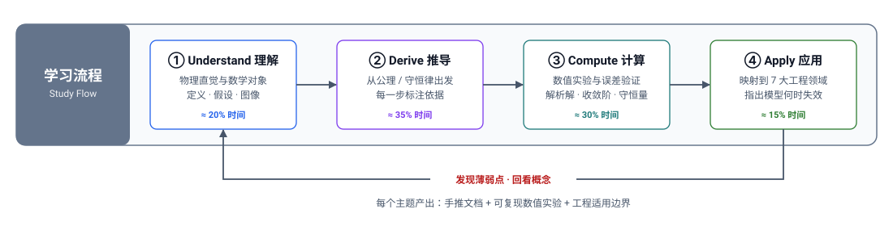
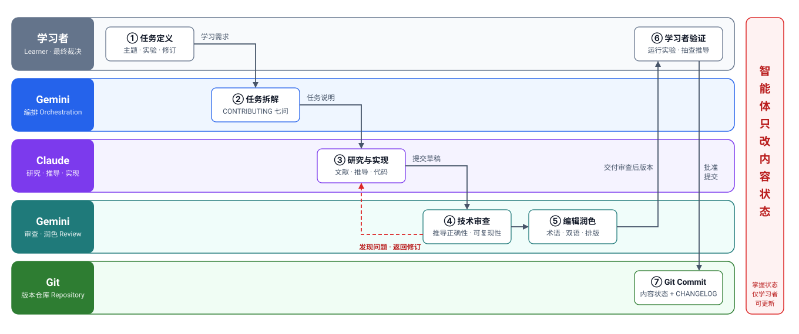

# 学习工作流（Study Workflow）

> 本文件规定：① 学习每个主题的操作流程（Understand → Derive → Compute → Apply）；② 推导文档的 10 节标准模板；③ 数值实验的 10 节标准；④ 双智能体内容更新流程。

---

## 1. 单个主题的四阶段流程



闭环的入口与出口：

1. **入口**：选定主题，先在 [`prerequisite_map.md`](prerequisite_map.md) 中检查硬先修是否均为 `Completed`。
2. **出口检查**：完成 Apply 后做一次白纸复现；**未通过 → 回到 Derive**。
3. **通过**：在 [`ROADMAP.md`](../ROADMAP.md) 中把个人掌握状态更新为 `Completed`，并加入间隔复习队列（第 1 / 4 / 12 周）。

### 1.1 Understand（理解）— 约占主题时间 20%

| 步骤 | 产出 |
|---|---|
| 写出主题的**动机问题**：它要解决什么问题？没有它会怎样？ | 1–3 句话 |
| 列出所有**核心定义**，每个定义配一个正例与一个反例 | 定义表 |
| 画出**几何或物理图像**（手绘即可） | 草图 |
| 用三层深度规则（见 [`learning_strategy.md`](learning_strategy.md) §2.1）为每个定理分级 | L1/L2/L3 清单 |

### 1.2 Derive（推导）— 约 35%

- 对每个 L1 定理按 §2 的推导模板写成文档。
- 每一步标注依据（定理、假设或代数运算）。
- 完成后至少进行一次白纸复现（[`learning_strategy.md`](learning_strategy.md) §3.3）。

### 1.3 Compute（计算）— 约 30%

- 按 §3 的实验标准实现至少一个数值实验。
- 必须有验证基准：解析解、守恒量、理论收敛阶或独立方法交叉对照。

### 1.4 Apply（应用）— 约 15%

- 映射到至少一个应用领域，回答：**在该领域中，这个数学对象对应什么物理量或工程量？模型的哪条假设最先失效？**
- 更新 `06_knowledge_graph/` 中的跨主题链接。

### 1.5 完成判定

只有当学习者本人满足 [`ROADMAP.md`](../ROADMAP.md) §0.2 中 `Completed` 的全部三项条件时，才能更新个人掌握状态。

---

## 2. 标准推导模板（Standard Derivation Template, 10 Sections）

所有推导文档（存放于 `01_mathematics/`、`02_physics/`、`03_computational_methods/`）必须包含以下 10 节。各节可简可繁，但不可缺省；确实不适用时写明"不适用"及理由。

```markdown
# <主题中文名>（<English Title>）

## 1. 动机与问题陈述（Motivation & Problem Statement）
这个推导要回答什么问题？它在知识体系中的位置（引用 ROADMAP ID）。

## 2. 先修知识（Prerequisites）
列出所需的定义与定理，并链接到仓库内对应文档。

## 3. 假设与适用范围（Assumptions & Scope）
编号列出全部假设（A1, A2, …），说明每条假设的物理/数学含义。

## 4. 符号约定（Notation）
符号表：符号 | 含义 | 量纲/所在空间。与 GLOSSARY.md 保持一致。

## 5. 推导（Derivation）
逐步推导，每一步右侧标注依据：[定理名] / [假设 A2] / [代数]。
关键步骤给出"为什么这样做"的说明。

## 6. 结果与解释（Result & Interpretation）
最终结果（加框或单独成行），并给出物理/几何解释、量纲检验、极限情形检验。

## 7. 替代推导或等价表述（Alternative Derivations）
至少一种其他推导路径，或说明与其他表述（如积分形式/微分形式/变分形式）的等价性。

## 8. 失效条件与常见误区（Limitations & Pitfalls）
哪些假设被违反时结论失效？给出至少一个反例或失效场景。

## 9. 计算与应用连接（Computational & Application Links）
对应的数值实验（链接到 05_experiments/）与应用领域（链接到 04_engineering_applications/）。

## 10. 参考文献与自测（References & Self-Check）
参考文献（精确到章节/页码）；3–5 道自测题，至少一题要求白纸复现核心推导。
```

**检验要点**：§6 必须包含至少一项**一致性检验**（量纲分析、极限情形、对称性或已知特例）。

---

## 3. 标准实验规范（Experiment Standard, 10 Sections）

所有数值实验存放于 `05_experiments/<子领域>/<实验名>/`，目录结构如下：

```text
05_experiments/heat_transfer/heat1d_explicit_fdm/
├── README.md          # 按下述 10 节撰写
├── heat1d.py          # 主程序（或 .ipynb）
├── test_heat1d.py     # 验证测试（可选但推荐）
└── output/            # 运行产物（已在 .gitignore 中忽略；精选图片可单独提交到 figures/）
```

`README.md` 必须包含以下 10 节：

| # | 节名 | 必含内容 |
|---|---|---|
| 1 | 目的（Objective） | 本实验验证什么理论结论或探索什么现象；关联的推导文档 |
| 2 | 数学模型（Mathematical Model） | 控制方程、定义域、边界条件与初始条件 |
| 3 | 数值方法（Numerical Method） | 离散格式、算法步骤；理论上的精度阶与稳定性条件 |
| 4 | 实现说明（Implementation） | 代码结构、关键函数、依赖库及版本 |
| 5 | 参数设置（Parameters） | 全部参数表（物理参数、网格、时间步、容差、随机种子） |
| 6 | 验证基准（Verification Benchmark） | 解析解 / 制造解（method of manufactured solutions）/ 守恒量 / 文献结果 |
| 7 | 结果（Results） | 图表、误差表；收敛阶需给出双对数图与拟合斜率 |
| 8 | 分析与讨论（Analysis） | 结果与理论是否一致；不一致的原因；参数敏感性 |
| 9 | 局限性与扩展（Limitations & Extensions） | 模型/方法的边界；可进一步探索的方向 |
| 10 | 复现方法（Reproduction） | 一条命令即可复现的运行指令；预期运行时间；随机种子 |

**可复现性硬性要求**：

- 固定随机种子（`numpy.random.default_rng(seed)`）。
- 不使用绝对路径；输出写入实验目录下的 `output/`。
- 收敛性实验至少使用 4 个网格层级（如 $h, h/2, h/4, h/8$）。
- 浮点比较使用容差（`numpy.testing.assert_allclose`），并说明容差的选取依据。

---

## 4. 双智能体更新流程（Dual-Agent Update Workflow）



### 4.1 各阶段职责与产出

| 阶段 | 执行者 | 输入 | 产出 | 出口标准 |
|---|---|---|---|---|
| 1. 任务定义（Task） | 学习者 / Gemini 编排 | 学习需求 | 任务说明：范围、ROADMAP ID、验收标准 | 通过 [`CONTRIBUTING.md`](../CONTRIBUTING.md) 七问 |
| 2. 研究与实现（Research / Impl） | Claude | 任务说明 | 推导文档草稿、实验代码、参考文献 | 符合 10 节模板；不确定处已标 `[NEEDS VERIFICATION]` |
| 3. 技术审查（Technical Review） | Gemini | 草稿 | 问题清单（逐条，含位置与理由） | 无未解决的正确性问题 |
| 4. 编辑润色（Editorial Polish） | Gemini | 审查后版本 | 润色版本 | 术语与 [`GLOSSARY.md`](../GLOSSARY.md) 一致；双语格式合规 |
| 5. 验证（Verification） | 学习者 | 润色版本 | 实验运行记录、抽查结论 | 实验可复现；`[NEEDS VERIFICATION]` 已处理或明确保留 |
| 6. 提交（Git Commit） | 学习者 | 验证后版本 | Git 提交 + CHANGELOG 条目 | 遵循提交信息规范（§4.2） |

### 4.2 提交信息规范（Commit Message Convention）

采用 Conventional Commits 风格：

```text
<type>(<scope>): <简要说明>

<可选正文：做了什么、为什么>
Refs: ROADMAP <ID>
```

| type | 用途 |
|---|---|
| `docs` | 新增或修改推导/说明文档 |
| `exp` | 新增或修改数值实验 |
| `fix` | 修正推导错误、代码缺陷 |
| `refactor` | 结构调整，不改变内容 |
| `chore` | 工具脚本、配置、治理文件 |

示例：`docs(linear_algebra): add spectral theorem derivation` + `Refs: ROADMAP I.3`

### 4.3 关键原则

- 智能体产出只改变**内容状态**；学习者的验证只确认内容质量，**个人掌握状态需另行通过白纸复现确认**。
- 审查发现的错误应记录在 CHANGELOG 中，因为错误本身是有价值的学习材料。
