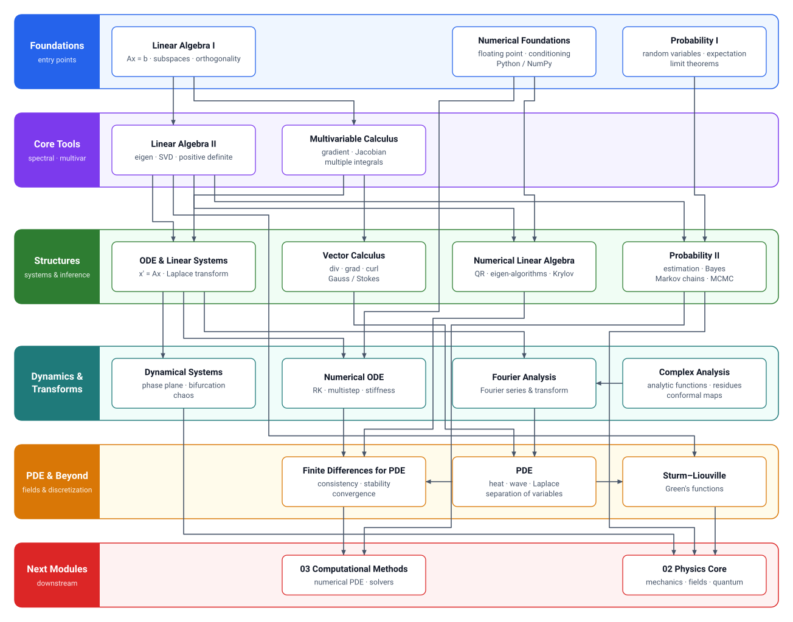

# 01 数学核心 Mathematics Core

> 对应 [`ROADMAP.md`](../ROADMAP.md) 的 **Phase I (M1–M2)** 与 **Phase II (M3–M4)** 主干，同时 **Probability（概率统计）**、**Optimization（优化）** 与 **Numerical Analysis（数值分析）** 将贯穿至 **Phase V–VI** 交织深化。
> Goal 目标: (1) derive the governing equations of physics and engineering models, (2) solve them analytically where possible, and (3) discretize them and solve numerically with error control.

## 1. 模块索引 Module Index

| Module | Path | Scope 范围 | Phase / Months | Est. hours |
|---|---|---|---|---|
| Single-Variable Calculus 一元微积分（前置） | [single_variable_calculus/curriculum.md](single_variable_calculus/curriculum.md) | Limits, derivatives, mean value theorems, Taylor formula, integrals and techniques, series | Before P-I | ~60–80 h |
| Linear Algebra & Matrix Analysis 线性代数与矩阵分析 | [linear_algebra/curriculum.md](linear_algebra/curriculum.md) | Subspaces, factorizations, eigen/SVD, least squares, positive definiteness, matrix norms & perturbation | P-I: M1–M4 (+ P-II revisit) | ~180 h |
| Multivariable & Vector Calculus + Complex Analysis 多元/向量微积分 + 复分析 | [calculus/curriculum.md](calculus/curriculum.md) | Gradients/Jacobians, multiple integrals, div/grad/curl, integral theorems, curvilinear coords; analytic functions, residues, conformal maps | P-I: M2–M6 (vector); P-II: M8–M9 (complex) | ~160 h |
| Differential Equations 微分方程 | [differential_equations/curriculum.md](differential_equations/curriculum.md) | ODE, linear systems, Laplace, dynamical systems, Fourier series/transform, PDE (heat/wave/Laplace), Sturm–Liouville, Green's functions | P-I: M5–M6 (ODE intro); P-II: M7–M12 | ~230 h |
| Probability & Statistics 概率与统计 | [probability_statistics/curriculum.md](probability_statistics/curriculum.md) | Probability, random variables, limit theorems, estimation, Bayesian inference, Markov chains, MCMC, intro stochastic processes | Interleaved: M3–M6 (foundations), M9–M12 (inference/stochastic) | ~140 h |
| Numerical Analysis 数值分析 | [numerical_analysis/curriculum.md](numerical_analysis/curriculum.md) | Floating point, conditioning/stability, numerical linear algebra, root finding, interpolation/quadrature, ODE integrators, FDM intro | Interleaved: M1–M6 (foundations), M8–M12 (NLA + discretization) | ~170 h |
| Calculus of Variations & Optimization 变分法与最优化 | [optimization/curriculum.md](optimization/curriculum.md) | Euler–Lagrange, constrained variations, Ritz method; convexity, KKT, duality; gradient/Newton/quasi-Newton, SGD/Adam | P-II: II.7 (variations); P-VI: VI.1–VI.2 | ~120 h |
| Applied Functional Analysis 泛函分析初步 | [functional_analysis/curriculum.md](functional_analysis/curriculum.md) | Hilbert spaces, projection, self-adjoint operators, Sobolev spaces, weak forms, Lax–Milgram, distributions | P-II (late), before FEM in P-V | ~60 h |

**Total ≈ 880 h over 12 months ≈ 17 h/week** for the five original modules; single-variable calculus (prerequisite), optimization and functional analysis add ≈ 250 h, spread across the prerequisite stage, Phase II and Phase VI. Hours include reading, problem sets, derivations and code.

## 2. 学完 01 需要掌握的知识 Knowledge Checklist

| 模块 | 学完必须能做到 |
|---|---|
| 一元微积分 | 推导微积分基本定理和带余项的泰勒公式；熟练积分；判断级数敛散 |
| 线性代数 | 证明谱定理；解释 SVD 的几何意义与条件数；用 QR 解最小二乘 |
| 多元/向量微积分 + 复分析 | 用散度定理从积分守恒律推出微分形式；曲线坐标下的梯度、散度、旋度；用留数计算实积分 |
| 微分方程 | 用矩阵指数解 $\mathbf x'=A\mathbf x$；判断平衡点稳定性；用分离变量和傅里叶方法解热、波、Laplace 方程；构造 Green 函数 |
| 概率与统计 | 熟练运用条件概率、贝叶斯公式、多元高斯；做 MLE 与贝叶斯推断；写出并诊断 Metropolis 采样器 |
| 数值分析 | 分析浮点误差与条件数；实现插值、求积、求根、RK 方法；对 FDM 格式做稳定性与收敛阶分析 |
| 变分法与最优化 | 推导 Euler–Lagrange 方程；写出 KKT 条件与对偶问题；实现并比较梯度法、牛顿法 |
| 泛函分析初步 | 把傅里叶级数解释为 Hilbert 空间中的正交投影；推导 Poisson 方程的弱形式并验证 Lax–Milgram 条件 |

## 3. 依赖关系 Dependency Diagram

## 4. 月度安排 Month-by-Month Sketch

| Month | Main thread 主线 | Interleaved 穿插 |
|---|---|---|
| M1 | LA: vectors, elimination, LU | NC: Python/NumPy, floating point |
| M2 | LA: four subspaces, orthogonality, least squares; Calc: vectors, partial derivatives | NC: conditioning, error analysis |
| M3 | LA: determinants, eigenvalues; Calc: multiple integrals, change of variables | Prob: counting, conditional probability, Bayes |
| M4 | LA: symmetric/PD, SVD, applications; Calc: line integrals, Green | Prob: random variables, expectation |
| M5 | Calc: div/curl, Gauss/Stokes, curvilinear coords; ODE: 1st-order, 2nd-order linear | Prob: continuous distributions, joint, transformations |
| M6 | ODE: systems x′ = Ax, matrix exponential; **P-I review and capstone** | Prob: limit theorems; NC: root finding, interpolation, quadrature |
| M7 | ODE: Laplace transform, nonlinear systems, stability | NC: numerical ODE (RK, stiffness) |
| M8 | Dynamics: phase plane, bifurcation, limit cycles, chaos; Complex: analytic functions | NC: NLA (QR, Householder, least squares stability) |
| M9 | Complex: Cauchy, residues, conformal maps; Fourier series | Prob: estimation (MLE, bias/variance) |
| M10 | Fourier transform; PDE: heat/wave/Laplace, separation of variables | NC: eigenvalue algorithms, sparse matrices, Krylov intro; Prob: Bayesian inference |
| M11 | PDE: Sturm–Liouville, nonhomogeneous problems, Green's functions | NC: FDM for BVP/heat/wave, stability (von Neumann); Prob: Markov chains |
| M12 | PDE: transforms on infinite domains, characteristics; **P-II review and capstone** | Prob: MCMC, Brownian motion / random walk → diffusion |

## 5. 每个模块的统一结构 Uniform Module Structure

Every `curriculum.md` contains the same 11 sections:
1. Primary Textbook 主教材 · 2. Supplementary Textbook 辅助教材 · 3. Official Course Resources 官方课程资源 · 4. Must-Study Chapters/Topics 必修章节 · 5. Optional/Skippable 可选/可跳过 · 6. Prerequisites 先修关系 · 7. Estimated Study Hours 学时 · 8. Mathematical Derivation Tasks 数学推导 · 9. Physical Modeling Tasks 物理建模 · 10. Programming/Computational Experiments 编程实验 · 11. Engineering Application Mapping 工程应用映射

Suggested sub-folders per module (create as work begins): `notes/`, `derivations/`, `experiments/`, `problem_sets/`.

## 6. 阶段验收 Phase Exit Criteria

- **P-I exit (M6):** compute and interpret the SVD of a data matrix; state and apply the divergence theorem in curvilinear coordinates; solve x′ = Ax via eigen-decomposition and e^{At}; explain why `np.linalg.solve` can lose digits (condition number).
- **P-II exit (M12):** solve the heat equation on a bounded domain by eigenfunction expansion *and* by a stable FDM scheme with a demonstrated convergence order; evaluate a real integral by residues; classify fixed points of a 2-D nonlinear system; run a Metropolis sampler and diagnose convergence.

## 7. 参考 References

See [`../07_references/`](../07_references/): textbooks, university courses, software documentation, research papers.
