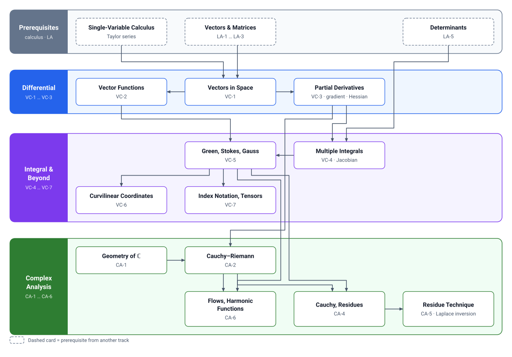

# 多元与向量微积分 + 复分析 Multivariable & Vector Calculus + Complex Analysis Essentials

> Vector calculus: **P-I (M2–M6)**. Complex analysis: **P-II (M8–M9)**. Budget **~160 h** (vector ~105 h, complex ~55 h).
> Chapter numbering: Stewart chapters refer to the **8e/9e *Early Transcendentals*** numbering (Ch. 12–16). Other editions and the non-ET version shift chapter numbers, so match by title against your local copy. Needham chapters refer to *Visual Complex Analysis* (1997 and 25th Anniversary Ed. share the chapter structure). RHB refers to the 3e (2006).

| 字段 | 内容 |
|---|---|
| Knowledge Graph Node ID | `MATH-VC-01`（梯度、散度、旋度）· `MATH-VC-02`（高斯、斯托克斯、格林定理） |
| Phase | Phase I（I.5–I.6，M2–M6 向量微积分）；复分析在 Phase II（M8–M9） |
| Prerequisites | [一元微积分](../single_variable_calculus/curriculum.md)；线性代数（向量、矩阵、行列式） |
| Primary References | Stewart, *Calculus* ET 8e/9e, Ch. 12–16；Needham, *Visual Complex Analysis*；Schey, *Div, Grad, Curl, and All That*；MIT 18.02 |

## 0. 必须掌握的知识点 Knowledge Checklist

学完本模块应能逐条勾选。每条对应的教材章节见 §4。

### 多元微分

- [ ] 空间向量、点积与叉积、直线与平面
- [ ] 向量值函数、弧长、曲率
- [ ] 偏导数、链式法则、梯度、方向导数
- [ ] 二阶多元泰勒展开与 Hessian，极值判别
- [ ] Lagrange 乘子法

### 重积分

- [ ] 二重、三重积分
- [ ] 极坐标、柱坐标、球坐标
- [ ] 一般换元公式与 Jacobian 行列式

### 向量微积分 `MATH-VC-01`、`MATH-VC-02`

- [ ] 线积分、保守场与势函数
- [ ] 格林定理
- [ ] 散度、旋度的定义与物理意义
- [ ] 曲面积分
- [ ] 斯托克斯定理与散度定理
- [ ] 曲线坐标中的 $\nabla$、$\nabla\cdot$、$\nabla\times$、$\nabla^2$
- [ ] 向量恒等式、Helmholtz 分解（陈述）
- [ ] 指标记号：爱因斯坦求和、$\delta_{ij}$、$\varepsilon_{ijk}$

### 复分析

- [ ] 欧拉公式、单位根、$e^z$、$\log z$ 与分支
- [ ] Cauchy–Riemann 方程、共形映射、调和函数
- [ ] Cauchy 定理与 Cauchy 积分公式
- [ ] Taylor 级数与 Laurent 级数
- [ ] 留数定理与实积分计算、Jordan 引理
- [ ] 用共形映射解二维静电与理想流问题

## 1. 主教材 Primary Textbook

| Part | Book |
|---|---|
| Multivariable/vector calculus | **James Stewart, *Calculus* (local copy), Ch. 12–16** for computational fluency |
| Complex analysis | **Tristan Needham, *Visual Complex Analysis*, OUP (local copy)** for geometric understanding |

## 2. 辅助教材 Supplementary Textbook

| Book | Role |
|---|---|
| Schey, *Div, Grad, Curl, and All That*, 4e, Norton 2005 | Physical meaning of div/curl through electrostatics. **Strongly recommended** before Griffiths EM. |
| Marsden & Tromba, *Vector Calculus*, 6e, Freeman 2012 | Rigorous statements of the integral theorems; a preview of differential forms. |
| Riley, Hobson & Bence, *Mathematical Methods for Physics and Engineering*, 3e: chapters *Vector calculus*, *Line, surface and volume integrals*, *Complex variables*, *Applications of complex variables* (Ch. 10, 11, 24, 25) | Physics-level technique: curvilinear coordinates, residue calculus, Laplace-transform inversion. |
| Rudin, *PMA* (local): Ch. 9 *Functions of Several Variables* | **Optional rigor**: inverse/implicit function theorems. |
| Brown & Churchill, *Complex Variables and Applications*, 9e, McGraw-Hill 2014 | Optional: a traditional problem source for residues and conformal mapping. |

## 3. 官方课程资源 Official Course Resources

- **MIT 18.02 Multivariable Calculus (Auroux, Fall 2007)** lectures + **18.02SC (Fall 2010)** problem sets.
- **MIT 18.04 Complex Variables with Applications (Orloff, Spring 2018)**.
- **David Tong, *Vector Calculus* lecture notes (Cambridge IA)**: a physicist's treatment including curvilinear coordinates and tensors.
- Cambridge IB *Complex Methods* / *Complex Analysis* (Dexter Chua notes) for residue-calculus drill.
- 3Blue1Brown *Essence of Calculus* (intuition only).

## 4. 必修章节 Must-Study Chapters / Topics

### Part A — Vector calculus (Stewart 8e/9e ET)

| Block | Source | Key outcomes |
|---|---|---|
| VC-1 Vectors & geometry of space | Stewart Ch. 12 | Dot/cross products, lines/planes, quadric surfaces |
| VC-2 Vector functions | Stewart Ch. 13 | Curves, arc length, curvature, Frenet frame, motion in space |
| VC-3 Partial derivatives | Stewart Ch. 14 | Chain rule, gradient, directional derivative, tangent planes, **Taylor expansion to 2nd order (Hessian)**, Lagrange multipliers |
| VC-4 Multiple integrals | Stewart Ch. 15 | Double/triple integrals; polar/cylindrical/spherical; **general change of variables with the Jacobian** |
| VC-5 Vector calculus | Stewart Ch. 16 | Line integrals, conservative fields, Green's theorem, curl/div, surface integrals, **Stokes and divergence theorems** |
| VC-6 Curvilinear coordinates & identities | RHB Ch. 10 (vector calculus); Schey Ch. IV `[NEEDS VERIFICATION: Schey chapter numbering]` | Scale factors; ∇, ∇·, ∇×, ∇² in cylindrical/spherical coords; product-rule identities; Helmholtz decomposition (statement) |
| VC-7 Index notation & tensors (light) | RHB Ch. 26 *Tensors* (Cartesian tensors sections) | Einstein summation, δ_ij, ε_ijk; prove identities; rank-2 tensors under rotation |

### Part B — Complex analysis essentials (Needham + RHB)

| Block | Source | Key outcomes |
|---|---|---|
| CA-1 Geometry of ℂ | Needham Ch. 1 *Geometry and Complex Arithmetic*; Ch. 2 *Complex Functions as Transformations* | Euler's formula, roots of unity, power series, e^z, log z, branches |
| CA-2 Differentiation | Needham Ch. 4 *Differentiation: The Amplitwist Concept*; Ch. 5 *Further Geometry of Differentiation* | Cauchy–Riemann equations, conformality, harmonic conjugates |
| CA-3 Möbius maps (selected) | Needham Ch. 3 *Möbius Transformations and Inversion*: first half | Möbius maps for conformal mapping problems |
| CA-4 Integration | Needham Ch. 7 *Winding Numbers and Topology* (winding-number sections); Ch. 8 *Complex Integration: Cauchy's Theorem*; Ch. 9 *Cauchy's Formula and Its Applications* | Cauchy's theorem and formula, Taylor/Laurent series, residue theorem |
| CA-5 Residue calculus technique | RHB Ch. 24 *Complex variables*; Ch. 25 *Applications of complex variables* | Real integrals via contours; Jordan's lemma; Bromwich inversion of Laplace transforms; branch cuts |
| CA-6 Flows & harmonic functions | Needham Ch. 10 *Vector Fields: Physics and Topology* (selected); Ch. 11 *Vector Fields and Complex Integration*; Ch. 12 *Flows and Harmonic Functions* | Complex potential, ideal flow around a cylinder, 2-D electrostatics by conformal mapping |

## 5. 可选/可跳过 Optional / Skippable

- Stewart Ch. 12 quadric-surfaces drill: skim if already fluent.
- Stewart Ch. 13 curvature/torsion: **skim**. Kinematics in Taylor covers what is needed.
- Needham Ch. 6 *Non-Euclidean Geometry*: **skip** (beautiful but off-path).
- Needham Ch. 3 second half (Möbius classification, Riemann sphere details): **optional**.
- Rudin Ch. 10 *Integration of Differential Forms*: **optional**, for the general Stokes theorem.
- Differential forms in Marsden–Tromba: optional preview for later geometric mechanics.

## 6. 先修关系 Prerequisites

**Entry:** single-variable calculus (Stewart Ch. 1–11 level, including Taylor series); linear algebra LA-1 to LA-3 (vectors, matrices).

**Cross-module:**
- VC-3 (Hessian, Lagrange multipliers) → optimization, numerical_analysis (Newton's method), probability (multivariate Gaussian MLE).
- VC-5/VC-6 → differential_equations (deriving heat/wave/Laplace from conservation laws; Laplacian in polar/spherical coordinates → Bessel/Legendre).
- CA-5 → differential_equations (Laplace and Fourier transform inversion).
- CA-6 → PDE (Laplace equation in 2-D), 02 physics (electrostatics, potential flow).

## 7. 学时 Estimated Study Hours

| Block | Hours |
|---|---|
| VC-1/2 | 14 |
| VC-3 | 20 |
| VC-4 | 18 |
| VC-5 | 28 |
| VC-6/7 | 25 |
| CA-1/2/3 | 18 |
| CA-4 | 15 |
| CA-5 | 12 |
| CA-6 | 10 |
| **Total** | **~160 h** |

## 8. 数学推导任务 Mathematical Derivation Tasks

1. Derive the second-order multivariable Taylor expansion f(x+h) ≈ f + ∇fᵀh + ½hᵀHh. Classify critical points via eigenvalues of H (LA-6 link).
2. Derive the Lagrange multiplier condition ∇f = λ∇g geometrically, and apply it to show the max of xᵀAx on the unit sphere is λ_max.
3. Derive the Jacobian of spherical coordinates; prove dV = r² sin θ dr dθ dφ.
4. Prove Green's theorem for a rectangle, then extend to a general region by additivity. Derive the divergence theorem for a cube from first principles (flux balance).
5. Derive ∇², ∇·, ∇× in cylindrical and spherical coordinates from scale factors.
6. Prove with index notation: ∇×(∇×F) = ∇(∇·F) − ∇²F; ∇·(fF) = f∇·F + F·∇f; ε_ijk ε_imn = δ_jm δ_kn − δ_jn δ_km.
7. Derive the Cauchy–Riemann equations from complex differentiability. Show u, v are harmonic.
8. Evaluate ∫_{−∞}^{∞} dx/(1+x²), ∫_0^{∞} sin x / x dx, and ∫_{−∞}^{∞} e^{ikx}/(x²+a²) dx by residues.
9. Derive the complex potential w = U(z + a²/z) for flow past a cylinder; verify no-penetration on |z| = a.
10. Derive the inverse Laplace transform (Bromwich integral) of 1/(s² + ω²) by residues.

## 9. 物理建模任务 Physical Modeling Tasks

1. **Conservation law → PDE 守恒律:** for a density ρ with flux J in an arbitrary volume V, use the divergence theorem to derive ∂ρ/∂t + ∇·J = 0. Add Fourier's law J = −k∇T to obtain the heat equation.
2. **Gauss's law 高斯定律:** derive ∇·E = ρ/ε₀ from the integral form. Compute E for a uniformly charged sphere both ways.
3. **Work and potential 功与势:** show a force field is conservative iff ∇×F = 0 on a simply connected domain. Compute gravitational potential energy.
4. **Circulation and vorticity 环量与涡量:** apply Stokes's theorem to relate circulation around a loop to the vorticity flux; analyze a vortex and solid-body rotation.
5. **2-D electrostatics by conformal map:** potential between two coaxial cylinders, and near a corner, via w = z^{π/α}.
6. **Moments of inertia / center of mass** by triple integrals in appropriate coordinates.

## 10. 编程实验 Programming / Computational Experiments

| # | Experiment | Tools | Deliverable |
|---|---|---|---|
| E1 | Plot gradient fields over level sets; show ∇f ⊥ level curves | NumPy, Matplotlib (`contour`, `quiver`) | Figure + short note |
| E2 | Symbolically verify vector identities and curvilinear Laplacians | SymPy (`sympy.vector`) | Notebook verifying Task 8.5/8.6 |
| E3 | Monte Carlo vs tensor-grid quadrature for a 3-D integral | NumPy | Error vs N: Monte Carlo ∝ N^{−1/2} vs grid ∝ h^p (link to probability/numerical) |
| E4 | Numerically verify the divergence theorem on a sphere for a given field | SciPy `integrate` | Surface flux vs volume integral to 1e-8 |
| E5 | Finite-difference gradient/divergence/curl on a grid | NumPy | Show O(h²) convergence for central differences |
| E6 | Domain coloring of complex functions; visualize zeros/poles and branch cuts | NumPy, Matplotlib | Plots for z², 1/z, e^z, log z, √z |
| E7 | Conformal mapping of a grid under Möbius and Joukowski maps; streamlines of flow past a cylinder and airfoil | NumPy, Matplotlib | Streamline plots; lift via Kutta condition (stretch goal) |
| E8 | Numerical contour integration (trapezoid on a circle) vs residue theorem | NumPy | Spectral (exponential) convergence of the periodic trapezoid rule |

## 11. 工程应用映射 Engineering Application Mapping

| Concept | Engineering application | Where it reappears |
|---|---|---|
| Divergence theorem | Every conservation law (mass, momentum, energy, charge) → **finite volume method** | 03 FVM, 04 CFD |
| Gradient / Hessian | Optimization, Newton solvers, sensitivity analysis | 03 optimization, nonlinear FEM |
| Jacobian & change of variables | **Isoparametric FEM mapping**, mesh quality | 03 FEM |
| Stokes' theorem / curl | Faraday/Ampère laws, vorticity, circulation (lift) | 02 EM, 04 aerodynamics |
| Curvilinear Laplacian | Heat conduction in pipes/spheres, waveguides, antennas | 02 EM, 04 heat transfer |
| Tensors / index notation | Stress, strain, conductivity, permittivity tensors | 04 continuum mechanics |
| Analytic functions / conformal maps | 2-D potential flow, electrostatic field design, airfoil theory (Joukowski) | 04 fluids, EM |
| Residue calculus | Inverse Laplace transforms in circuits/control; Kramers–Kronig relations | 04 control, signals |
