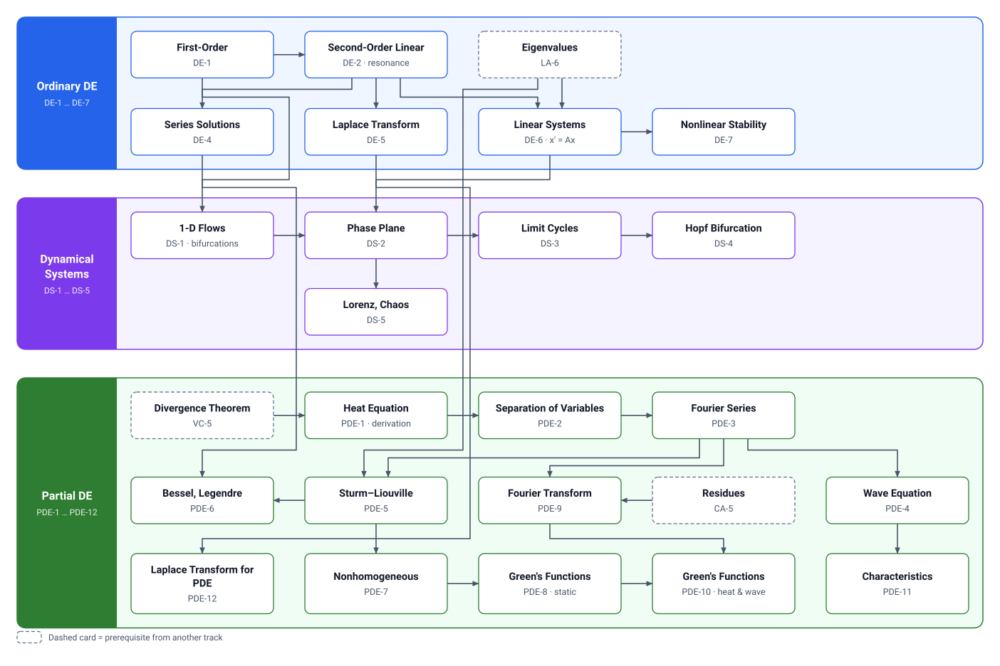

# 微分方程 Differential Equations
### ODE · Dynamical Systems · Fourier Analysis · Laplace Transform · PDE · BVP · Sturm–Liouville · Green's Functions

> ODE intro **P-I (M5–M6)**, main body **P-II (M7–M12)**. Budget **~230 h**.
> Chapter numbering: Boyce–DiPrima **11e (2017)**, Strogatz **2e (2015)**, Haberman **5e (2013)**, RHB **3e (2006)**. Adjacent editions keep the same chapter *titles*, but numbering can shift. Match by title.

| 字段 | 内容 |
|---|---|
| Knowledge Graph Node ID | `MATH-DE-01`（ODE 与线性系统）· `MATH-DE-02`（动力系统与稳定性）· `MATH-DE-03`（PDE）· `MATH-FA-01`（傅里叶分析）· `MATH-FA-02`（Green 函数）· `MATH-FA-03`（Sturm–Liouville） |
| Phase | Phase II（II.1–II.6，M7–M12）；ODE 入门在 Phase I 末（M5–M6） |
| Prerequisites | [一元微积分](../single_variable_calculus/curriculum.md)；[多元/向量微积分](../calculus/curriculum.md)；线性代数（特征值、矩阵指数） |
| Primary References | Boyce & DiPrima 11e；Strogatz, *Nonlinear Dynamics and Chaos* 2e；Haberman, *Applied PDE* 5e |

## 0. 必须掌握的知识点 Knowledge Checklist

学完本模块应能逐条勾选。每条对应的教材章节见 §4。

### 常微分方程 `MATH-DE-01`

- [ ] 一阶方程：线性、可分离、恰当方程；存在唯一性定理
- [ ] 二阶线性方程：特征方程、待定系数、常数变易
- [ ] 受迫与阻尼振动、共振
- [ ] 级数解法、Frobenius 方法，Bessel 与 Legendre 方程的来源
- [ ] Laplace 变换：阶跃与冲激、卷积、传递函数
- [ ] 线性方程组 $\mathbf x'=A\mathbf x$：特征值法、矩阵指数、相图

### 动力系统与稳定性 `MATH-DE-02`

- [ ] 平衡点线性化与 Lyapunov 第二方法
- [ ] 一维流与分岔（鞍结、跨临界、叉式）
- [ ] 相平面分类（迹–行列式图）、零倾线
- [ ] 极限环、Poincaré–Bendixson 定理、Hopf 分岔
- [ ] 混沌：Lorenz 方程、Lyapunov 指数、logistic 映射

### 傅里叶分析 `MATH-FA-01`

- [ ] 傅里叶级数：收敛性、Gibbs 现象、Parseval 等式
- [ ] 傅里叶变换与卷积定理

### 偏微分方程 `MATH-DE-03`

- [ ] 热方程与波动方程的推导、边界条件类型
- [ ] 分离变量法：杆、矩形、圆盘
- [ ] d'Alembert 解与特征线方法、Burgers 方程与激波
- [ ] 高维问题：Bessel 函数、Legendre 多项式
- [ ] 非齐次问题：本征函数展开、Duhamel 原理
- [ ] 无限区域：傅里叶变换解法、热核

### Sturm–Liouville 与 Green 函数 `MATH-FA-02`、`MATH-FA-03`

- [ ] Sturm–Liouville 问题：自伴性、实特征值、正交性、完备性、Rayleigh 商
- [ ] δ 函数、边值问题的 Green 函数、Fredholm 二择一
- [ ] 热方程与波动方程的 Green 函数、因果性

## 1. 主教材 Primary Textbook (three-book spine, one per sub-area)

| Sub-area | Book | Why |
|---|---|---|
| ODE + Laplace + BVP intro | **Boyce, DiPrima & Meade, *Elementary Differential Equations and Boundary Value Problems*, 11e, Wiley 2017** | Standard, complete, matched to MIT 18.03 |
| Nonlinear dynamics | **Strogatz, *Nonlinear Dynamics and Chaos*, 2e, Westview/CRC 2015** | Geometric, applied, physical |
| PDE + Fourier + Sturm–Liouville + Green | **Haberman, *Applied PDEs with Fourier Series and BVPs*, 5e, Pearson 2013** | Physically motivated PDE methods, including a chapter on finite differences |

## 2. 辅助教材 Supplementary Textbook

| Book | Role |
|---|---|
| Riley, Hobson & Bence, 3e: chapters *Fourier series*, *Integral transforms*, *Series solutions of ODEs*, *Eigenfunction methods for differential equations*, *Special functions*, *PDEs: general and particular solutions*, *PDEs: separation of variables and other methods* (Ch. 12, 13, 16–18, 20, 21) | Cross-cutting technique reference; Bessel/Legendre functions |
| Strang, *Computational Science and Engineering*, 2007 | Discrete ↔ continuous parallels (−u″ ↔ second-difference matrix K) |
| Oppenheim & Willsky, *Signals and Systems*, 2e | Engineering conventions for Fourier/Laplace transforms |
| Evans, *PDE*, 2e, AMS | **Optional**: weak solutions and energy methods for FEM theory |
| Rudin *PMA* (local), Ch. 7 *Sequences and Series of Functions* | **Optional**: uniform convergence, needed to make Fourier-series term-by-term operations rigorous |

## 3. 官方课程资源 Official Course Resources

- **MIT 18.03 / 18.03SC Differential Equations** (Mattuck lectures; 18.03SC Fall 2011 problem sets & mathlets).
- **MIT 18.085 Computational Science and Engineering I (Strang, Fall 2008)**: Fourier, BVPs, and their discrete versions.
- **MIT 18.303 Linear PDEs: Analysis and Numerics (S. G. Johnson)** `[NEEDS VERIFICATION: OCW term]`: the operator viewpoint.
- **Cambridge IB *Methods*** (Dexter Chua notes): Fourier, Sturm–Liouville, Green's functions, PDE.
- **David Tong**: relevant chapters of the *Vector Calculus* and *Classical Dynamics* notes for physical context.
- Strogatz's recorded *Nonlinear Dynamics and Chaos* lectures (Cornell, public video) for the dynamics block.

## 4. 必修章节 Must-Study Chapters / Topics

### Part A — ODE (Boyce–DiPrima 11e)

| Block | Chapter | Key outcomes |
|---|---|---|
| DE-1 First-order | Ch. 1 *Introduction*; Ch. 2 *First-Order Differential Equations* | Linear, separable, exact; existence–uniqueness (Picard); autonomous equations; modeling (mixing, cooling, population) |
| DE-2 Second-order linear | Ch. 3 *Second-Order Linear Differential Equations* | Wronskian, characteristic equation, undetermined coefficients, variation of parameters, **forced/damped oscillations and resonance** |
| DE-3 Higher-order (skim) | Ch. 4 *Higher-Order Linear Differential Equations* | Generalization; skim |
| DE-4 Series solutions | Ch. 5 *Series Solutions of Second-Order Linear Equations* | Ordinary/regular singular points, Frobenius; **Bessel and Legendre** origin |
| DE-5 Laplace transform | Ch. 6 *The Laplace Transform* | Transform of derivatives, step/impulse functions, **convolution and transfer functions** |
| DE-6 Linear systems | Ch. 7 *Systems of First-Order Linear Equations* | x′ = Ax, eigenvalue method, phase portraits, repeated eigenvalues, **matrix exponential**, nonhomogeneous systems |
| DE-7 Nonlinear stability | Ch. 9 *Nonlinear Differential Equations and Stability* | Linearization, Lyapunov's second method, competing species, predator–prey |

### Part B — Dynamical systems (Strogatz 2e)

| Block | Chapter | Key outcomes |
|---|---|---|
| DS-1 1-D flows & bifurcations | Ch. 2 *Flows on the Line*; Ch. 3 *Bifurcations* | Fixed points, saddle-node/transcritical/pitchfork, imperfect bifurcation |
| DS-2 Phase plane | Ch. 5 *Linear Systems*; Ch. 6 *Phase Plane* | Classification (trace–determinant), nullclines, conservative/reversible systems, index theory (light) |
| DS-3 Limit cycles | Ch. 7 *Limit Cycles* | Poincaré–Bendixson, Liénard/van der Pol, relaxation oscillations |
| DS-4 2-D bifurcations | Ch. 8 *Bifurcations Revisited* | Hopf bifurcation; oscillator coupling |
| DS-5 Chaos | Ch. 9 *Lorenz Equations*; Ch. 10 *One-Dimensional Maps* | Strange attractor, Lyapunov exponent, logistic map, period doubling |

### Part C — Fourier analysis, PDE, BVP (Haberman 5e)

| Block | Chapter | Key outcomes |
|---|---|---|
| PDE-1 Heat equation derivation | Ch. 1 *Heat Equation* | Conservation + Fourier's law; BCs (Dirichlet/Neumann/Robin); equilibrium |
| PDE-2 Separation of variables | Ch. 2 *Method of Separation of Variables* | Heat on a rod; Laplace on rectangle/disk |
| PDE-3 Fourier series | Ch. 3 *Fourier Series* | Convergence (Gibbs), sine/cosine series, term-by-term differentiation, complex form, Parseval |
| PDE-4 Wave equation | Ch. 4 *Wave Equation: Vibrating Strings and Membranes* | Derivation, normal modes, d'Alembert solution |
| PDE-5 Sturm–Liouville | Ch. 5 *Sturm–Liouville Eigenvalue Problems* | Self-adjointness, real eigenvalues, orthogonality, completeness, **Rayleigh quotient** |
| PDE-6 Higher dimensions | Ch. 7 *Higher-Dimensional Partial Differential Equations* | Vibrating membrane, **Bessel functions** (circular drum), **Legendre polynomials** (sphere) |
| PDE-7 Nonhomogeneous problems | Ch. 8 *Nonhomogeneous Problems* | Eigenfunction expansion, Duhamel's principle |
| PDE-8 Green's functions (static) | Ch. 9 *Green's Functions for Time-Independent Problems* | Delta function, Green's function for BVPs, Fredholm alternative, Poisson's equation |
| PDE-9 Fourier transform | Ch. 10 *Infinite Domain Problems: Fourier Transform Solutions of PDEs* | FT, convolution theorem, heat kernel, Laplace on half-plane |
| PDE-10 Green's functions (dynamic) | Ch. 11 *Green's Functions for Wave and Heat Equations* | Causality, retarded Green's function |
| PDE-11 Characteristics | Ch. 12 *Method of Characteristics for Linear and Quasilinear Wave Equations* `[NEEDS VERIFICATION: 5e chapter number]` | Advection, Burgers, shock formation (preview of FVM) |
| PDE-12 Laplace transform for PDEs | Ch. 13 *Laplace Transform Solution of PDEs* `[NEEDS VERIFICATION: 5e chapter number]` | Transient problems on semi-infinite domains |

## 5. 可选/可跳过 Optional / Skippable

- Boyce–DiPrima Ch. 4 (higher-order): **skim**. Ch. 8 *Numerical Methods*: **skip** (covered in numerical_analysis with more rigor). Ch. 10 *PDEs and Fourier Series* and Ch. 11 *BVPs and Sturm–Liouville*: **skip** (Haberman covers them in more depth).
- Strogatz Ch. 4 *Flows on the Circle*: optional (do the nonuniform oscillator only). Ch. 11 *Fractals*, Ch. 12 *Strange Attractors*: optional.
- Haberman Ch. 6 *Finite Difference Numerical Methods for PDEs*: **read**, but the numerics are taught in numerical_analysis. Use it as a bridge.
- Haberman chapters after the Laplace-transform chapter (dispersive waves, perturbation methods): **optional** for P-II; revisit in P-III for waves/QM.
- Evans Part II (nonlinear PDE): **skip** for this track.

## 6. 先修关系 Prerequisites

**Entry:** LA-1 to LA-7 (eigen-decomposition essential before DE-6), VC-3 to VC-5 (for PDE derivation), CA-5 (for transform inversion; can run concurrently).

**Cross-module:**
- DE-6 ↔ linear_algebra (e^{At}); DE-5 ↔ calculus CA-5 (Bromwich inversion).
- PDE-5 (Sturm–Liouville) ↔ LA-6 (symmetric eigenproblem) ↔ 02 QM (Hermitian operators).
- PDE-* → numerical_analysis (FDM for the same equations; compare with analytic solutions).
- PDE-9 heat kernel ↔ probability_statistics (Gaussian density, random walk → diffusion).

## 7. 学时 Estimated Study Hours

| Part | Blocks | Hours |
|---|---|---|
| A — ODE | DE-1…DE-7 | 80 |
| B — Dynamical systems | DS-1…DS-5 | 50 |
| C — Fourier/PDE/BVP | PDE-1…PDE-12 | 100 |
| **Total** | | **~230 h** |

## 8. 数学推导任务 Mathematical Derivation Tasks

1. Prove existence–uniqueness for y′ = f(t, y) with Lipschitz f via Picard iteration (contraction).
2. Derive the amplitude/phase response of the forced damped oscillator. Find resonance frequency and quality factor Q.
3. Derive variation of parameters, and show it equals convolution with the impulse response (the Green's function of the IVP).
4. Derive L{f′} = sF(s) − f(0), and the convolution theorem. Solve an RLC circuit with a step input via partial fractions.
5. Derive the matrix-exponential solution of x′ = Ax + g(t). Classify all 2×2 phase portraits via (tr A, det A).
6. Find the normal form of the Hopf bifurcation (supercritical), and verify the amplitude ∝ √μ.
7. Derive the heat equation from energy conservation + Fourier's law, and the wave equation from Newton's 2nd law on a string element.
8. Prove orthogonality and real eigenvalues for regular Sturm–Liouville problems; derive the Rayleigh quotient.
9. Derive the Green's function for −u″ = f on [0, 1] with Dirichlet BCs; verify symmetry G(x, ξ) = G(ξ, x) and relate it to (K_h)⁻¹, the inverse second-difference matrix.
10. Derive the heat kernel (4πκt)^{−1/2} e^{−x²/(4κt)} via the Fourier transform; show it is a Gaussian with variance 2κt.
11. Derive d'Alembert's solution and verify it with characteristics. Find the breaking time for inviscid Burgers with smooth data.
12. Derive the Bessel equation from separation of the Laplacian in polar coordinates; obtain drum-mode frequencies from zeros of J₀.

## 9. 物理建模任务 Physical Modeling Tasks

1. **RLC circuit ↔ mass–spring–damper 机电类比:** derive both ODEs, map parameters, analyze resonance and transient response with Laplace transforms.
2. **Pendulum 单摆:** full nonlinear phase portrait (libration vs rotation, separatrix); damped/driven pendulum → chaos.
3. **Population & epidemics:** logistic growth; SIR model (threshold R₀ via linearization).
4. **Van der Pol oscillator 张弛振荡:** limit cycle; relaxation regime; link to electronic oscillators.
5. **Heat conduction in a rod 杆的热传导:** fixed temperature ends, insulated ends, and convective (Robin) ends; time constants from the first eigenvalue.
6. **Vibrating string and circular drum 弦与鼓:** mode shapes and frequencies; why drums are not harmonic (Bessel zeros).
7. **Electrostatic potential:** Laplace equation in a rectangle (box with one charged side) and in a sphere (Legendre expansion).
8. **Point source and Green's function 点源:** temperature from an instantaneous point heat source; field of a point charge as the Green's function of the Laplacian.
9. **Traffic flow 交通流:** LWR model → Burgers-type equation → shock (traffic jam) formation.

## 10. 编程实验 Programming / Computational Experiments

| # | Experiment | Tools | Deliverable |
|---|---|---|---|
| E1 | Direction fields and solution curves for 1st-order ODEs | NumPy, Matplotlib | Slope-field plots with `solve_ivp` trajectories |
| E2 | Frequency response (Bode plot) of a damped oscillator: analytic vs simulated | SciPy `signal`, `solve_ivp` | Bode magnitude/phase; resonance peak vs Q |
| E3 | Phase portraits for linear and nonlinear 2-D systems; automatic fixed-point classification | NumPy, SciPy `optimize.fsolve` | Phase-portrait gallery (node/saddle/spiral/center) |
| E4 | Bifurcation diagram of the logistic map; Feigenbaum ratio estimate | NumPy | Diagram + δ ≈ 4.669 estimate |
| E5 | Lorenz system: attractor, sensitive dependence, largest Lyapunov exponent | `solve_ivp` (tight tolerances) | λ₁ ≈ 0.9 for the classic parameters |
| E6 | Fourier series partial sums of a square wave; Gibbs overshoot ≈ 9% of the jump | NumPy | Plot vs N; Parseval check |
| E7 | Heat equation on a rod: eigenfunction series vs a numerical solution (method of lines + `solve_ivp`) | NumPy, SciPy | Error vs number of modes and vs grid size |
| E8 | Vibrating membrane modes on a disk using `scipy.special.jn_zeros` | SciPy `special` | 3-D/colormap mode shapes |
| E9 | Green's function as matrix inverse: compare G(x, ξ) with columns of K_h⁻¹ | NumPy | Overlay plots (preview of FEM/FDM) |
| E10 | Inviscid Burgers: characteristics crossing → shock time | NumPy | Characteristic diagram + breaking time vs theory |

## 11. 工程应用映射 Engineering Application Mapping

| Concept | Engineering application | Where it reappears |
|---|---|---|
| Laplace transform, transfer function | Circuit analysis, **control system design**, filter design | 04 control |
| Resonance, damping, Q factor | Vibration isolation, MEMS resonators, RF circuits | 04 structures, devices |
| Linear systems e^{At}, stability | State-space control, Kalman filtering (D3 in research_papers.md) | 04 estimation/control |
| Bifurcation, limit cycles | Oscillator design, flutter, power-grid stability, combustion instability | 04 dynamics |
| Chaos, Lyapunov exponents | Predictability limits (weather), mixing | 03 simulation |
| Heat/diffusion equation | Thermal management, **dopant diffusion in semiconductors**, mass transfer | 04 heat transfer, devices |
| Wave equation, normal modes | Acoustics, structural vibration, transmission lines, seismic | 02 waves, 04 |
| Sturm–Liouville / eigenfunctions | Waveguide modes, buckling loads, **quantum wells** | 02 QM, 04 devices |
| Green's functions | Influence lines in structures, boundary element method, point sources | 03 BEM/FEM |
| Characteristics, shocks | Gas dynamics, traffic, open-channel flow → **FVM/Godunov** | 03 FVM, 04 CFD |
