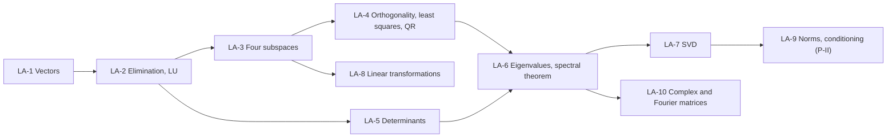

# 线性代数与矩阵分析 Linear Algebra & Matrix Analysis

> Phase **P-I (M1–M4)**, revisited in **P-II (M8–M10)** alongside numerical linear algebra. Budget **~180 h**.
> Chapter numbering: Strang chapter numbers refer to the **6th edition (2023)**. If your copy is the 5th edition, match chapters by title; Ch. 1–8 titles are close but not identical. Axler numbering refers to the **4th edition (2024)**.

## 1. 主教材 Primary Textbook

**Gilbert Strang, *Introduction to Linear Algebra*, 6th ed., Wellesley-Cambridge Press, 2023.**
Matrix-factorization viewpoint, A = LU, QR, SΛS⁻¹, QΛQᵀ, UΣVᵀ, which is exactly the toolkit computation needs. Lecture-matched to MIT 18.06.

## 2. 辅助教材 Supplementary Textbook

| Book | Role |
|---|---|
| Axler, *Linear Algebra Done Right*, 4e (local copy) | Proof-based operator view. Read the matching Axler chapter after each Strang block. |
| Boyd & Vandenberghe, *Introduction to Applied Linear Algebra (VMLS)*, CUP 2018 | Least squares, data fitting, control: applied exercises. |
| Trefethen & Bau, *Numerical Linear Algebra*, SIAM, Lectures 1–5 | Norms and SVD from the computational side (bridge to the numerical_analysis module). |
| Horn & Johnson, *Matrix Analysis*, 2e, CUP 2012 | Reference only: norms, Gershgorin, PD matrices, perturbation. |
| Rudin, *PMA* (local) | Not needed here. |

## 3. 官方课程资源 Official Course Resources

- **MIT 18.06 Linear Algebra (Strang), OCW Spring 2010** video lectures + **18.06SC (Fall 2011)** problem sets/recitations. Primary lecture spine.
- **MIT 18.065 (Strang, Spring 2018)**: SVD, low-rank and least-squares lectures during the P-II revisit.
- **Stanford EE263 (Boyd)**: least squares, SVD, linear dynamical systems (optional, P-II).
- Cambridge IB *Linear Algebra* (Dexter Chua's notes) for a proof-level cross-check.

## 4. 必修章节 Must-Study Chapters / Topics

| Block | Strang 6e | Axler 4e (parallel) | Key outcomes 掌握目标 |
|---|---|---|---|
| LA-1 Vectors & matrices | Ch. 1 *Vectors and Matrices* | Ch. 1 *Vector Spaces* | Linear combinations, dot product, column/row picture |
| LA-2 Elimination | Ch. 2 *Solving Linear Equations Ax = b* | — | Elimination = LU, PA = LU, inverses, cost O(n³) |
| LA-3 Four subspaces | Ch. 3 *The Four Fundamental Subspaces* | Ch. 2 *Finite-Dimensional Vector Spaces*; Ch. 3 *Linear Maps* (3A–3D, 3F duality optional) | Rank–nullity, C(A), N(A), C(Aᵀ), N(Aᵀ), complete solution of Ax = b |
| LA-4 Orthogonality | Ch. 4 *Orthogonality* | Ch. 6 *Inner Product Spaces* | Projections, least squares AᵀAx̂ = Aᵀb, Gram–Schmidt, A = QR |
| LA-5 Determinants | Ch. 5 *Determinants* | Ch. 9 *Multilinear Algebra and Determinants* (determinant sections only) | Properties, cofactors, volume, Jacobian determinant link |
| LA-6 Eigenvalues | Ch. 6 *Eigenvalues and Eigenvectors* | Ch. 5 *Eigenvalues and Eigenvectors*; Ch. 7 *Operators on Inner Product Spaces* (spectral theorem, positive operators) | Diagonalization, Aᵏ, e^{At}, symmetric ⇒ real λ, orthogonal Q; positive definiteness tests |
| LA-7 SVD | Ch. 7 *The Singular Value Decomposition* | Ch. 7 (sections on SVD and consequences of SVD) | A = UΣVᵀ, low-rank approximation (Eckart–Young), pseudoinverse, PCA |
| LA-8 Linear transformations | Ch. 8 *Linear Transformations* | Ch. 3 (matrix of a linear map) | Change of basis, similarity, matrix of an operator |
| LA-9 Matrix analysis (P-II) | Strang chapters on optimization and data `[NEEDS VERIFICATION: 6e chapter numbers]`; Trefethen–Bau Lec. 3–5 | — | Vector/matrix norms, condition number κ(A), Rayleigh quotient, min-max (Courant–Fischer), Gershgorin |
| LA-10 Complex & Fourier matrices | Strang section on complex vectors and the Fourier matrix `[NEEDS VERIFICATION: 6e location]` | Ch. 7 (self-adjoint/normal operators over ℂ) | Hermitian/unitary matrices, DFT matrix F, F⁻¹ = F̄/n |

## 5. 可选/可跳过 Optional / Skippable

- Axler Ch. 8 *Operators on Complex Vector Spaces* (generalized eigenvectors, Jordan form). **Optional**: needed only for defective-matrix theory. Know that Jordan form is numerically unstable and why the Schur decomposition is used instead.
- Axler Ch. 4 *Polynomials*: skim.
- Axler Ch. 9 tensor-product/multilinear parts: **defer** to the continuum-mechanics tensor review (P-III).
- Strang's statistics/probability chapter: skip here; covered in probability_statistics.
- Strang's applications chapter(s) (graphs, Markov matrices, economics): read **only** Markov matrices and graph incidence matrices (needed for circuits/FEM assembly).

## 6. 先修关系 Prerequisites

**Entry:** high-school algebra; complex numbers (Needham Ch. 1 is an ideal refresher).

**Intra-module order 章内顺序:**

**Cross-module 跨模块:**
- LA-5 → calculus (Jacobian determinant in change of variables).
- LA-6 → differential_equations (x′ = Ax, normal modes, Sturm–Liouville as an infinite-dimensional symmetric eigenproblem).
- LA-7, LA-9 → numerical_analysis (stability, least squares, Krylov).
- LA-4, LA-6 → probability_statistics (covariance matrices, multivariate Gaussian, linear regression).
- LA-10 → Fourier analysis / FFT.

## 7. 学时 Estimated Study Hours

| Block | Reading + lectures | Problems | Derivations + code | Total |
|---|---|---|---|---|
| LA-1/2 | 12 | 10 | 6 | 28 |
| LA-3 | 10 | 10 | 4 | 24 |
| LA-4 | 10 | 10 | 8 | 28 |
| LA-5 | 5 | 5 | 2 | 12 |
| LA-6 | 12 | 12 | 8 | 32 |
| LA-7 | 8 | 6 | 10 | 24 |
| LA-8 | 4 | 4 | 2 | 10 |
| LA-9/10 (P-II) | 8 | 6 | 8 | 22 |
| **Total** | | | | **~180 h** |

## 8. 数学推导任务 Mathematical Derivation Tasks

1. Prove that elimination without row exchanges produces A = LU, with L holding the multipliers. Count flops (~2n³/3).
2. Prove rank–nullity and the orthogonality N(A) ⊥ C(Aᵀ). Derive the complete solution x = x_p + x_n.
3. Derive the normal equations from min‖Ax − b‖² two ways: (a) geometric projection; (b) setting the gradient to zero (needs calculus LA→VC link). Show P = A(AᵀA)⁻¹Aᵀ is idempotent and symmetric.
4. Prove the spectral theorem for real symmetric matrices (Axler-style via the inner product or Strang-style via Schur).
5. Derive the SVD from the eigen-decomposition of AᵀA. Prove the Eckart–Young theorem in the 2-norm.
6. Show that e^{At} = S e^{Λt} S⁻¹ solves x′ = Ax and that the solution is stable iff Re λ < 0.
7. Prove the Rayleigh-quotient bounds λ_min ≤ xᵀAx/xᵀx ≤ λ_max, and the Courant–Fischer min–max characterization.
8. Prove the Fourier matrix F satisfies F̄F = nI. Show circulant matrices are diagonalized by F (preview of FFT and spectral methods).
9. Derive the perturbation bound ‖δx‖/‖x‖ ≤ κ(A)‖δb‖/‖b‖.

## 9. 物理建模任务 Physical Modeling Tasks

1. **Spring–mass chain 弹簧-质量链:** derive the stiffness matrix K = AᵀCA (Strang's framework). Show K is symmetric positive (semi)definite, and interpret the null space as rigid-body motion.
2. **Normal modes 简正模:** for M ẍ + Kx = 0, reduce to the generalized eigenproblem Kv = ω²Mv. Compute modes of a 3-mass chain by hand.
3. **Resistor network / Kirchhoff 电路网络:** build the incidence matrix A of a graph. Derive the weighted Laplacian AᵀCA and solve for node potentials (the discrete Poisson equation).
4. **Principal axes 主轴:** diagonalize the inertia tensor of a rigid body and the stress tensor (preview of continuum mechanics).
5. **Markov matrix 马尔可夫矩阵:** steady state as the eigenvector for λ = 1 (population or random-walk model).

## 10. 编程实验 Programming / Computational Experiments (NumPy, SciPy, Matplotlib)

| # | Experiment | Deliverable |
|---|---|---|
| E1 | Implement Gaussian elimination with partial pivoting and forward/back substitution | Compare with `scipy.linalg.lu`; plot time vs n on log-log axes, slope ≈ 3 |
| E2 | Classical vs modified Gram–Schmidt vs `np.linalg.qr` on an ill-conditioned (e.g., Vandermonde) matrix | Plot ‖QᵀQ − I‖ vs κ(A) |
| E3 | Least-squares polynomial fit via normal equations vs QR vs `lstsq` | Show the loss of accuracy with the normal equations as κ grows |
| E4 | Power iteration and inverse iteration | Convergence rate ∝ \|λ₂/λ₁\| verified numerically |
| E5 | SVD image compression + PCA on a 2-D Gaussian cloud | Error vs rank vs σ_{k+1}; principal axes overlay |
| E6 | Normal modes of an N-mass chain | Animate modes; compare ω_k with the analytic 2√(k/m) sin(kπ/(2(N+1))) |
| E7 | Graph Laplacian of a resistor grid | Solve with `scipy.sparse`; visualize potential (discrete Laplace equation) |
| E8 | Condition-number experiment | Hilbert matrix: digits lost ≈ log₁₀ κ |

## 11. 工程应用映射 Engineering Application Mapping

| Concept | Engineering application 工程应用 | Where it reappears |
|---|---|---|
| K = AᵀCA, SPD systems | Structural stiffness matrices; FEM assembly; circuit nodal analysis | 03 FEM, 04 structures |
| Generalized eigenproblem Kv = ω²Mv | Modal analysis, vibration, resonance avoidance | 02 waves, 04 structural dynamics |
| Least squares / QR | Calibration, curve fitting, system identification, GPS | 04 estimation |
| SVD / low-rank | POD reduced-order models, PCA, DMD, image compression | 03 SciML (DMD, POD) |
| Condition number | Sensor placement, stability of solvers, mesh quality | 03 numerical solvers |
| Spectral theorem | Principal stresses/strains, inertia tensor, Hermitian Hamiltonians | 02 QM, 04 continuum mechanics |
| Fourier matrix / circulants | Signal processing, periodic BCs, spectral solvers | 03 spectral methods |
| Markov matrices | Reliability, queueing, PageRank, MCMC | probability_statistics |
