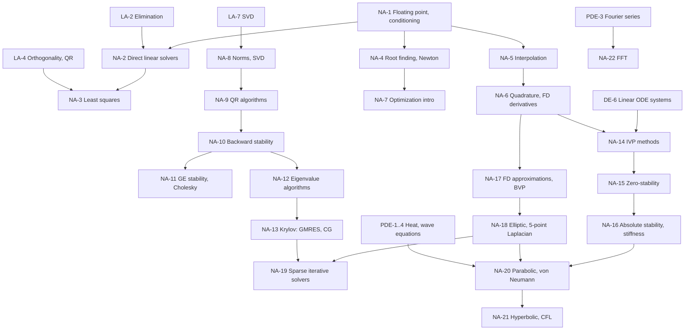

# 数值分析 Numerical Analysis
### Numerical Computing Foundations · Floating Point · Numerical Linear Algebra · ODE/PDE Discretization (intro)

> Interleaved: **foundations M1–M6 (P-I)**, **NLA + discretization M7–M12 (P-II)**. Budget **~170 h**.
> Chapter numbering: Heath **2e (2002 / SIAM Classics 2018 reprint; same content)**; Trefethen & Bau cited by **Lecture** number (stable across the 1997 and 2022 editions); LeVeque *FDM* (SIAM 2007).

## 1. 主教材 Primary Textbook

| Part | Book |
|---|---|
| Survey & foundations | **Michael T. Heath, *Scientific Computing: An Introductory Survey*, 2e (SIAM Classics reprint 2018)** |
| Numerical linear algebra | **Lloyd N. Trefethen & David Bau III, *Numerical Linear Algebra*, SIAM (1997; 25th Anniversary Ed. 2022)** |
| Discretization (ODE/PDE) | **Randall J. LeVeque, *Finite Difference Methods for Ordinary and Partial Differential Equations*, SIAM 2007** |

## 2. 辅助教材 Supplementary Textbook

| Book | Role |
|---|---|
| Süli & Mayers, *An Introduction to Numerical Analysis*, CUP 2003 | Rigorous proofs: interpolation error, Gauss quadrature, ODE convergence |
| Higham, *Accuracy and Stability of Numerical Algorithms*, 2e, SIAM 2002 | Reference: backward error analysis |
| Overton, *Numerical Computing with IEEE Floating Point Arithmetic*, SIAM 2001 | Short and precise on IEEE 754 |
| Hairer, Nørsett & Wanner, *Solving ODEs I/II*, Springer | Reference for RK theory and stiffness |
| Strang, *Computational Science and Engineering*, 2007 | Bridges the second-difference matrix, Fourier analysis and FEM |
| Goldberg (1991), "What every computer scientist should know about floating-point arithmetic" | **Required paper** (A7 in research_papers.md) |

## 3. 官方课程资源 Official Course Resources

- **MIT 18.335J Introduction to Numerical Methods** (Persson, Fall 2010; later Johnson offering `[NEEDS VERIFICATION: term]`). Follows Trefethen–Bau.
- **MIT 18.085 / 18.086 (Strang)**: computational science and time-stepping lectures.
- **Cambridge IB/II *Numerical Analysis*** (Dexter Chua notes): rigorous, Süli–Mayers tradition.
- **Barba, *Practical Numerical Methods with Python* ("numerical-mooc")**: notebook practice for ODE/PDE.
- NumPy/SciPy official documentation (see software_documentation.md).

## 4. 必修章节 Must-Study Chapters / Topics

### Part A — Foundations (P-I)

| Block | Source | Key outcomes |
|---|---|---|
| NA-1 Error, conditioning, floating point | Heath Ch. 1 *Scientific Computing*; Trefethen–Bau Lec. 12 *Conditioning and Condition Numbers*, Lec. 13 *Floating Point Arithmetic*; Goldberg (1991) | Absolute/relative error, truncation vs rounding, IEEE 754 (ε_mach ≈ 1.1e-16 for double), cancellation, condition number of a problem vs stability of an algorithm |
| NA-2 Linear systems (direct) | Heath Ch. 2 *Systems of Linear Equations* | LU with partial pivoting, Cholesky, cost, banded systems, residual vs error |
| NA-3 Linear least squares | Heath Ch. 3 *Linear Least Squares* | Normal equations vs QR vs SVD; sensitivity |
| NA-4 Nonlinear equations | Heath Ch. 5 *Nonlinear Equations* | Bisection, fixed-point, Newton (quadratic convergence), secant; Newton for systems |
| NA-5 Interpolation | Heath Ch. 7 *Interpolation* | Polynomial interpolation, Runge phenomenon, **Chebyshev points**, piecewise/splines |
| NA-6 Quadrature & differentiation | Heath Ch. 8 *Numerical Integration and Differentiation* | Newton–Cotes, composite rules, Gaussian quadrature, Richardson extrapolation, finite-difference derivative error (truncation vs rounding optimum h) |
| NA-7 Optimization (intro) | Heath Ch. 6 *Optimization* | Golden section, Newton, gradient descent, BFGS concept; link to Boyd & Vandenberghe |

### Part B — Numerical linear algebra (P-II, Trefethen–Bau)

| Block | Lectures | Key outcomes |
|---|---|---|
| NA-8 Fundamentals | Lec. 1–5 (matrix–vector products, orthogonality, norms, SVD) | Norms, SVD as the computational core |
| NA-9 QR & least squares | Lec. 6–11 (projectors, QR, Gram–Schmidt, Householder, least squares) | Householder QR is backward stable; MGS vs CGS |
| NA-10 Conditioning & stability | Lec. 12–19 | **Backward stability**: accuracy ≲ κ · ε_mach; stability of back substitution, Householder, least-squares algorithms |
| NA-11 Systems of equations | Lec. 20–23 (Gaussian elimination, pivoting, stability of GE, Cholesky) | Growth factor; why partial pivoting works in practice |
| NA-12 Eigenvalues | Lec. 24–31 (Hessenberg reduction, Rayleigh quotient iteration, QR algorithm with shifts, computing the SVD) | Two-phase eigen-algorithms; cost; what `numpy.linalg.eig` actually does |
| NA-13 Iterative methods | Lec. 32–40 (Arnoldi, GMRES, Lanczos, CG, preconditioning) | Krylov subspaces; CG convergence ∝ (√κ−1)/(√κ+1); preconditioning |

### Part C — Discretization of ODE/PDE (P-II)

| Block | Source | Key outcomes |
|---|---|---|
| NA-14 IVP methods | LeVeque Ch. 5 *The Initial Value Problem for ODEs*; Heath Ch. 9 *Initial Value Problems for ODEs* | Euler, RK2/RK4, linear multistep methods; local vs global error |
| NA-15 Zero-stability & convergence | LeVeque Ch. 6 *Zero-Stability and Convergence for IVPs* | Dahlquist equivalence (consistency + zero-stability ⇔ convergence) |
| NA-16 Absolute stability & stiffness | LeVeque Ch. 7 *Absolute Stability for ODEs*; Ch. 8 *Stiff ODEs* | Stability regions, A-stability, L-stability, BDF, stiff problems |
| NA-17 FD approximations & BVPs | LeVeque Ch. 1 *Finite Difference Approximations*; Ch. 2 *Steady States and Boundary Value Problems* | Truncation error, the second-difference matrix, convergence proof for −u″ = f |
| NA-18 Elliptic equations | LeVeque Ch. 3 *Elliptic Equations* | 5-point Laplacian, sparse structure, eigenvalues of the discrete Laplacian |
| NA-19 Sparse iterative solvers | LeVeque Ch. 4 *Iterative Methods for Sparse Linear Systems* | Jacobi, Gauss–Seidel, SOR, CG, multigrid idea |
| NA-20 Parabolic problems | LeVeque Ch. 9 *Diffusion Equations and Parabolic Problems* | Method of lines, FTCS/BTCS/Crank–Nicolson, **von Neumann stability**, Lax equivalence theorem |
| NA-21 Hyperbolic problems | LeVeque Ch. 10 *Advection Equations and Hyperbolic Systems* | Upwind, Lax–Friedrichs, Lax–Wendroff, CFL condition, numerical diffusion/dispersion (modified equations) |
| NA-22 FFT | Heath Ch. 12 *Fast Fourier Transform* | DFT, FFT, spectral differentiation (preview of spectral methods) |

## 5. 可选/可跳过 Optional / Skippable

- Heath Ch. 4 *Eigenvalue Problems*: **skip**; Trefethen–Bau NA-12 replaces it.
- Heath Ch. 10 *Boundary Value Problems for ODEs* (shooting, collocation): **optional**. LeVeque Ch. 2 is the required path.
- Heath Ch. 11 *Partial Differential Equations*: **skim** as overview only.
- Heath Ch. 13 *Random Numbers and Stochastic Simulation*: **optional** (probability module covers Monte Carlo).
- Trefethen–Bau Lec. 9 (MATLAB-specific) and Lec. 39 (biorthogonalization methods): optional.
- LeVeque Ch. 11 *Mixed Equations* and the appendices: optional; read the appendices on matrix norms/eigen-analysis if gaps appear.
- Higham in full: reference only.

## 6. 先修关系 Prerequisites

**Entry:** Python basics; LA-1/LA-2 for NA-2; calculus (Taylor's theorem) for NA-1/NA-6.

**Cross-module:**
- Every NA-17…NA-21 experiment must be validated against an analytic solution from differential_equations.
- NA-13 (CG) ↔ LA-6/LA-9 (SPD, condition number); NA-20 von Neumann analysis ↔ Fourier modes (PDE-3).
- NA-6 Gaussian quadrature ↔ orthogonal polynomials (Sturm–Liouville, PDE-5).
- Part C is the direct gateway into **03_computational_methods** (FVM, FEM, spectral).

## 7. 学时 Estimated Study Hours

| Part | Blocks | Hours |
|---|---|---|
| A — Foundations (incl. Python/NumPy ramp-up ~15 h) | NA-1…NA-7 | 65 |
| B — Numerical linear algebra | NA-8…NA-13 | 50 |
| C — Discretization | NA-14…NA-22 | 55 |
| **Total** | | **~170 h** |

## 8. 数学推导任务 Mathematical Derivation Tasks

1. Derive the relative condition number of f(x) at x: κ = \|x f′(x)/f(x)\|. Show subtraction of nearly equal numbers is ill-conditioned.
2. Prove fl(x ∘ y) = (x ∘ y)(1 + δ), \|δ\| ≤ ε_mach; derive the rounding-error bound for summation (recursive vs pairwise).
3. Derive the optimal step h* ≈ √ε_mach for the forward difference, and h* ≈ ε_mach^{1/3} for the central difference.
4. Prove quadratic convergence of Newton's method near a simple root.
5. Derive the polynomial interpolation error formula; explain the Runge phenomenon and why Chebyshev nodes fix it.
6. Derive the 2-point Gauss–Legendre rule and show it is exact for cubics.
7. Show Householder reflectors are orthogonal and symmetric; derive the QR algorithm's link to simultaneous iteration.
8. Derive CG from minimizing the A-norm of the error over Krylov subspaces. State and interpret the √κ convergence bound.
9. Derive the local truncation error of RK2 and of the 3-point central difference for u″.
10. Derive the absolute-stability regions of forward Euler, backward Euler and trapezoid; show backward Euler is L-stable.
11. Von Neumann analysis of FTCS for u_t = κu_xx: prove stability iff r = κΔt/Δx² ≤ ½. Show Crank–Nicolson is unconditionally stable.
12. Derive the modified equation for upwind advection (artificial diffusion) and for Lax–Wendroff (dispersion).
13. Prove convergence of the FD scheme for −u″ = f using stability of (K_h)⁻¹ in the max-norm plus consistency.

## 9. 物理建模任务 Physical Modeling Tasks

1. **Projectile with drag 带阻力抛体:** nonlinear ODE system; solve with RK4; use root finding (event detection) to hit a target (shooting).
2. **Stiff chemical kinetics 刚性化学动力学:** Robertson problem; explicit vs implicit integrators; timescale separation from Jacobian eigenvalues.
3. **Orbital mechanics 轨道力学:** Kepler problem with forward Euler vs RK4 vs symplectic (velocity Verlet); energy drift vs long-time behavior (preview of MD).
4. **Steady heat conduction 稳态导热:** 2-D plate with heat source; 5-point Laplacian; compare direct vs CG vs SOR solvers.
5. **Transient diffusion 瞬态扩散:** dopant diffusion profile (erfc solution) vs Crank–Nicolson.
6. **Advection of a pollutant pulse 污染物输运:** upwind vs Lax–Wendroff; observe smearing vs oscillations.

## 10. 编程实验 Programming / Computational Experiments

| # | Experiment | Tools | Deliverable |
|---|---|---|---|
| E1 | Floating-point explorer: ε_mach, overflow/underflow, `0.1+0.2`, catastrophic cancellation; Kahan summation | NumPy | Notebook + explanation |
| E2 | FD derivative error vs h (log-log V-shape) | NumPy | Plot with theoretical slopes and optimum h |
| E3 | Newton vs bisection vs secant convergence; Newton basins of attraction for z³ − 1 | NumPy | Convergence table + fractal basin plot |
| E4 | Runge phenomenon: equispaced vs Chebyshev interpolation | NumPy | Max-error vs n plot |
| E5 | Quadrature convergence: trapezoid, Simpson, Gauss–Legendre (`numpy.polynomial.legendre.leggauss`) | NumPy | Error vs n for smooth and periodic integrands |
| E6 | Householder QR from scratch; backward-error check ‖A − QR‖/‖A‖ ≈ ε_mach | NumPy | Validation vs `np.linalg.qr` |
| E7 | QR algorithm with/without Wilkinson shift on a symmetric tridiagonal matrix | NumPy | Convergence history |
| E8 | CG and preconditioned CG (Jacobi, incomplete Cholesky) on 2-D Poisson; iterations vs grid size | SciPy `sparse`, `sparse.linalg` | Iterations ∝ √κ ∝ 1/h verified |
| E9 | ODE solver suite: Euler, RK4, AB2, BDF2 implemented by hand; observed order of accuracy | NumPy | Convergence plot, slopes 1/4/2/2 |
| E10 | Stiffness demo: explicit RK4 blow-up vs implicit BDF on the Robertson problem | SciPy `solve_ivp` | Step-size histories |
| E11 | Heat equation: FTCS (stable/unstable r), BTCS, CN; compare with the series solution | NumPy, SciPy `sparse` | Stability demo + error vs (Δx, Δt) |
| E12 | Advection: upwind, Lax–Friedrichs, Lax–Wendroff on smooth and square pulses; CFL violation | NumPy | Animated comparison |
| E13 | FFT-based spectral differentiation vs FD: exponential vs algebraic convergence | NumPy `fft` | Error plot |

**Standard for every experiment 统一标准:** a convergence plot with the observed order printed, comparison against an analytic or reference solution, and timings where relevant.

## 11. 工程应用映射 Engineering Application Mapping

| Concept | Engineering application | Where it reappears |
|---|---|---|
| Conditioning, floating point | Reliability of any simulation; mixed-precision GPU computing | 03 HPC, 04 all |
| Sparse direct/iterative solvers, preconditioning | Inner loop of **FEM, FVM, CFD, circuit simulation** (SPICE) | 03, 04 |
| Newton's method (systems) | Nonlinear FEM, implicit time stepping, **Gummel/Newton in device simulation**, power-flow analysis | 04 devices, structures |
| Interpolation & quadrature | FEM shape functions and element integration (Gauss points) | 03 FEM |
| Stiff integrators | Chemical kinetics, circuit transients, combustion | 04 |
| Symplectic integrators | Molecular dynamics (velocity Verlet), orbital mechanics | 03 MD (LAMMPS) |
| Von Neumann / CFL | Time-step limits in CFD, wave propagation, explicit dynamics | 03, 04 CFD |
| Upwinding / numerical diffusion | Convection-dominated transport, **Scharfetter–Gummel** discretization | 04 devices, CFD |
| FFT | Spectral solvers, signal processing, plane-wave DFT (Quantum ESPRESSO) | 03 spectral, 04 |
| Eigenvalue algorithms | Modal analysis, band structure, stability analysis | 02 QM, 04 structures |
