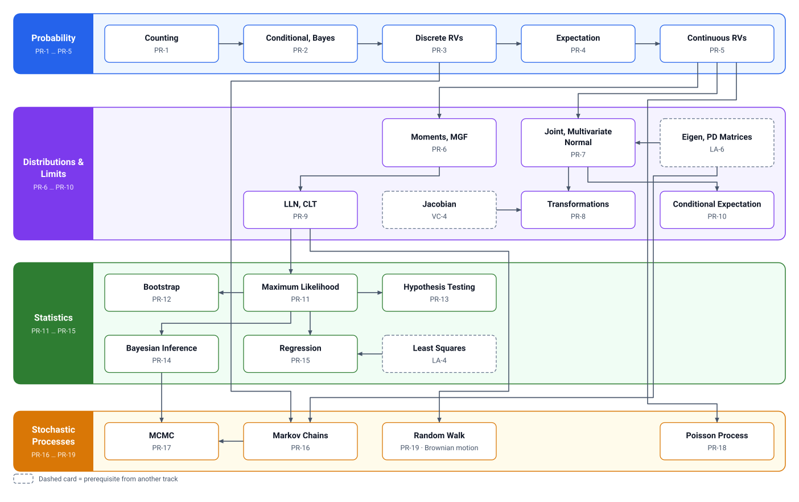

# 概率与统计 Probability & Statistics
### Probability Foundations · Random Variables · Estimation · Bayesian Inference · Stochastic Processes (intro)

> Interleaved: **foundations M3–M6 (P-I)**, **inference & stochastic M9–M12 (P-II)**. Budget **~140 h**.
> Chapter numbering: Blitzstein & Hwang **2e (2019)**; Wasserman *All of Statistics* (2004).

| 字段 | 内容 |
|---|---|
| Knowledge Graph Node ID | `MATH-PR-01`（概率论与随机变量）· `MATH-PR-02`（贝叶斯推断与估计）· `MATH-PR-03`（随机过程与 SDE） |
| Phase | Phase I（I.7，M3–M6 基础）；推断与随机过程在 Phase II（M9–M12） |
| Prerequisites | [一元微积分](../single_variable_calculus/curriculum.md)；多元积分与换元；线性代数（特征向量、投影） |
| Primary References | Blitzstein & Hwang, *Introduction to Probability* 2e；Wasserman, *All of Statistics*；MIT 18.05 |

## 0. 必须掌握的知识点 Knowledge Checklist

学完本模块应能逐条勾选。每条对应的教材章节见 §4。

### 概率基础 `MATH-PR-01`

- [ ] 样本空间、概率公理、计数、容斥原理
- [ ] 条件概率、全概率公式、贝叶斯公式、独立性
- [ ] 离散分布：Bernoulli、二项、几何、Poisson
- [ ] 期望的线性性、指示变量、方差
- [ ] 连续分布：均匀、正态、指数（无记忆性）
- [ ] 矩母函数、独立随机变量之和
- [ ] 联合分布、协方差、相关系数、多元正态分布
- [ ] 随机变量变换（Jacobian）、卷积、Beta 与 Gamma 分布
- [ ] Markov、Chebyshev、Jensen 不等式；大数定律与中心极限定理

### 统计推断 `MATH-PR-02`

- [ ] 条件期望作为投影
- [ ] 点估计：偏差、方差、MSE、一致性、MLE、Fisher 信息
- [ ] Bootstrap 与置信区间
- [ ] 假设检验与 p 值（了解）
- [ ] 贝叶斯推断：先验、似然、后验、共轭、MAP、可信区间
- [ ] 线性回归即高斯噪声下的 MLE

### 随机过程 `MATH-PR-03`

- [ ] Markov 链：转移矩阵、平稳分布、细致平衡
- [ ] MCMC：Metropolis–Hastings、Gibbs 采样、收敛诊断
- [ ] Poisson 过程
- [ ] 随机游走 → 布朗运动 → 扩散方程，Langevin 方程（入门）

## 1. 主教材 Primary Textbook

**Joseph K. Blitzstein & Jessica Hwang, *Introduction to Probability*, 2nd ed., CRC Press, 2019.**
Exactly matched to Harvard Stat 110 lectures. Story proofs build real intuition, and Markov chains and MCMC are included.

## 2. 辅助教材 Supplementary Textbook

| Book | Role |
|---|---|
| Wasserman, *All of Statistics*, Springer 2004 | **Primary for the inference half** (estimation, bootstrap, Bayesian, regression); compact |
| Grimmett & Stirzaker, *Probability and Random Processes*, 4e, OUP 2020 | Reference: random walks, Poisson processes, Brownian motion, rigorous convergence |
| Gelman et al., *Bayesian Data Analysis*, 3e, CRC 2013 | Reference for P-IV UQ / inverse problems |
| Riley, Hobson & Bence 3e, Ch. 30 *Probability*, Ch. 31 *Statistics* | Quick physics-style reference |

## 3. 官方课程资源 Official Course Resources

- **Harvard Stat 110 (Blitzstein)**: stat110.net. Lecture videos, strategic practice problems with solutions. **Primary lecture spine.**
- **MIT 18.05 Introduction to Probability and Statistics (Orloff & Bloom, Spring 2014)**: Bayesian updating and frequentist inference with clear notes.
- **MIT 6.041 / 6.041SC Probabilistic Systems Analysis (Tsitsiklis)**: alternative lectures with an engineering flavor (inference, Markov chains).
- **MIT 18.650 Statistics for Applications (Rigollet, Fall 2016)**: optional, for estimation theory depth.
- Cambridge IB *Statistics* and *Markov Chains* (Dexter Chua notes): rigorous cross-check.

## 4. 必修章节 Must-Study Chapters / Topics

### Part A — Foundations (P-I, Blitzstein & Hwang 2e)

| Block | Chapter | Key outcomes |
|---|---|---|
| PR-1 Probability & counting | Ch. 1 *Probability and Counting* | Sample spaces, naive definition, counting, axioms, inclusion–exclusion |
| PR-2 Conditional probability | Ch. 2 *Conditional Probability* | Bayes' rule, law of total probability, independence, the Monty Hall and testing paradoxes |
| PR-3 Discrete RVs | Ch. 3 *Random Variables and Their Distributions* | PMF/CDF; Bernoulli, Binomial, Hypergeometric, Geometric, Poisson |
| PR-4 Expectation | Ch. 4 *Expectation* | Linearity, indicator RVs, LOTUS, variance |
| PR-5 Continuous RVs | Ch. 5 *Continuous Random Variables* | PDF, Uniform (universality), Normal, Exponential (memorylessness), Poisson process intro |
| PR-6 Moments | Ch. 6 *Moments* | MGFs, skewness, kurtosis, sums of independent RVs |
| PR-7 Joint distributions | Ch. 7 *Joint Distributions* | Marginals/conditionals, covariance, correlation, **multivariate normal** |
| PR-8 Transformations | Ch. 8 *Transformations* | Change of variables (Jacobian, linking to calculus VC-4), convolution, Beta/Gamma |
| PR-9 Limit theorems | Ch. 10 *Inequalities and Limit Theorems* | Markov/Chebyshev/Jensen, **LLN, CLT** |

### Part B — Inference & stochastic (P-II)

| Block | Source | Key outcomes |
|---|---|---|
| PR-10 Conditional expectation | B&H Ch. 9 *Conditional Expectation* | E(Y\|X) as a projection (links to least squares, LA-4); Adam's and Eve's laws |
| PR-11 Point estimation | Wasserman Ch. 6 *Models, Statistical Inference and Learning*; Ch. 9 *Parametric Inference* | Bias/variance/MSE, consistency, **MLE**, Fisher information, asymptotic normality, delta method |
| PR-12 Bootstrap & confidence | Wasserman Ch. 7 *Estimating the CDF and Statistical Functionals*; Ch. 8 *The Bootstrap* | Empirical CDF, bootstrap confidence intervals |
| PR-13 Hypothesis testing (light) | Wasserman Ch. 10 *Hypothesis Testing and p-values* | Wald test, p-values, multiple testing caveats |
| PR-14 Bayesian inference | Wasserman Ch. 11 *Bayesian Inference*; MIT 18.05 Bayesian units | Prior/likelihood/posterior, conjugacy (Beta–Binomial, Normal–Normal), MAP vs MLE, credible intervals |
| PR-15 Regression | Wasserman Ch. 13 *Linear and Logistic Regression* | OLS as MLE under Gaussian noise; link to LA-4 least squares |
| PR-16 Markov chains | B&H Ch. 11 *Markov Chains* | Transition matrix, stationary distribution (eigenvector, LA-6), reversibility, detailed balance |
| PR-17 MCMC | B&H Ch. 12 *Markov Chain Monte Carlo* | Metropolis–Hastings, Gibbs sampling, convergence diagnostics |
| PR-18 Poisson processes | B&H Ch. 13 *Poisson Processes* | Arrivals, thinning, superposition; shot noise |
| PR-19 Random walk → Brownian motion | Grimmett & Stirzaker, chapters on random walks and diffusion processes `[NEEDS VERIFICATION: chapter numbers]` | Scaling limit, diffusion equation as the Fokker–Planck equation of Brownian motion, Langevin equation (intro) |

## 5. 可选/可跳过 Optional / Skippable

- B&H combinatorics-heavy sections (e.g., Bose–Einstein counting stories): skim, but keep anything with a physics flavor.
- Wasserman chapters on nonparametric curve estimation, classification and causal inference: **skip** (off-path) `[chapter numbers NEEDS VERIFICATION]`.
- Wasserman Ch. 12 *Statistical Decision Theory*: optional.
- Measure-theoretic probability (Lebesgue integration, σ-algebras in depth): **skip**. Rudin Ch. 11 is available locally if curiosity strikes.
- Stochastic calculus (Itô): **defer** to P-IV if needed for noise modeling.

## 6. 先修关系 Prerequisites

**Entry:** single-variable calculus (series, integration); for Part B: LA-4/LA-6 and VC-4.

**Cross-module:**
- PR-19 ↔ differential_equations PDE-9 (heat kernel = Gaussian; diffusion constant D = σ²/(2Δt)).
- PR-16/17 ↔ 02 statistical physics (Boltzmann distribution, Ising model) and research paper C1 (Metropolis 1953).
- PR-14/PR-15 ↔ 04 estimation (Kalman filter = recursive Bayesian estimation for linear-Gaussian models).
- PR-9 ↔ numerical_analysis (Monte Carlo error ∝ N^{−1/2}).

## 7. 学时 Estimated Study Hours

| Part | Blocks | Hours |
|---|---|---|
| A — Foundations | PR-1…PR-9 | 75 |
| B — Inference | PR-10…PR-15 | 35 |
| B — Stochastic | PR-16…PR-19 | 30 |
| **Total** | | **~140 h** |

## 8. 数学推导任务 Mathematical Derivation Tasks

1. Derive Bayes' rule and compute the posterior probability of disease given a positive test (base-rate fallacy).
2. Derive mean and variance of Binomial via indicators; derive the Poisson as the limit of Binomial(n, λ/n).
3. Prove memorylessness characterizes the Exponential among continuous distributions.
4. Derive the density of the sum of independent RVs (convolution) and show sums of independent Normals are Normal (via MGFs).
5. Derive the multivariate normal density; show Σ must be SPD; derive the marginal and conditional distributions (Schur complement).
6. Prove the weak LLN via Chebyshev; sketch the CLT proof via MGFs.
7. Derive the MLE for Normal (μ, σ²), Exponential, and Poisson; show the MLE σ̂² is biased; compute Fisher information.
8. Derive the Beta–Binomial and Normal–Normal posteriors; show the posterior mean is a precision-weighted average.
9. Show OLS = MLE under i.i.d. Gaussian noise; derive Var(β̂) = σ²(XᵀX)⁻¹.
10. Prove that detailed balance implies stationarity; prove the Metropolis acceptance rule satisfies detailed balance.
11. Derive the diffusion equation as the continuum limit of a symmetric random walk; identify D.

## 9. 物理建模任务 Physical Modeling Tasks

1. **Radioactive decay 放射性衰变:** Poisson counting statistics; Exponential lifetimes; estimate half-life with confidence interval from counts.
2. **Measurement error 测量误差:** propagate uncertainties through a nonlinear formula (delta method) vs Monte Carlo propagation.
3. **Maxwell–Boltzmann velocities:** derive the speed distribution from three independent Gaussian velocity components (transformation of RVs).
4. **Random walk → diffusion 随机游走:** model Brownian motion of a particle; recover Einstein's ⟨x²⟩ = 2Dt.
5. **Shot noise 散粒噪声:** model electron arrivals as a Poisson process; derive current noise ∝ √(2qIΔf) (preview of devices).
6. **Two-state system / Boltzmann factor:** sampling energy states with Metropolis at temperature T (preview of stat mech).

## 10. 编程实验 Programming / Computational Experiments

| # | Experiment | Tools | Deliverable |
|---|---|---|---|
| E1 | Simulate Monty Hall, birthday problem; compare with exact answers | NumPy `random.default_rng` | Convergence of frequencies |
| E2 | CLT demo: sums of Uniform/Exponential → Normal; Q–Q plots | NumPy, SciPy `stats` | Histograms + Q–Q plots vs n |
| E3 | Inverse-transform and Box–Muller sampling | NumPy | Verify with KS test |
| E4 | Monte Carlo integration and π estimation; error ∝ N^{−1/2} | NumPy | Log-log error plot |
| E5 | MLE by numerical optimization vs closed form; Fisher-information CI coverage study | SciPy `optimize`, `stats` | Coverage ≈ 95% table |
| E6 | Bootstrap CI for a median | NumPy | Comparison with asymptotic CI |
| E7 | Bayesian coin/Beta–Binomial updating animation; grid posterior for a 1-D parameter | NumPy, Matplotlib | Posterior evolution plots |
| E8 | Markov chain: stationary distribution by power iteration vs eigenvector vs simulation | NumPy | Agreement table |
| E9 | Metropolis–Hastings for a 2-D correlated Gaussian and a bimodal target; trace plots, autocorrelation, acceptance rate tuning | NumPy | Diagnostics figure |
| E10 | 1-D/2-D random walks; ⟨x²⟩ vs t; compare histogram with the heat kernel | NumPy | Overlay plot |

## 11. 工程应用映射 Engineering Application Mapping

| Concept | Engineering application | Where it reappears |
|---|---|---|
| Bayes' rule, posterior | Sensor fusion, fault diagnosis, **Kalman filtering** | 04 estimation |
| Multivariate normal, covariance | Error ellipses, GPS/IMU fusion, uncertainty propagation | 04 estimation |
| MLE / least squares | Parameter identification, model calibration, device parameter extraction | 04 devices, 03 inverse problems |
| Bootstrap, confidence intervals | Reporting simulation results with uncertainty | all experiments |
| Monte Carlo | Reliability analysis, radiation transport, financial engineering, UQ | 03 MC methods |
| Markov chains, MCMC | Statistical mechanics sampling, Bayesian calibration of simulators | 02 stat phys, 03 |
| Poisson process | Shot noise, failure arrivals, queueing in networks | 04 devices |
| Random walk / Brownian motion | Diffusion of dopants, Langevin dynamics in MD | 02, 03 MD, 04 devices |
