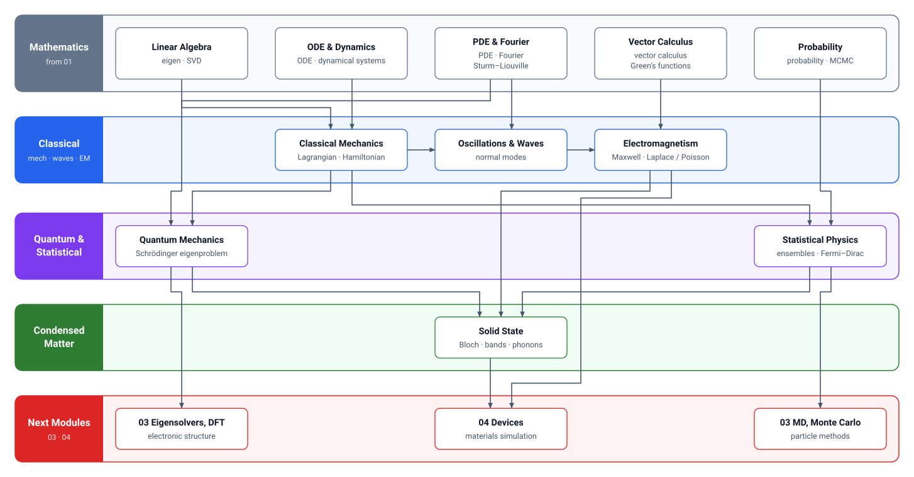

# 02 物理核心 Physics Core — Milestone 3

> 对应 [`ROADMAP.md`](../ROADMAP.md) 的 **Phase III (M5–M8：经典物理)** 与 **Phase IV (M9–M12：近代物理与材料)**。
> Goal 目标: turn physical laws into well-posed mathematical models (ODE / PDE / eigenproblems / statistical ensembles) that `03_computational_methods/` can solve.
> Node IDs (`PHYS-*`) refer to [physics_graph.md](../06_knowledge_graph/physics_graph.md).
> Each module directory has a `curriculum.md` introduction listing what must be mastered; `university_physics/` covers the prerequisite general-physics level.

## 1. 模块索引 Module Index

| Module (actual directory) | Primary text | Reference | Course spine | ROADMAP Phase | Hours | Graph nodes |
|---|---|---|---|---|---|---|
| University Physics 大学物理基础（前置） [`university_physics/`](university_physics/curriculum.md) | Halliday, Resnick & Walker, *Fundamentals of Physics* | Young & Freedman, *University Physics* | MIT 8.01 / 8.02 / 8.03 | Before Phase I | 130 | — |
| Classical Mechanics 经典力学 [`classical_mechanics/`](classical_mechanics/curriculum.md) | Taylor, *Classical Mechanics* (2005) | Goldstein–Poole–Safko 3e; French (Waves) | Tong, *Classical Dynamics* (Cambridge II); MIT 8.03 | Phase III (M5–M6) | 100 | `PHYS-CM-01..03`, `PHYS-CL-01` |
| Electromagnetism 电磁学 [`electromagnetism/`](electromagnetism/curriculum.md) | Griffiths, *Introduction to Electrodynamics* 5e (2023; 4e also fine) | Jackson 3e (selected) | Tong, *Electromagnetism* (IB); MIT 8.02 review | Phase III (M6–M7) | 100 | `PHYS-EM-01` |
| Thermodynamics & StatMech 热力学与统计力学 [`thermodynamics/`](thermodynamics/curriculum.md) | Kittel & Kroemer, *Thermal Physics* 2e | Schroeder (2000) | Tong, *Statistical Physics* (II); MIT 8.044 | Phase III–IV (M7, M10) | 80 | `PHYS-TD-01`, `PHYS-SM-01..02` |
| Continuum Mechanics & Fluids 连续介质与流体 [`continuum_mechanics/`](continuum_mechanics/curriculum.md) | Fung, *A First Course in Continuum Mechanics* 3e | Kundu–Cohen–Dowling 6e; Bergman et al. | MIT 2.29; Tong *Fluid Mechanics* | Phase III (M7–M8) | 80 | `PHYS-FL-01`, `PHYS-TR-01`, `PHYS-EL-01` |
| Quantum Mechanics 量子力学 [`quantum_mechanics/`](quantum_mechanics/curriculum.md) | Griffiths & Schroeter, *Introduction to QM* 3e | Sakurai & Napolitano 3e | MIT 8.04 (Adams 2013 / Zwiebach 2016), 8.05 | Phase IV (M9–M11) | 110 | `PHYS-QM-01` |
| Solid State & Semiconductor Physics 固体与半导体物理 [`solid_state_physics/`](solid_state_physics/curriculum.md) | Kittel, *Introduction to Solid State Physics* 8e; Streetman–Banerjee 7e | Ashcroft & Mermin | Tong, *Applications of QM* (II); nanoHUB-U | Phase IV (M11–M12) | 80 | `PHYS-SS-01..02`, `PHYS-QM-02` |

## 2. 学完 02 需要掌握的知识 Knowledge Checklist

| 模块 | 学完必须能做到 |
|---|---|
| 大学物理基础 | 用牛顿定律、能量、动量三种方法解标准力学题；写出 Maxwell 方程组积分形式；分析理想气体过程；计算干涉衍射；用光电效应和德布罗意关系做估算 |
| 分析力学 | 用 Lagrange 方法建立约束系统运动方程；求简正模；写出 Hamilton 正则方程；比较辛积分器与普通积分器的能量漂移 |
| 电动力学 | 从积分形式推出 Maxwell 方程组微分形式；分离变量解 Laplace 方程并用 FDM 对照；推导电磁波方程与坡印廷定理 |
| 热力学与统计力学 | 推导 Maxwell 关系；由配分函数求热力学量；用费米–狄拉克分布解释载流子统计；Metropolis 模拟 Ising 模型 |
| 连续介质力学 | 由守恒律和散度定理推出连续性方程与柯西方程；线弹性梁挠度；Poiseuille 流；对流–扩散方程无量纲化 |
| 量子力学 | 解析求解势阱、谐振子、氢原子；把一维薛定谔方程化为稀疏特征值问题数值求解；微扰论与变分法估算 |
| 固体与半导体物理 | 推导紧束缚能带与有效质量；计算硅本征载流子浓度；解释 p–n 结能带图；写出泊松–漂移–扩散方程组 |

## 3. 依赖关系 Dependencies

## 4. 各模块核心内容 Core Content per Module

| Module | Must-cover topics 必修 | Key models handed to `03_` |
|---|---|---|
| Classical Mechanics | Newton → Lagrange (constraints, generalized coordinates) → Hamilton; central forces; rigid bodies (inertia tensor); small oscillations; nonlinear mechanics and chaos (Taylor ch. on chaos) | Mq̈ + Kq = 0; Hamiltonian flow → symplectic integrators |
| Waves | Coupled oscillators, normal modes, continuous string, dispersion, group velocity, Fourier synthesis | Wave equation; dispersion relations for checking schemes |
| Electromagnetism | Electrostatics, Laplace's equation & uniqueness, method of images, multipoles, fields in matter, magnetostatics, Maxwell's equations, EM waves, potentials & gauges | −∇·(ε∇φ) = ρ; time-domain Maxwell (Yee/FDTD) |
| Quantum Mechanics | Wavefunction, infinite/finite well, harmonic oscillator, free particle, delta potential, formalism (Hilbert space, Hermitian operators), hydrogen atom, spin, identical particles, perturbation theory, variational principle | Ĥψ = Eψ as a sparse symmetric eigenproblem; time-dependent Schrödinger (Crank–Nicolson, split-step) |
| Statistical Physics | Entropy & temperature, Boltzmann factor, partition function, Planck distribution, chemical potential, Fermi–Dirac / Bose–Einstein, ideal gases, heat engines (light), phase transitions (Ising) | Canonical sampling (Metropolis); MD thermostats |
| Solid State | Crystal lattices, reciprocal lattice, phonons, free-electron gas, Bloch theorem, nearly-free-electron & tight-binding bands, semiconductor crystals (effective mass, holes, doping) | Band structure as a k-parametrized eigenproblem; carrier statistics |

## 5. 物理 ↔ 计算 标志性实验 Signature Computational Experiments

| # | Experiment | Module | Method preview |
|---|---|---|---|
| X1 | Double pendulum: chaos, energy drift with RK4 vs symplectic integrator | CM | ODE integrators |
| X2 | Normal modes of a 2-D membrane via the discrete Laplacian eigenproblem | Waves | Sparse eigensolver |
| X3 | Potential in a box with mixed BCs: Jacobi / SOR / CG; compare with a series solution | EM | FDM, iterative solvers |
| X4 | 1-D Schrödinger: finite well, harmonic oscillator, double well (tunneling splitting) | QM | FD Hamiltonian + `scipy.sparse.linalg.eigsh` |
| X5 | Wave-packet scattering off a barrier: transmission vs energy | QM | Crank–Nicolson / split-step Fourier |
| X6 | 2-D Ising model: magnetization, heat capacity, T_c | Stat | Metropolis MC (paper C1) |
| X7 | Kronig–Penney and 1-D tight-binding bands; effective mass from curvature | Solid State | Bloch eigenproblem |
| X8 | Intrinsic carrier density n_i(T) of Si from Fermi–Dirac integrals | Solid State | Quadrature + root finding (charge neutrality) |

## 6. 阶段验收 Milestone 3 Exit Criteria

- Derive equations of motion for a constrained system by Lagrange, and its normal modes as a generalized eigenproblem.
- Solve a 2-D electrostatics problem analytically (separation of variables) and numerically, with a convergence check.
- Compute bound states of an arbitrary 1-D potential and explain the result's dependence on grid spacing.
- Run a Metropolis simulation of the Ising model and locate T_c within error bars.
- Explain a semiconductor band diagram: E_c, E_v, E_F, doping, and the origin of n·p = n_i².

## 7. 参考 References

[textbooks.md](../07_references/textbooks.md) §4 Physics · [university_courses.md](../07_references/university_courses.md) §1.2, §4 · [research_papers.md](../07_references/research_papers.md) §C.
