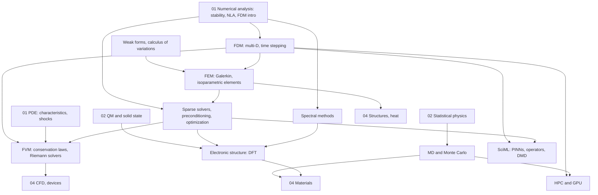

# 03 计算方法 Computational Methods — Milestone 4

> 对应 [`ROADMAP.md`](../ROADMAP.md) 的 **Phase V (M13–M15：数值数学与科学计算)** 与 **Phase VI (M15–M18：反问题与科学机器学习)**。
> Goal 目标: build, verify and understand the solvers behind production codes, and know *why* a scheme is consistent, stable and convergent before using OpenFOAM / FEniCSx / LAMMPS / QE.
> Builds directly on [`01_mathematics/numerical_analysis`](../01_mathematics/numerical_analysis/curriculum.md). Each module will get an 11-element `curriculum.md`.

## 1. 模块索引 Module Index

| Module (actual directory) | Primary text | Reference / course | Software | ROADMAP Phase | Hours |
|---|---|---|---|---|---|
| Finite Difference & Spectral Methods 有限差分与谱方法 `fdm/` | LeVeque, *FDM for ODEs and PDEs* (2007); Trefethen *Spectral Methods* | Strang CSE; MIT 18.086 | NumPy, SciPy sparse | Phase V (M13) | 60 |
| Finite Volume Methods 有限体积 `fvm/` | LeVeque, *Finite Volume Methods for Hyperbolic Problems* (2002) | Ferziger–Perić–Street 4e | NumPy → OpenFOAM | Phase V (M13–M14) | 60 |
| Finite Element Methods 有限元 `fem/` | Hughes, *The Finite Element Method* (Dover 2000) | Brenner–Scott 3e; MIT RES.2-002 (Bathe) | NumPy → FEniCSx, Gmsh | Phase V (M14–M15) | 80 |
| Monte Carlo & Particle Methods 蒙特卡洛与粒子方法 `monte_carlo/` | Frenkel & Smit, *Understanding Molecular Simulation* | Allen & Tildesley 2e | NumPy → LAMMPS | Phase V (M15) | 50 |
| Inverse Problems & Regularization 反问题与正则化 `inverse_problems/` | Hansen; Gelman et al. *BDA* 3e | Boyd–Vandenberghe *Convex Optimization* | SciPy, CVXPY | Phase VI (M16–M17) | 45 |
| Scientific ML 科学机器学习 `scientific_ml/` | Brunton & Kutz, *Data-Driven Science and Engineering* 2e | Papers D5–D6, F1–F10; MIT 18.337J | PyTorch, JAX | Phase VI (M17–M18) | 60 |

> 注：数值线性代数与迭代求解器归于 [`01_mathematics/numerical_analysis/`](../01_mathematics/numerical_analysis/curriculum.md)；HPC/GPU 并行计算归于 [`04_engineering_applications/hpc_architecture/`](../04_engineering_applications/README.md)。

## 2. 依赖关系 Dependencies

## 3. 方法核心与验证 Core Ideas & Verification

| Module | Must master 必须掌握 | Verification test 验证算例 |
|---|---|---|
| FDM | 2-D/3-D stencils, ADI, method of lines, nonuniform grids, boundary treatment | Method of manufactured solutions (MMS) → observed order |
| Spectral | Fourier and Chebyshev differentiation matrices, aliasing and dealiasing, spectral accuracy | Exponential convergence for smooth periodic data |
| FVM | Integral form, numerical flux, upwind/Godunov, Roe/HLL, TVD limiters, unstructured cells, SIMPLE (incompressible) | Sod shock tube; lid-driven cavity vs Ghia et al. (1982) data |
| FEM | Weak form, Galerkin, Lax–Milgram/Céa (statement), P1/P2/Q1 elements, isoparametric mapping, Gauss quadrature, assembly, a-priori error rates, locking | Patch test; h- and p-convergence; cantilever vs beam theory |
| Solvers | Sparse direct (fill-in, ordering), CG/GMRES, ILU/AMG preconditioning, Newton–Krylov, line search; convex optimization basics | Iterations vs mesh size with/without preconditioner |
| MD / MC | Velocity Verlet, periodic BCs, neighbor lists, thermostats, ensembles, Metropolis, error bars by blocking | Energy conservation; g(r) and pressure of the LJ fluid vs literature |
| DFT | Plane waves, pseudopotentials, k-point sampling, SCF mixing, convergence testing | Si lattice constant and band gap (and why LDA/PBE underestimate it) |
| SciML | AD, PINN loss construction, operator learning, POD/DMD/SINDy, train/test on unseen parameters | Compare against the classical solver at equal wall-clock cost |
| HPC | Roofline model, memory bandwidth, stencil and SpMV kernels, strong/weak scaling | Measured speedup vs roofline prediction |

## 4. 统一的 V&V 规范 Verification & Validation Standard

Every solver in this module ships with:
1. **Code verification:** MMS or analytic solution, with the observed order of accuracy printed on a log–log plot.
2. **Solution verification:** grid/time-step convergence (Richardson extrapolation or GCI) on the actual problem.
3. **Validation:** comparison with a published benchmark or experiment.
4. A `README` stating the equations, discretization, BCs, parameters and how to reproduce every figure.

## 5. 阶段验收 Milestone 4 Exit Criteria

- A self-written 2-D FVM solver (advection or Euler) and a self-written 2-D P1 FEM solver (Poisson / elasticity), both with verified convergence orders.
- The same problems reproduced in OpenFOAM and FEniCSx, with matching results.
- One LAMMPS and one Quantum ESPRESSO study with documented convergence parameters.
- A PINN or FNO compared honestly against a classical solver (accuracy, cost, generalization).
- A GPU port of one kernel with a roofline analysis.

## 6. 参考 References

[textbooks.md](../07_references/textbooks.md) §3 · [software_documentation.md](../07_references/software_documentation.md) · [research_papers.md](../07_references/research_papers.md) §A, B, C, F.
