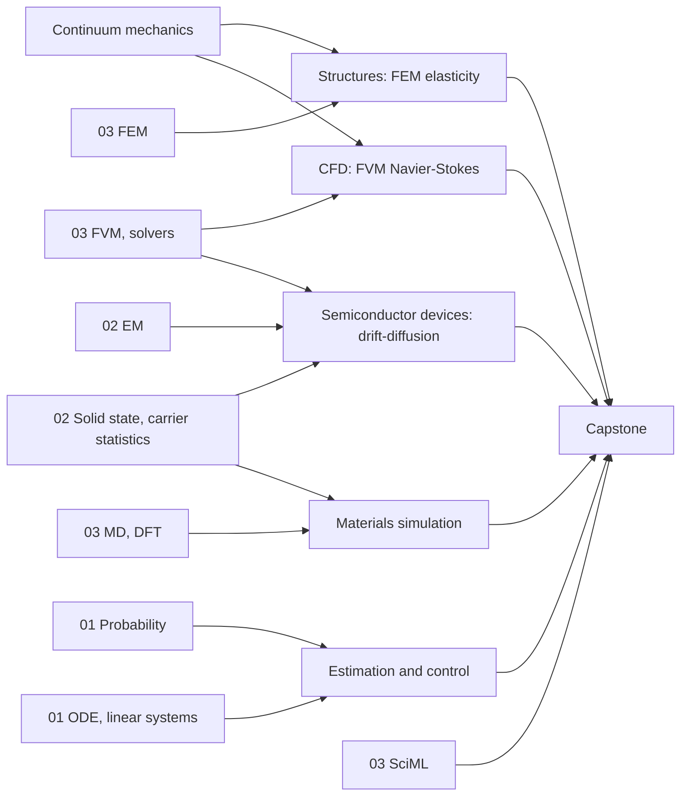

# 04 工程应用 Engineering Applications — Milestone 5

> 对应 [`ROADMAP.md`](../ROADMAP.md) 的 **Phase VI (M15–M18)** 与 **Phase VII (M18–M24)**。
> Goal 目标: complete the chain **math → physics → model → method → engineering answer**, with a quantified error budget, across the 7 interconnected MPCE application domains plus a capstone.
> Each domain will get an 11-element `curriculum.md`. This README is the roadmap.

## 1. 应用方向 Application Tracks

| Domain (actual directory) | Governing model | Primary text | Methods (from `03_`) | Software | ROADMAP Phase |
|---|---|---|---|---|---|
| AI & Data Science 人工智能与数据科学 `ai_data_science/` | Statistical learning, optimization, PDE surrogates | Brunton–Kutz 2e; Goodfellow et al. | AD, PINNs, Neural Operators, Bayesian UQ | PyTorch, JAX | Phase VI–VII |
| Semiconductors & IC 半导体与集成电路 `semiconductor_ic/` | Poisson + drift-diffusion; Schrödinger–Poisson | Streetman–Banerjee 7e; Sze–Ng 3e | Scharfetter–Gummel FVM, Newton/Gummel | NumPy/SciPy (own TCAD) | Phase VII |
| Robotics & Embodied AI 机器人与具身智能 `robotics/` | Rigid-body dynamics, state-space, linear-Gaussian | Åström & Murray 2e; Simon (2006) | Kalman/EKF, LQR, MPC, trajectory opt. | NumPy, SciPy, CVXPY | Phase VI–VII |
| Advanced Manufacturing & Multiphysics 先进制造与多物理场 `advanced_manufacturing/` | Linear/thermo-elasticity, Navier–Stokes, heat transfer | Fung 3e; Hughes; Ferziger–Perić–Street 4e | FEM, FVM (SIMPLE/PISO), coupled thermo-mech | FEniCSx, OpenFOAM, ParaView | Phase VII |
| Computational Physics & Materials 计算物理与材料 `materials_science/` | Newtonian MD; Kohn–Sham DFT | Frenkel & Smit; Martin 2e | MD, MC, DFT | LAMMPS, Quantum ESPRESSO, ASE | Phase VII |
| Computer Architecture & HPC 计算机体系结构与高性能计算 `hpc_architecture/` | Memory hierarchy, Roofline, parallel numerical kernels | Hwu–Kirk–El Hajj 4e | SpMV, stencil kernels, GPU/MPI parallelization | CuPy, CUDA, mpi4py | Phase V, VII |
| Medical Imaging & Biomedical 医学成像与生物医学 *(planned `medical_imaging/`)* | Radon/Fourier inversion, regularized reconstruction | Oppenheim–Willsky 2e; inverse problems refs | FFT, FBP, Tikhonov, unrolled ML | NumPy, PyTorch | Phase VI–VII |

## 2. 依赖关系 Dependencies

## 3. 各方向标志性项目 Signature Projects

| Track | Project | Deliverable / acceptance |
|---|---|---|
| Structures | Cantilever and plate with a hole: stress concentration factor; modal analysis of a bracket | K_t vs analytic (Kirsch) solution; natural frequencies vs Euler–Bernoulli beam theory |
| Structures | Thermal stress in a bimaterial strip (thermoelastic coupling) | Curvature vs Stoney/Timoshenko bimetal formula |
| CFD | Lid-driven cavity (Re = 100, 1000); flow past a cylinder (vortex shedding) | Centerline velocities vs Ghia et al. (1982); Strouhal number ≈ 0.2 near Re ≈ 100–200 `[NEEDS VERIFICATION against chosen benchmark source]` |
| CFD | Conjugate heat transfer in a heat-sink channel | Nusselt number vs correlation in Bergman et al. |
| Devices | 1-D p–n diode: equilibrium band diagram, I–V, depletion width | Match Shockley ideal diode at low bias; explain high-injection deviations |
| Devices | 1-D MOS capacitor C–V; (stretch) 2-D MOSFET I_D–V_G | C–V shape vs Streetman/Sze; threshold voltage vs analytic estimate |
| Materials | LJ argon: g(r), diffusion coefficient, melting (MD); Si band structure (DFT) | Literature comparison; convergence tables for ecutwfc / k-points |
| Est. & Control | Kalman filter for a tracking problem; LQR for an inverted pendulum | NEES/NIS consistency; closed-loop stability margins |

## 4. 毕业项目候选 Capstone Options (choose one)

1. **Electro-thermal device simulation 电热耦合器件仿真:** drift-diffusion + heat equation, with self-heating feedback on mobility.
2. **Surrogate-accelerated design 代理模型加速设计:** FNO/DeepONet surrogate for a parametric CFD or heat problem, then optimization of a design parameter. Report surrogate error vs the full solver.
3. **Inverse problem with UQ 不确定性反演:** Bayesian calibration (MCMC) of material parameters in an FEM model from noisy synthetic measurements.
4. **Multiscale materials 多尺度材料:** DFT → fitted interatomic potential → MD → continuum property (e.g., thermal conductivity or elastic constants).

**Capstone deliverable:** technical report (problem → model derivation → discretization → V&V → results with uncertainty → limitations) and a reproducible repository.

## 5. 阶段验收 Milestone 5 Exit Criteria

- Three track projects completed to the V&V standard of [`03_computational_methods`](../03_computational_methods/README.md#4-统一的-vv-规范-verification--validation-standard).
- For each project, a one-page "model card": assumptions, where the model breaks, and the dominant error source (modeling / discretization / solver / data).
- Capstone report and a 15-minute presentation.

## 6. 参考 References

[textbooks.md](../07_references/textbooks.md) §5 · [university_courses.md](../07_references/university_courses.md) §1.3, §5 · [research_papers.md](../07_references/research_papers.md) §D, E, F.
