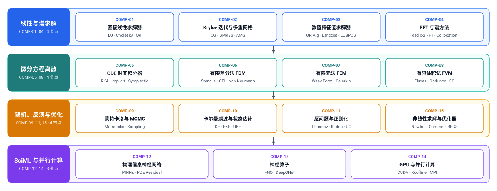

# Computational Methods Knowledge Graph｜计算方法知识图谱

> Layer 4 of the MPCE chain: Mathematical Principle → Physical Principle → Mathematical Model → **Computational Method** → Engineering Application → Research Frontier.
> MPCE 链条第四层：**计算方法**。本文件登记 15 个基础计算节点（`COMP-*`）。
> Master overview / 总览：[`../KNOWLEDGE_GRAPH.md`](../KNOWLEDGE_GRAPH.md) · Sibling layers / 其他层：[mathematics](mathematics_graph.md) · [physics](physics_graph.md) · [engineering](engineering_graph.md)

## 1. Node families｜节点族

| Family | Nodes | 中文 |
|---|---|---|
| Numerical linear algebra | `COMP-01`, `COMP-02`, `COMP-03` | 数值线性代数 |
| Transforms & time integration | `COMP-04`, `COMP-05` | 变换与时间积分 |
| PDE discretization | `COMP-06`, `COMP-07`, `COMP-08` | 偏微分方程离散 |
| Stochastic & inference | `COMP-09`, `COMP-10`, `COMP-11` | 随机方法与推断 |
| Scientific machine learning | `COMP-12`, `COMP-13` | 科学机器学习 |
| Systems & solvers | `COMP-14`, `COMP-15` | 并行系统与非线性/优化求解 |

## 2. Prerequisite graph｜先修关系图

Solid arrows = **Prerequisites** fields of this registry; grey nodes are prerequisites from the mathematics and physics layers.
实线箭头与"先修"字段一一对应；灰色节点为来自数学层/物理层的外部先修。

## 3. Node registry｜节点登记表

Field order is fixed (10 fields). "—" means no direct, rigorous link exists.
字段顺序固定（10 个字段）。"—" 表示不存在直接、严格的联系。

---

### COMP-01 · Direct Linear Solvers｜直接线性求解器

- **ID**: `COMP-01`
- **English Name**: Direct Linear Solvers (Dense and Sparse)
- **Chinese Name**: 直接线性求解器（稠密与稀疏）
- **Definition**: Solve $Ax=b$ through a factorization: Gaussian elimination with partial pivoting $PA=LU$ ($\tfrac23n^3$ flops, backward stable in practice), Cholesky $A=LL^{T}$ for SPD matrices, Householder QR for least squares. Sparse direct solvers use fill-reducing orderings (AMD, nested dissection) and supernodal/multifrontal factorization.
  释义：通过矩阵分解精确（至舍入误差）求解线性方程组，鲁棒但内存随规模快速增长。
- **Prerequisites**: `MATH-LA-03`, `MATH-NA-01`
- **Related Mathematics**: `MATH-LA-01`
- **Related Physics**: `PHYS-EL-01` (stiffness systems), `PHYS-SS-03` (Newton Jacobian systems)
- **Computational Methods**: `COMP-02` (direct coarse solves, incomplete factorizations as preconditioners), `COMP-07`, `COMP-14`
- **Engineering Applications**: `ENG-HPC-01` (LAPACK/ScaLAPACK, LINPACK benchmark), `ENG-MFG-02`, `ENG-SEMI-01` (sparse LU inside SPICE), `ENG-SEMI-02`
- **References**: Golub & Van Loan, *Matrix Computations*, 4th ed., 2013; T. A. Davis, *Direct Methods for Sparse Linear Systems*, SIAM, 2006; E. Anderson et al., *LAPACK Users' Guide*, 3rd ed., SIAM, 1999.

---

### COMP-02 · Krylov Iterative Solvers, Preconditioning and Multigrid｜Krylov 迭代求解器、预条件与多重网格

- **ID**: `COMP-02`
- **English Name**: Krylov Subspace Iterative Solvers, Preconditioning and Multigrid
- **Chinese Name**: Krylov 子空间迭代求解器、预条件与多重网格
- **Definition**: Seek $x_k\in x_0+\mathcal K_k(A,r_0)=x_0+\mathrm{span}\{r_0,Ar_0,\dots,A^{k-1}r_0\}$. CG (SPD) minimizes the $A$-norm error with $\lVert e_k\rVert_A\le2\big(\tfrac{\sqrt\kappa-1}{\sqrt\kappa+1}\big)^k\lVert e_0\rVert_A$; GMRES minimizes the residual for general $A$. A preconditioner $M\approx A^{-1}$ clusters the spectrum; multigrid achieves $O(N)$ complexity for elliptic problems by combining smoothing with coarse-grid correction.
  释义：只需矩阵–向量乘积的迭代法；配合预条件/多重网格是大规模 PDE 求解的核心。
- **Prerequisites**: `MATH-LA-02`, `MATH-NA-01`
- **Related Mathematics**: `MATH-OPT-01` (CG minimizes a convex quadratic), `MATH-NA-02` (convergence via polynomial approximation on the spectrum)
- **Related Physics**: `PHYS-EL-01`, `PHYS-FL-01` (pressure Poisson equation), `PHYS-EM-01`
- **Computational Methods**: `COMP-01`, `COMP-03`, `COMP-07`, `COMP-08`, `COMP-14`
- **Engineering Applications**: `ENG-HPC-02`, `ENG-HPC-01`, `ENG-MED-02` (CGLS/LSQR for iterative reconstruction)
- **References**: Y. Saad, *Iterative Methods for Sparse Linear Systems*, 2nd ed., SIAM, 2003; W. L. Briggs, V. E. Henson & S. F. McCormick, *A Multigrid Tutorial*, 2nd ed., SIAM, 2000; M. R. Hestenes & E. Stiefel, *J. Res. Natl. Bur. Stand.* 49(6):409–436, 1952; Y. Saad & M. H. Schultz, *SIAM J. Sci. Stat. Comput.* 7(3):856–869, 1986.

---

### COMP-03 · Numerical Eigensolvers｜数值特征值求解器

- **ID**: `COMP-03`
- **English Name**: Numerical Eigensolvers
- **Chinese Name**: 数值特征值求解器
- **Definition**: Dense: reduction to Hessenberg/tridiagonal form followed by the shifted QR algorithm ($O(n^3)$); SVD via Golub–Kahan bidiagonalization. Large sparse: power and inverse iteration, Lanczos (symmetric), implicitly restarted Arnoldi (ARPACK), LOBPCG and Davidson methods; shift-and-invert for interior eigenvalues.
  释义：从稠密 QR 算法到大规模 Krylov/块方法，计算特征对与奇异值。
- **Prerequisites**: `MATH-LA-02`, `MATH-LA-03`, `MATH-NA-01`
- **Related Mathematics**: `MATH-FA-03`
- **Related Physics**: `PHYS-QM-01`, `PHYS-QM-02`, `PHYS-SS-01`, `PHYS-EL-01` (modal analysis), `PHYS-CM-02` (normal modes)
- **Computational Methods**: `COMP-02` (shared Krylov machinery), `COMP-07` (FEM generalized eigenproblems)
- **Engineering Applications**: `ENG-MAT-02`, `ENG-AI-02`, `ENG-MFG-02`
- **References**: B. N. Parlett, *The Symmetric Eigenvalue Problem*, SIAM, 1998; R. B. Lehoucq, D. C. Sorensen & C. Yang, *ARPACK Users' Guide*, SIAM, 1998; A. V. Knyazev, *SIAM J. Sci. Comput.* 23(2):517–541, 2001.

---

### COMP-04 · Fast Fourier Transform and Spectral Methods｜快速傅里叶变换与谱方法

- **ID**: `COMP-04`
- **English Name**: Fast Fourier Transform and Spectral Methods
- **Chinese Name**: 快速傅里叶变换与谱方法
- **Definition**: The FFT evaluates the $N$-point DFT in $O(N\log N)$ operations (Cooley–Tukey recursive factorization). Spectral and pseudospectral methods expand the solution in global bases (Fourier, Chebyshev), differentiate via the transform, and converge exponentially for analytic solutions; the FFT also enables fast convolution and fast Poisson solvers on periodic/regular domains.
  释义：$O(N\log N)$ 的傅里叶变换；在光滑问题上给出指数收敛的谱方法。
- **Prerequisites**: `MATH-FA-01`, `MATH-NA-02`
- **Related Mathematics**: `MATH-FA-03`, `MATH-LA-02` (DFT diagonalizes circulant matrices)
- **Related Physics**: `PHYS-FL-01` (spectral DNS of turbulence), `PHYS-QM-01`, `PHYS-QM-02`, `PHYS-SS-01`
- **Computational Methods**: `COMP-13`, `COMP-14` (cuFFT, distributed 3D FFT)
- **Engineering Applications**: `ENG-MED-02` (MRI reconstruction, CT filtering), `ENG-MAT-02` (plane-wave DFT codes), `ENG-HPC-01` (FFT as a communication-bound HPC kernel)
- **References**: J. W. Cooley & J. W. Tukey, *Math. Comp.* 19:297–301, 1965; L. N. Trefethen, *Spectral Methods in MATLAB*, SIAM, 2000; J. P. Boyd, *Chebyshev and Fourier Spectral Methods*, 2nd ed., Dover, 2001; M. Frigo & S. G. Johnson, *Proc. IEEE* 93(2):216–231, 2005.

---

### COMP-05 · ODE Time Integrators｜常微分方程时间积分器

- **ID**: `COMP-05`
- **English Name**: ODE Time Integrators (Runge–Kutta, BDF, Symplectic)
- **Chinese Name**: 常微分方程时间积分器（龙格–库塔、BDF、辛积分）
- **Definition**: One-step Runge–Kutta (explicit/implicit) and linear multistep methods; BDF and other A/L-stable implicit methods for stiff systems; adaptive step control via embedded error estimates; symplectic integrators (Störmer–Verlet) preserve Hamiltonian structure and give bounded long-time energy error. The method of lines turns semi-discretized PDEs into large ODE/DAE systems.
  释义：把连续时间演化离散化；刚性与结构保持决定方法选择。
- **Prerequisites**: `MATH-DE-01`, `MATH-NA-03`
- **Related Mathematics**: `MATH-DE-02`, `MATH-NA-02`
- **Related Physics**: `PHYS-CM-01`, `PHYS-CM-03`, `PHYS-TR-01` (stiff method of lines), `PHYS-SS-03` (transient device simulation)
- **Computational Methods**: `COMP-06`, `COMP-10`, `COMP-15` (implicit steps require Newton solves)
- **Engineering Applications**: `ENG-ROB-02`, `ENG-MAT-02`, `ENG-SEMI-01` (SPICE transient analysis)
- **References**: E. Hairer, S. P. Nørsett & G. Wanner, *Solving Ordinary Differential Equations I*, 2nd ed., Springer, 1993; E. Hairer & G. Wanner, *Solving Ordinary Differential Equations II*, 2nd ed., Springer, 1996; E. Hairer, C. Lubich & G. Wanner, *Geometric Numerical Integration*, 2nd ed., Springer, 2006.

---

### COMP-06 · Finite Difference Method｜有限差分法

- **ID**: `COMP-06`
- **English Name**: Finite Difference Method (incl. FDTD)
- **Chinese Name**: 有限差分法（含时域有限差分 FDTD）
- **Definition**: Replace derivatives by Taylor-based difference quotients on structured grids, e.g. $u''(x_i)\approx(u_{i+1}-2u_i+u_{i-1})/h^2+O(h^2)$; explicit, implicit and Crank–Nicolson time stepping; the Yee staggered grid (FDTD) for Maxwell's equations. Analysis via consistency + von Neumann stability.
  释义：结构网格上最直接的离散方法，实现简单、易于并行（模板计算）。
- **Prerequisites**: `MATH-DE-03`, `MATH-NA-03`
- **Related Mathematics**: `MATH-FA-01` (von Neumann analysis), `MATH-LA-02` (spectrum of the discrete Laplacian)
- **Related Physics**: `PHYS-TR-01`, `PHYS-EM-01`, `PHYS-QM-01`, `PHYS-FL-01`
- **Computational Methods**: `COMP-02`, `COMP-05`, `COMP-14` (stencil kernels)
- **Engineering Applications**: `ENG-SEMI-02`, `ENG-HPC-02`
- **References**: R. J. LeVeque, *Finite Difference Methods for Ordinary and Partial Differential Equations*, SIAM, 2007; J. C. Strikwerda, *Finite Difference Schemes and Partial Differential Equations*, 2nd ed., SIAM, 2004; A. Taflove & S. C. Hagness, *Computational Electrodynamics: The Finite-Difference Time-Domain Method*, 3rd ed., Artech House, 2005.

---

### COMP-07 · Finite Element Method｜有限元法

- **ID**: `COMP-07`
- **English Name**: Finite Element Method
- **Chinese Name**: 有限元法
- **Definition**: Galerkin projection of the weak form onto a piecewise-polynomial subspace $V_h\subset V$: find $u_h\in V_h$ with $a(u_h,v_h)=\ell(v_h)\ \forall v_h\in V_h$, assembling a sparse system $Ku=f$ (SPD for symmetric coercive $a$). Céa's lemma: $\lVert u-u_h\rVert_V\le\frac{M}{\alpha}\inf_{v_h\in V_h}\lVert u-v_h\rVert_V$. Handles unstructured geometry; supports $h$/$p$-refinement and a posteriori error estimation.
  释义：在弱形式上做 Galerkin 投影；复杂几何与多物理耦合的首选方法。
- **Prerequisites**: `MATH-FA-04`, `MATH-VAR-01`, `MATH-NA-02`
- **Related Mathematics**: `MATH-NA-03`, `MATH-LA-02`
- **Related Physics**: `PHYS-EL-01`, `PHYS-TR-01`, `PHYS-EM-01`, `PHYS-FL-01`
- **Computational Methods**: `COMP-01`, `COMP-02`, `COMP-03`
- **Engineering Applications**: `ENG-MFG-02`, `ENG-MFG-01`, `ENG-SEMI-02`, `ENG-MED-01` (biomechanics)
- **References**: S. C. Brenner & L. R. Scott, *The Mathematical Theory of Finite Element Methods*, 3rd ed., Springer, 2008; T. J. R. Hughes, *The Finite Element Method*, Dover, 2000; G. Strang & G. Fix, *An Analysis of the Finite Element Method*, 2nd ed., Wellesley-Cambridge Press, 2008.

---

### COMP-08 · Finite Volume Method｜有限体积法

- **ID**: `COMP-08`
- **English Name**: Finite Volume Method
- **Chinese Name**: 有限体积法
- **Definition**: Integrate the conservation law over each control volume $K$: $\frac{d}{dt}\int_Ku\,dV+\sum_{f\in\partial K}\hat{\mathbf F}_f\cdot\mathbf n_fA_f=\int_Ks\,dV$, with numerical fluxes (upwind, Godunov/Roe, Scharfetter–Gummel). Because the flux leaving one cell enters its neighbour, discrete conservation holds exactly; TVD limiters control oscillations near shocks.
  释义：散度定理的离散版本，保证离散守恒；CFD 与 TCAD 的主力方法。
- **Prerequisites**: `MATH-VC-02`, `PHYS-CL-01`, `MATH-NA-03`
- **Related Mathematics**: `MATH-DE-03`
- **Related Physics**: `PHYS-FL-01`, `PHYS-TR-01`, `PHYS-SS-03`
- **Computational Methods**: `COMP-02`, `COMP-05`, `COMP-15`
- **Engineering Applications**: `ENG-SEMI-02`, `ENG-HPC-02`, `ENG-MFG-02`
- **References**: R. J. LeVeque, *Finite Volume Methods for Hyperbolic Problems*, Cambridge Univ. Press, 2002; S. V. Patankar, *Numerical Heat Transfer and Fluid Flow*, Hemisphere, 1980; Ferziger, Perić & Street, *Computational Methods for Fluid Dynamics*, 4th ed., Springer, 2020.

---

### COMP-09 · Monte Carlo and Markov Chain Monte Carlo｜蒙特卡罗与马尔可夫链蒙特卡罗

- **ID**: `COMP-09`
- **English Name**: Monte Carlo and Markov Chain Monte Carlo
- **Chinese Name**: 蒙特卡罗与马尔可夫链蒙特卡罗
- **Definition**: Estimate $\mathbb E[g(X)]\approx\frac1N\sum_{i=1}^Ng(X_i)$ with RMS error $\sigma/\sqrt N$, independent of dimension; variance reduction (importance sampling, control variates). MCMC constructs a Markov chain with target stationary distribution $\pi$, e.g. Metropolis–Hastings acceptance $\min\{1,\pi(x')q(x\mid x')/[\pi(x)q(x'\mid x)]\}$; Hamiltonian Monte Carlo uses Hamiltonian dynamics for proposals.
  释义：用随机采样计算高维积分与分布；误差与维数无关但收敛慢。
- **Prerequisites**: `MATH-PR-01`, `MATH-PR-03`
- **Related Mathematics**: `MATH-PR-02`
- **Related Physics**: `PHYS-SM-01`, `PHYS-SM-02`, `PHYS-CM-03` (HMC)
- **Computational Methods**: `COMP-11` (posterior sampling), `COMP-14` (embarrassingly parallel), `COMP-10` (particle filters)
- **Engineering Applications**: `ENG-MAT-02`, `ENG-MAT-01`, `ENG-SEMI-02` (ensemble Monte Carlo device simulation), `ENG-MED-01` (Monte Carlo dose/photon transport), `ENG-AI-01`
- **References**: C. P. Robert & G. Casella, *Monte Carlo Statistical Methods*, 2nd ed., Springer, 2004; N. Metropolis et al., *J. Chem. Phys.* 21:1087–1092, 1953; W. K. Hastings, *Biometrika* 57(1):97–109, 1970.

---

### COMP-10 · Kalman Filtering and State Estimation｜卡尔曼滤波与状态估计

- **ID**: `COMP-10`
- **English Name**: Kalman Filtering and State Estimation
- **Chinese Name**: 卡尔曼滤波与状态估计
- **Definition**: For $x_{k+1}=Fx_k+w_k$, $y_k=Hx_k+v_k$ with Gaussian noise $w\sim\mathcal N(0,Q)$, $v\sim\mathcal N(0,R)$: predict $\hat x^-=F\hat x$, $P^-=FPF^{T}+Q$; update $K=P^-H^{T}(HP^-H^{T}+R)^{-1}$, $\hat x=\hat x^-+K(y-H\hat x^-)$, $P=(I-KH)P^-$. This is the exact recursive Bayesian posterior for linear-Gaussian models; EKF, UKF and particle filters handle nonlinear/non-Gaussian cases.
  释义：递归贝叶斯估计；机器人定位、导航与数字孪生同化的标准工具。
- **Prerequisites**: `MATH-PR-02`, `MATH-LA-03`, `MATH-DE-01`
- **Related Mathematics**: `MATH-DE-02` (observability, Riccati stability), `MATH-PR-03`
- **Related Physics**: `PHYS-CM-01` (kinematic/dynamic motion models)
- **Computational Methods**: `COMP-05`, `COMP-09` (particle filters), `COMP-11` (data assimilation)
- **Engineering Applications**: `ENG-ROB-03`, `ENG-ROB-01`, `ENG-MFG-01` (digital-twin state estimation)
- **References**: R. E. Kalman, *J. Basic Eng.* 82(1):35–45, 1960; D. Simon, *Optimal State Estimation*, Wiley, 2006; S. Thrun, W. Burgard & D. Fox, *Probabilistic Robotics*, MIT Press, 2005.

---

### COMP-11 · Inverse Problems and Regularization｜反问题与正则化

- **ID**: `COMP-11`
- **English Name**: Inverse Problems and Regularization
- **Chinese Name**: 反问题与正则化
- **Definition**: Recover $x$ from $y=\mathcal A(x)+\varepsilon$ when the inversion is ill-posed (non-unique or unstable; decaying singular values). Tikhonov: $\min_x\lVert\mathcal Ax-y\rVert^2+\lambda\lVert Lx\rVert^2$; truncated SVD; sparsity/total-variation ($\ell_1$) regularization; iterative regularization (early-stopped CGLS/LSQR). Bayesian view: regularizer = negative log-prior. Parameter choice via discrepancy principle, L-curve or GCV.
  释义：由观测反推原因；必须用正则化（先验）恢复稳定性。
- **Prerequisites**: `MATH-LA-03`, `MATH-OPT-01`, `MATH-PR-02`
- **Related Mathematics**: `MATH-FA-02`, `MATH-FA-04`, `MATH-NA-01`
- **Related Physics**: `PHYS-EM-01` (electrical impedance tomography), `PHYS-TR-01` (inverse heat conduction)
- **Computational Methods**: `COMP-02`, `COMP-12`, `COMP-09`, `COMP-04`
- **Engineering Applications**: `ENG-MED-02`, `ENG-MED-01`, `ENG-SEMI-01` (device/process parameter extraction)
- **References**: P. C. Hansen, *Discrete Inverse Problems: Insight and Algorithms*, SIAM, 2010; H. W. Engl, M. Hanke & A. Neubauer, *Regularization of Inverse Problems*, Kluwer, 1996; J. Kaipio & E. Somersalo, *Statistical and Computational Inverse Problems*, Springer, 2005.

---

### COMP-12 · Physics-Informed Neural Networks｜物理信息神经网络

- **ID**: `COMP-12`
- **English Name**: Physics-Informed Neural Networks (PINNs)
- **Chinese Name**: 物理信息神经网络（PINN）
- **Definition**: Represent the solution by a network $u_\theta$ and minimize $\mathcal L(\theta)=\lambda_d\sum\lVert u_\theta-u^{\mathrm{obs}}\rVert^2+\lambda_r\sum_{\text{collocation}}\lVert\mathcal N[u_\theta]\rVert^2+\lambda_b\sum_{\text{boundary}}\lVert\mathcal B[u_\theta]\rVert^2$, with derivatives from automatic differentiation; unknown physical parameters can be trained jointly (inverse problems). Known limitations: spectral bias, ill-conditioned/stiff loss landscapes, loss-weight balancing.
  释义：把 PDE 残差写进损失函数的神经网络求解器；擅长反问题，正问题精度/效率仍不及经典方法。
- **Prerequisites**: `MATH-DE-03`, `MATH-OPT-02`, `MATH-NA-02`, `COMP-15`
- **Related Mathematics**: `MATH-VAR-01` (Deep Ritz energy losses), `MATH-FA-04`
- **Related Physics**: `PHYS-FL-01`, `PHYS-TR-01`, `PHYS-SS-03`
- **Computational Methods**: `COMP-11`, `COMP-13`, `COMP-14`
- **Engineering Applications**: `ENG-AI-01`, `ENG-MFG-02`
- **References**: M. Raissi, P. Perdikaris & G. E. Karniadakis, *J. Comput. Phys.* 378:686–707, 2019; G. E. Karniadakis et al., "Physics-informed machine learning," *Nat. Rev. Phys.* 3:422–440, 2021; W. E & B. Yu, "The Deep Ritz Method," *Commun. Math. Stat.* 6:1–12, 2018; S. Wang, Y. Teng & P. Perdikaris, *SIAM J. Sci. Comput.* 43(5):A3055–A3081, 2021.

---

### COMP-13 · Neural Operators｜神经算子

- **ID**: `COMP-13`
- **English Name**: Neural Operators (DeepONet, Fourier Neural Operator)
- **Chinese Name**: 神经算子（DeepONet、傅里叶神经算子）
- **Definition**: Learn a map between function spaces $\mathcal G:a\mapsto u$ (e.g. coefficients/initial data → PDE solution) from data, with discretization-invariant architectures. DeepONet: branch/trunk networks, grounded in the universal operator-approximation theorem (Chen & Chen, 1995). FNO layer: $v\mapsto\sigma\big(Wv+\mathcal F^{-1}(R\cdot\mathcal Fv)\big)$, a learned kernel integral operator evaluated by FFT.
  释义：学习"函数到函数"的解算子，作为多次查询场景的快速代理模型。
- **Prerequisites**: `MATH-FA-01`, `MATH-FA-04`, `MATH-OPT-02`, `COMP-04`
- **Related Mathematics**: `MATH-FA-02` (kernel integral operators generalize Green's functions), `MATH-DE-03`, `MATH-NA-02`
- **Related Physics**: `PHYS-FL-01`, `PHYS-TR-01`
- **Computational Methods**: `COMP-12`, `COMP-14`
- **Engineering Applications**: `ENG-AI-01`, `ENG-HPC-02` (surrogates for many-query simulation), `ENG-MFG-02`
- **References**: L. Lu et al., "Learning nonlinear operators via DeepONet," *Nat. Mach. Intell.* 3:218–229, 2021; Z. Li et al., "Fourier Neural Operator for Parametric PDEs," ICLR 2021; N. Kovachki et al., "Neural Operator: Learning Maps Between Function Spaces," *JMLR* 24(89):1–97, 2023; T. Chen & H. Chen, *IEEE Trans. Neural Netw.* 6(4):911–917, 1995.

---

### COMP-14 · GPU and Parallel Computing｜GPU 与并行计算

- **ID**: `COMP-14`
- **English Name**: GPU and Parallel Computing
- **Chinese Name**: GPU 与并行计算
- **Definition**: Distributed-memory parallelism (MPI, domain decomposition) and shared-memory/SIMT accelerators (CUDA). Attainable performance follows the roofline model $P=\min(P_{\mathrm{peak}},\,\beta\cdot I)$ with memory bandwidth $\beta$ and arithmetic intensity $I$ (FLOP/byte); strong/weak scaling per Amdahl and Gustafson; BLAS-3 blocking and mixed-precision tensor-core arithmetic.
  释义：把算法映射到并行硬件；性能由算力、带宽与通信共同决定。
- **Prerequisites**: `MATH-NA-01`, `COMP-01`
- **Related Mathematics**: `MATH-LA-03`
- **Related Physics**: — (implementation layer; no direct physical law)
- **Computational Methods**: `COMP-02`, `COMP-04`, `COMP-06`, `COMP-09`, `COMP-13`
- **Engineering Applications**: `ENG-HPC-01`, `ENG-HPC-02`, `ENG-AI-01`
- **References**: W. W. Hwu, D. B. Kirk & I. El Hajj, *Programming Massively Parallel Processors*, 4th ed., Morgan Kaufmann, 2022; S. Williams, A. Waterman & D. Patterson, "Roofline," *Commun. ACM* 52(4):65–76, 2009; G. Hager & G. Wellein, *Introduction to High Performance Computing for Scientists and Engineers*, CRC Press, 2010.

---

### COMP-15 · Nonlinear Solvers and Numerical Optimization Algorithms｜非线性求解器与数值优化算法

- **ID**: `COMP-15`
- **English Name**: Nonlinear Solvers and Numerical Optimization Algorithms
- **Chinese Name**: 非线性求解器与数值优化算法
- **Definition**: Newton's method $J(x_k)\,\Delta x=-F(x_k)$ with local quadratic convergence, globalized by line search or trust regions; Jacobian-free Newton–Krylov; quasi-Newton (BFGS, L-BFGS); decoupled fixed-point schemes (Gummel iteration, SCF with density mixing); first-order stochastic methods (SGD, Adam) for large-scale learning.
  释义：求解非线性方程组与优化问题的算法工具箱，连接隐式仿真与模型训练。
- **Prerequisites**: `MATH-OPT-01`, `MATH-OPT-02`, `COMP-01`
- **Related Mathematics**: `MATH-NA-01`, `MATH-LA-02`
- **Related Physics**: `PHYS-SS-03`, `PHYS-QM-02`
- **Computational Methods**: `COMP-02` (inner Krylov solves), `COMP-05`, `COMP-08`, `COMP-12`
- **Engineering Applications**: `ENG-SEMI-02`, `ENG-AI-01`, `ENG-ROB-02` (MPC), `ENG-MFG-01` (topology optimization), `ENG-ROB-03` (Gauss–Newton SLAM back-ends)
- **References**: J. Nocedal & S. J. Wright, *Numerical Optimization*, 2nd ed., Springer, 2006; C. T. Kelley, *Iterative Methods for Linear and Nonlinear Equations*, SIAM, 1995; D. A. Knoll & D. E. Keyes, *J. Comput. Phys.* 193(2):357–397, 2004.
