# Engineering Applications Knowledge Graph｜工程应用知识图谱

> Layer 5 of the MPCE chain: Mathematical Principle → Physical Principle → Mathematical Model → Computational Method → **Engineering Application** → Research Frontier.
> MPCE 链条第五层：**工程应用**。本文件登记 7 个领域节点（`ENG-*-01`）与 8 个关键子应用节点。
> Master overview / 总览：[`../KNOWLEDGE_GRAPH.md`](../KNOWLEDGE_GRAPH.md) · Sibling layers / 其他层：[mathematics](mathematics_graph.md) · [physics](physics_graph.md) · [computational](computational_graph.md)

## 1. Domains and sub-applications｜领域与子应用

| Domain code | Domain node | Sub-application node(s) | 中文 |
|---|---|---|---|
| `AI` | `ENG-AI-01` AI & Data Science | `ENG-AI-02` Dimensionality Reduction / PCA–POD | 人工智能与数据科学 |
| `SEMI` | `ENG-SEMI-01` Semiconductors & ICs | `ENG-SEMI-02` TCAD Device & Process Modeling | 半导体与集成电路 |
| `ROB` | `ENG-ROB-01` Robotics | `ENG-ROB-02` Manipulator Control; `ENG-ROB-03` State Estimation & SLAM | 机器人 |
| `MFG` | `ENG-MFG-01` Advanced Manufacturing | `ENG-MFG-02` Multiphysics Thermal–Mechanical Coupling | 先进制造 |
| `MAT` | `ENG-MAT-01` Materials & Computational Physics | `ENG-MAT-02` DFT / MD Materials Simulation | 材料与计算物理 |
| `HPC` | `ENG-HPC-01` HPC & Computer Architecture | `ENG-HPC-02` Large-Scale PDE Simulation & Surrogates | 高性能计算与体系结构 |
| `MED` | `ENG-MED-01` Medical Imaging & Biomedical Eng. | `ENG-MED-02` Medical Image Reconstruction (CT/MRI) | 医学成像与生物医学工程 |

## 2. Prerequisite graph｜先修关系图

Solid arrows = **Prerequisites** fields of this registry (grey nodes come from other layers). Dotted arrows = domain → sub-application hierarchy (not a prerequisite).
实线箭头与"先修"字段一一对应（灰色为其他层节点）；虚线表示"领域 → 子应用"的从属关系，不是先修关系。

```mermaid
flowchart LR
    subgraph SG_M ["Mathematics 数学"]
        MATH_LA_01["MATH-LA-01 Linear Algebra"]
        MATH_LA_03["MATH-LA-03 Decompositions and SVD"]
        MATH_DE_02["MATH-DE-02 Dynamical Systems"]
        MATH_FA_01["MATH-FA-01 Fourier Analysis"]
        MATH_OPT_02["MATH-OPT-02 Stochastic Gradient Optimization"]
        MATH_PR_01["MATH-PR-01 Probability"]
        MATH_PR_02["MATH-PR-02 Bayesian Inference"]
        MATH_NA_01["MATH-NA-01 Conditioning and Stability"]
    end
    subgraph SG_P ["Physics 物理"]
        PHYS_CM_02["PHYS-CM-02 Lagrangian Mechanics"]
        PHYS_CM_03["PHYS-CM-03 Hamiltonian Mechanics"]
        PHYS_EM_01["PHYS-EM-01 Maxwell"]
        PHYS_TR_01["PHYS-TR-01 Heat and Mass Transfer"]
        PHYS_EL_01["PHYS-EL-01 Linear Elasticity"]
        PHYS_TD_01["PHYS-TD-01 Thermodynamics"]
        PHYS_SM_01["PHYS-SM-01 Statistical Mechanics"]
        PHYS_QM_02["PHYS-QM-02 DFT"]
        PHYS_SS_01["PHYS-SS-01 Band Theory"]
        PHYS_SS_02["PHYS-SS-02 Fermi-Dirac"]
        PHYS_SS_03["PHYS-SS-03 Poisson-Drift-Diffusion"]
    end
    subgraph SG_C ["Computation 计算"]
        COMP_03["COMP-03 Eigensolvers"]
        COMP_02["COMP-02 Krylov and Multigrid"]
        COMP_04["COMP-04 FFT"]
        COMP_05["COMP-05 ODE Integrators"]
        COMP_07["COMP-07 FEM"]
        COMP_08["COMP-08 FVM"]
        COMP_10["COMP-10 Kalman Filtering"]
        COMP_11["COMP-11 Inverse Problems"]
        COMP_14["COMP-14 GPU and Parallel"]
        COMP_15["COMP-15 Nonlinear Solvers"]
    end
    subgraph SG_E ["Engineering 工程"]
        ENG_AI_01["ENG-AI-01 AI and Data Science"]
        ENG_AI_02["ENG-AI-02 PCA and POD"]
        ENG_SEMI_01["ENG-SEMI-01 Semiconductors and IC"]
        ENG_SEMI_02["ENG-SEMI-02 TCAD Modeling"]
        ENG_ROB_01["ENG-ROB-01 Robotics"]
        ENG_ROB_02["ENG-ROB-02 Manipulator Control"]
        ENG_ROB_03["ENG-ROB-03 State Estimation and SLAM"]
        ENG_MFG_01["ENG-MFG-01 Advanced Manufacturing"]
        ENG_MFG_02["ENG-MFG-02 Thermal-Mechanical Coupling"]
        ENG_MAT_01["ENG-MAT-01 Materials and CompPhys"]
        ENG_MAT_02["ENG-MAT-02 DFT and MD Simulation"]
        ENG_HPC_01["ENG-HPC-01 HPC and Architecture"]
        ENG_HPC_02["ENG-HPC-02 Large-Scale PDE Simulation"]
        ENG_MED_01["ENG-MED-01 Medical Imaging and Biomed"]
        ENG_MED_02["ENG-MED-02 CT and MRI Reconstruction"]
    end

    MATH_LA_03 --> ENG_AI_01
    MATH_PR_02 --> ENG_AI_01
    MATH_OPT_02 --> ENG_AI_01
    MATH_LA_03 --> ENG_AI_02
    MATH_PR_01 --> ENG_AI_02
    PHYS_SS_01 --> ENG_SEMI_01
    PHYS_SS_02 --> ENG_SEMI_01
    PHYS_SS_03 --> ENG_SEMI_01
    PHYS_SS_03 --> ENG_SEMI_02
    COMP_08 --> ENG_SEMI_02
    COMP_15 --> ENG_SEMI_02
    PHYS_CM_02 --> ENG_ROB_01
    MATH_LA_01 --> ENG_ROB_01
    MATH_DE_02 --> ENG_ROB_01
    PHYS_CM_02 --> ENG_ROB_02
    MATH_LA_03 --> ENG_ROB_02
    MATH_DE_02 --> ENG_ROB_02
    COMP_10 --> ENG_ROB_03
    MATH_PR_02 --> ENG_ROB_03
    PHYS_EL_01 --> ENG_MFG_01
    PHYS_TR_01 --> ENG_MFG_01
    MATH_OPT_02 --> ENG_MFG_01
    PHYS_TR_01 --> ENG_MFG_02
    PHYS_EL_01 --> ENG_MFG_02
    COMP_07 --> ENG_MFG_02
    PHYS_QM_02 --> ENG_MAT_01
    PHYS_SM_01 --> ENG_MAT_01
    PHYS_TD_01 --> ENG_MAT_01
    PHYS_QM_02 --> ENG_MAT_02
    PHYS_CM_03 --> ENG_MAT_02
    COMP_03 --> ENG_MAT_02
    COMP_05 --> ENG_MAT_02
    COMP_14 --> ENG_HPC_01
    MATH_NA_01 --> ENG_HPC_01
    COMP_02 --> ENG_HPC_02
    COMP_07 --> ENG_HPC_02
    COMP_14 --> ENG_HPC_02
    MATH_FA_01 --> ENG_MED_01
    PHYS_EM_01 --> ENG_MED_01
    COMP_11 --> ENG_MED_01
    MATH_FA_01 --> ENG_MED_02
    COMP_11 --> ENG_MED_02
    COMP_04 --> ENG_MED_02

    ENG_AI_01 -.-> ENG_AI_02
    ENG_SEMI_01 -.-> ENG_SEMI_02
    ENG_ROB_01 -.-> ENG_ROB_02
    ENG_ROB_01 -.-> ENG_ROB_03
    ENG_MFG_01 -.-> ENG_MFG_02
    ENG_MAT_01 -.-> ENG_MAT_02
    ENG_HPC_01 -.-> ENG_HPC_02
    ENG_MED_01 -.-> ENG_MED_02

    classDef ext fill:#eeeeee,stroke:#999999,color:#333333
    class MATH_LA_01,MATH_LA_03,MATH_DE_02,MATH_FA_01,MATH_OPT_02,MATH_PR_01,MATH_PR_02,MATH_NA_01 ext
    class PHYS_CM_02,PHYS_CM_03,PHYS_EM_01,PHYS_TR_01,PHYS_EL_01,PHYS_TD_01,PHYS_SM_01,PHYS_QM_02,PHYS_SS_01,PHYS_SS_02,PHYS_SS_03 ext
    class COMP_02,COMP_03,COMP_04,COMP_05,COMP_07,COMP_08,COMP_10,COMP_11,COMP_14,COMP_15 ext
```

## 3. Node registry｜节点登记表

Field order is fixed (10 fields). In the **Engineering Applications** field of an engineering node, we list sibling/child engineering nodes that it directly feeds or depends on.
字段顺序固定（10 个字段）。工程节点的"工程应用"字段列出与其直接相关的其他工程节点（子应用或上下游领域）。

---

### ENG-AI-01 · AI and Data Science｜人工智能与数据科学

- **ID**: `ENG-AI-01`
- **English Name**: Artificial Intelligence and Data Science (mathematical foundations of ML)
- **Chinese Name**: 人工智能与数据科学（机器学习的数学基础）
- **Definition**: Learn a model $f_\theta$ by (regularized) empirical risk minimization $\min_\theta\frac1n\sum_i\ell(f_\theta(x_i),y_i)+R(\theta)$; generalization analysed statistically; deep networks trained by reverse-mode automatic differentiation + SGD-type optimizers; probabilistic models for uncertainty; generative models (e.g. score-based diffusion defined by SDEs); scientific ML that embeds physics (PINNs, neural operators).
  释义：线性代数（表示）+ 概率统计（建模与泛化）+ 优化（训练）构成机器学习的三根支柱。
- **Prerequisites**: `MATH-LA-03`, `MATH-PR-02`, `MATH-OPT-02`
- **Related Mathematics**: `MATH-PR-03`, `MATH-NA-02`, `MATH-OPT-01`, `MATH-DE-02`
- **Related Physics**: `PHYS-SM-01` (Boltzmann/Gibbs form of softmax and energy-based models)
- **Computational Methods**: `COMP-15`, `COMP-14`, `COMP-12`, `COMP-13`, `COMP-09`
- **Engineering Applications**: `ENG-AI-02` (sub-application), `ENG-HPC-01`, `ENG-MED-02`, `ENG-ROB-03`
- **References**: I. Goodfellow, Y. Bengio & A. Courville, *Deep Learning*, MIT Press, 2016; C. M. Bishop, *Pattern Recognition and Machine Learning*, Springer, 2006; T. Hastie, R. Tibshirani & J. Friedman, *The Elements of Statistical Learning*, 2nd ed., Springer, 2009; K. P. Murphy, *Probabilistic Machine Learning: An Introduction*, MIT Press, 2022.

---

### ENG-AI-02 · Dimensionality Reduction and Low-Rank Modeling (PCA / POD)｜降维与低秩建模（PCA / POD）

- **ID**: `ENG-AI-02`
- **English Name**: Dimensionality Reduction and Low-Rank Modeling (PCA / POD)
- **Chinese Name**: 降维与低秩建模（主成分分析 / 本征正交分解）
- **Definition**: For centered data $X\in\mathbb R^{n\times d}$, principal directions are eigenvectors of the sample covariance $C=X^{T}X/(n-1)$, i.e. right singular vectors of $X$; projecting onto the top $k$ gives the best rank-$k$ reconstruction (Eckart–Young). The same construction on PDE solution snapshots (POD) yields reduced-order models; randomized SVD scales it to large data.
  释义：PCA 与 POD 本质上是同一个 SVD；前者用于数据，后者用于仿真降阶。
- **Prerequisites**: `MATH-LA-03`, `MATH-PR-01`
- **Related Mathematics**: `MATH-LA-02`, `MATH-OPT-01` (nuclear-norm low-rank recovery)
- **Related Physics**: `PHYS-FL-01` (POD of coherent structures in turbulent flows)
- **Computational Methods**: `COMP-03`
- **Engineering Applications**: `ENG-AI-01` (parent domain), `ENG-HPC-02` (reduced-order surrogates)
- **References**: I. T. Jolliffe, *Principal Component Analysis*, 2nd ed., Springer, 2002; N. Halko, P.-G. Martinsson & J. A. Tropp, *SIAM Review* 53(2):217–288, 2011; P. Holmes, J. L. Lumley, G. Berkooz & C. W. Rowley, *Turbulence, Coherent Structures, Dynamical Systems and Symmetry*, 2nd ed., Cambridge Univ. Press, 2012.

---

### ENG-SEMI-01 · Semiconductors and Integrated Circuits｜半导体与集成电路

- **ID**: `ENG-SEMI-01`
- **English Name**: Semiconductors and Integrated Circuits
- **Chinese Name**: 半导体与集成电路
- **Definition**: Device and IC engineering governed by carrier physics (bands, statistics, drift–diffusion), electromagnetics of interconnects, and thermal/mechanical reliability. Simulation hierarchy: ab initio materials → TCAD device/process → compact models → circuit simulation (SPICE: modified nodal analysis yields DAEs solved by implicit integration + Newton + sparse LU).
  释义：从能带到电路的多层级建模链条；每一层都是"物理模型 + 数值方法"。
- **Prerequisites**: `PHYS-SS-01`, `PHYS-SS-02`, `PHYS-SS-03`
- **Related Mathematics**: `MATH-DE-03`, `MATH-PR-01` (variability and yield), `MATH-FA-01` (Fourier optics in lithography)
- **Related Physics**: `PHYS-EM-01`, `PHYS-TR-01`, `PHYS-EL-01`, `PHYS-QM-02`
- **Computational Methods**: `COMP-05` (SPICE transient), `COMP-15`, `COMP-01` (sparse LU)
- **Engineering Applications**: `ENG-SEMI-02` (sub-application), `ENG-MFG-02` (package thermo-mechanics), `ENG-MAT-02` (materials screening), `ENG-HPC-01` (hardware substrate of computing)
- **References**: S. M. Sze & K. K. Ng, *Physics of Semiconductor Devices*, 3rd ed., Wiley, 2007; J. D. Plummer, M. D. Deal & P. B. Griffin, *Silicon VLSI Technology*, Prentice Hall, 2000; L. W. Nagel, *SPICE2*, UC Berkeley ERL Memo M520, 1975; C.-W. Ho, A. E. Ruehli & P. A. Brennan, *IEEE Trans. Circuits Syst.* 22(6):504–509, 1975.

---

### ENG-SEMI-02 · TCAD Device and Process Modeling｜TCAD 器件与工艺建模

- **ID**: `ENG-SEMI-02`
- **English Name**: TCAD Device and Process Modeling
- **Chinese Name**: TCAD 器件与工艺建模
- **Definition**: Numerical solution of the Poisson–drift–diffusion system (optionally with energy balance, quantum corrections or Schrödinger–Poisson) on device geometries, and of process PDEs (dopant diffusion, oxidation). Standard pipeline: box-method/FVM with Scharfetter–Gummel fluxes, coupled Newton or decoupled Gummel iteration, sparse linear solves; outputs I–V and C–V characteristics. Beyond drift–diffusion: Monte Carlo BTE and NEGF quantum transport.
  释义：把半导体方程变成可预测器件特性的仿真工具，是工艺–器件协同优化的基础。
- **Prerequisites**: `PHYS-SS-03`, `COMP-08`, `COMP-15`
- **Related Mathematics**: `MATH-DE-03`, `MATH-VC-02`, `MATH-NA-03`, `MATH-FA-03` (subband eigenproblems), `MATH-FA-02` (NEGF)
- **Related Physics**: `PHYS-SS-02`, `PHYS-QM-01`, `PHYS-SM-02`, `PHYS-EM-01`, `PHYS-TR-01`
- **Computational Methods**: `COMP-01`, `COMP-02`, `COMP-09` (Monte Carlo device simulation), `COMP-07`
- **Engineering Applications**: `ENG-SEMI-01` (parent domain), `ENG-HPC-02`
- **References**: S. Selberherr, *Analysis and Simulation of Semiconductor Devices*, Springer, 1984; D. Vasileska, S. M. Goodnick & G. Klimeck, *Computational Electronics*, CRC Press, 2010; H. K. Gummel, *IEEE Trans. Electron Devices* 11(10):455–465, 1964; Scharfetter & Gummel (1969).

---

### ENG-ROB-01 · Robotics｜机器人学

- **ID**: `ENG-ROB-01`
- **English Name**: Robotics
- **Chinese Name**: 机器人学
- **Definition**: Robots modelled as constrained multibody systems: configuration spaces and rigid-body motions in $SE(3)$, kinematics, Lagrangian dynamics, feedback control with stability guarantees, probabilistic perception/state estimation, and motion planning/optimization.
  释义：力学 + 线性代数 + 动力系统 + 概率估计的综合工程体。
- **Prerequisites**: `PHYS-CM-02`, `MATH-LA-01`, `MATH-DE-02`
- **Related Mathematics**: `MATH-LA-03`, `MATH-OPT-01`, `MATH-PR-02`
- **Related Physics**: `PHYS-CM-01`
- **Computational Methods**: `COMP-05`, `COMP-10`, `COMP-15`
- **Engineering Applications**: `ENG-ROB-02`, `ENG-ROB-03` (sub-applications), `ENG-MFG-01` (industrial automation), `ENG-MED-01` (surgical robotics)
- **References**: K. M. Lynch & F. C. Park, *Modern Robotics: Mechanics, Planning, and Control*, Cambridge Univ. Press, 2017; B. Siciliano, L. Sciavicco, L. Villani & G. Oriolo, *Robotics: Modelling, Planning and Control*, Springer, 2009.

---

### ENG-ROB-02 · Manipulator Kinematics, Dynamics and Control｜机械臂运动学、动力学与控制

- **ID**: `ENG-ROB-02`
- **English Name**: Manipulator Kinematics, Dynamics and Control
- **Chinese Name**: 机械臂运动学、动力学与控制
- **Definition**: Forward kinematics by the product of exponentials $T(\theta)=e^{[\mathcal S_1]\theta_1}\cdots e^{[\mathcal S_n]\theta_n}M$; differential kinematics $\mathcal V=J(\theta)\dot\theta$, with redundancy/singularity handling via the (damped) pseudo-inverse; dynamics $M(q)\ddot q+C(q,\dot q)\dot q+g(q)=\tau$ from Euler–Lagrange; computed-torque and PD-plus-gravity-compensation controllers with Lyapunov stability proofs; model predictive control as repeated constrained optimization.
  释义：机械臂从几何到动力学再到控制的完整链条。
- **Prerequisites**: `PHYS-CM-02`, `MATH-LA-03`, `MATH-DE-02`
- **Related Mathematics**: `MATH-DE-01`, `MATH-OPT-01`, `MATH-VAR-01` (optimal control)
- **Related Physics**: `PHYS-CM-01`, `PHYS-CM-03` (energy shaping / passivity)
- **Computational Methods**: `COMP-05`, `COMP-15`, `COMP-01`
- **Engineering Applications**: `ENG-ROB-01` (parent domain), `ENG-MFG-01`
- **References**: Lynch & Park (2017); M. W. Spong, S. Hutchinson & M. Vidyasagar, *Robot Modeling and Control*, 2nd ed., Wiley, 2020; M. Takegaki & S. Arimoto, *J. Dyn. Syst. Meas. Control* 103(2):119–125, 1981.

---

### ENG-ROB-03 · State Estimation and SLAM｜状态估计与同步定位建图

- **ID**: `ENG-ROB-03`
- **English Name**: State Estimation and Simultaneous Localization and Mapping (SLAM)
- **Chinese Name**: 状态估计与同步定位建图（SLAM）
- **Definition**: Estimate robot pose and environment map from noisy proprioceptive/exteroceptive measurements, either by recursive Bayesian filtering (EKF, particle filters) or by smoothing: MAP inference on a factor graph, solved as sparse nonlinear least squares (Gauss–Newton / Levenberg–Marquardt with sparse Cholesky).
  释义：机器人"我在哪、周围是什么"的概率推断问题。
- **Prerequisites**: `COMP-10`, `MATH-PR-02`
- **Related Mathematics**: `MATH-LA-03`, `MATH-OPT-02`, `MATH-PR-03`
- **Related Physics**: `PHYS-CM-01` (motion models)
- **Computational Methods**: `COMP-09` (particle filters), `COMP-01` (sparse Cholesky), `COMP-15`
- **Engineering Applications**: `ENG-ROB-01` (parent domain), `ENG-AI-01`
- **References**: Thrun, Burgard & Fox, *Probabilistic Robotics*, MIT Press, 2005; H. Durrant-Whyte & T. Bailey, *IEEE Robot. Autom. Mag.* 13(2):99–110, 2006; F. Dellaert & M. Kaess, "Factor Graphs for Robot Perception," *Found. Trends Robot.* 6(1–2):1–139, 2017.

---

### ENG-MFG-01 · Advanced Manufacturing｜先进制造

- **ID**: `ENG-MFG-01`
- **English Name**: Advanced Manufacturing
- **Chinese Name**: 先进制造
- **Definition**: Physics-based design and control of manufacturing processes and products: thermal/mechanical/fluid simulation of processes (welding, additive manufacturing, molding, machining), gradient-based topology and process-parameter optimization, digital twins with state estimation, and statistical process control.
  释义：用仿真 + 优化 + 估计 + 统计把制造过程变得可预测、可优化。
- **Prerequisites**: `PHYS-EL-01`, `PHYS-TR-01`, `MATH-OPT-02`
- **Related Mathematics**: `MATH-PR-01` (statistical process control), `MATH-VAR-01`
- **Related Physics**: `PHYS-FL-01`, `PHYS-TD-01`
- **Computational Methods**: `COMP-07`, `COMP-10`, `COMP-15`, `COMP-13`
- **Engineering Applications**: `ENG-MFG-02` (sub-application), `ENG-ROB-01`, `ENG-MAT-01`
- **References**: M. P. Bendsøe & O. Sigmund, *Topology Optimization: Theory, Methods, and Applications*, Springer, 2003; D. C. Montgomery, *Introduction to Statistical Quality Control*, 8th ed., Wiley, 2019; O. C. Zienkiewicz, R. L. Taylor & J. Z. Zhu, *The Finite Element Method: Its Basis and Fundamentals*, 7th ed., Butterworth-Heinemann, 2013.

---

### ENG-MFG-02 · Multiphysics Thermal–Mechanical Coupling｜多物理场热–力耦合

- **ID**: `ENG-MFG-02`
- **English Name**: Multiphysics Thermal–Mechanical Coupling
- **Chinese Name**: 多物理场热–力耦合
- **Definition**: Coupled heat equation $\rho c_p\partial_tT=\nabla\cdot(k\nabla T)+Q$ and thermoelastic equilibrium $\nabla\cdot\boldsymbol\sigma+\mathbf f=0$, $\boldsymbol\sigma=\mathbb C:(\boldsymbol\varepsilon-\alpha(T-T_0)\mathbf I)$; solved one-way (temperature → stress) or two-way, monolithically or by staggered iteration. Typical outputs: residual stress and distortion in welding/additive manufacturing, warpage of chip packages.
  释义：温度场驱动热应变、产生应力与变形；制造与封装可靠性的核心仿真。
- **Prerequisites**: `PHYS-TR-01`, `PHYS-EL-01`, `COMP-07`
- **Related Mathematics**: `MATH-DE-03`, `MATH-FA-04`, `MATH-VC-02`
- **Related Physics**: `PHYS-TD-01`, `PHYS-FL-01` (conjugate heat transfer)
- **Computational Methods**: `COMP-01`, `COMP-02`, `COMP-05`, `COMP-08`
- **Engineering Applications**: `ENG-MFG-01` (parent domain), `ENG-SEMI-01` (package reliability), `ENG-HPC-02`
- **References**: B. A. Boley & J. H. Weiner, *Theory of Thermal Stresses*, Wiley, 1960 (Dover reprint 1997); R. W. Lewis, P. Nithiarasu & K. N. Seetharamu, *Fundamentals of the Finite Element Method for Heat and Fluid Flow*, Wiley, 2004; Zienkiewicz, Taylor & Zhu (2013).

---

### ENG-MAT-01 · Materials Science and Computational Physics｜材料科学与计算物理

- **ID**: `ENG-MAT-01`
- **English Name**: Materials Science and Computational Physics
- **Chinese Name**: 材料科学与计算物理
- **Definition**: Prediction of structure–property relations across scales: electronic structure (DFT), atomistic simulation (MD, MC, kinetic MC), mesoscale phase-field models (gradient flows of a free-energy functional), continuum models, and computational thermodynamics (CALPHAD).
  释义：跨尺度（电子 → 原子 → 介观 → 连续）预测材料性能。
- **Prerequisites**: `PHYS-QM-02`, `PHYS-SM-01`, `PHYS-TD-01`
- **Related Mathematics**: `MATH-PR-03`, `MATH-VAR-01`
- **Related Physics**: `PHYS-SS-01`, `PHYS-CM-03`
- **Computational Methods**: `COMP-03`, `COMP-05`, `COMP-09`
- **Engineering Applications**: `ENG-MAT-02` (sub-application), `ENG-SEMI-01`, `ENG-MFG-01`
- **References**: J. G. Lee, *Computational Materials Science: An Introduction*, 2nd ed., CRC Press, 2016; R. M. Martin, *Electronic Structure*, 2nd ed., Cambridge Univ. Press, 2020; H. L. Lukas, S. G. Fries & B. Sundman, *Computational Thermodynamics: The CALPHAD Method*, Cambridge Univ. Press, 2007.

---

### ENG-MAT-02 · DFT and Molecular Dynamics Materials Simulation｜DFT 与分子动力学材料模拟

- **ID**: `ENG-MAT-02`
- **English Name**: DFT and Molecular Dynamics Materials Simulation
- **Chinese Name**: 密度泛函与分子动力学材料模拟
- **Definition**: DFT: self-consistent Kohn–Sham eigenproblems in plane-wave or localized bases (FFT, iterative block eigensolvers, density mixing), giving energies, forces, band structures. MD: integrate Newton's equations with interatomic potentials using velocity Verlet and thermostats to sample ensembles; ab initio MD (Car–Parrinello / Born–Oppenheimer) uses DFT forces; machine-learned interatomic potentials interpolate DFT data.
  释义：材料计算的两大支柱——电子结构与原子运动。
- **Prerequisites**: `PHYS-QM-02`, `PHYS-CM-03`, `COMP-03`, `COMP-05`
- **Related Mathematics**: `MATH-LA-02`, `MATH-FA-01`
- **Related Physics**: `PHYS-SS-01`, `PHYS-SM-01`, `PHYS-CM-01`
- **Computational Methods**: `COMP-04`, `COMP-09`, `COMP-14`, `COMP-15`
- **Engineering Applications**: `ENG-MAT-01` (parent domain), `ENG-SEMI-01`, `ENG-AI-01` (ML interatomic potentials)
- **References**: Martin (2020); D. Frenkel & B. Smit, *Understanding Molecular Simulation*, 2nd ed., Academic Press, 2002; M. P. Allen & D. J. Tildesley, *Computer Simulation of Liquids*, 2nd ed., Oxford Univ. Press, 2017; R. Car & M. Parrinello, *Phys. Rev. Lett.* 55:2471, 1985; J. Behler & M. Parrinello, *Phys. Rev. Lett.* 98:146401, 2007.

---

### ENG-HPC-01 · High-Performance Computing and Computer Architecture｜高性能计算与计算机体系结构

- **ID**: `ENG-HPC-01`
- **English Name**: High-Performance Computing and Computer Architecture
- **Chinese Name**: 高性能计算与计算机体系结构
- **Definition**: Co-design of algorithms and hardware: memory hierarchy and roofline analysis, parallel programming models (MPI, OpenMP, CUDA), optimized dense/sparse linear-algebra kernels (BLAS, LAPACK, ScaLAPACK), and floating-point formats including reduced/mixed precision.
  释义：让数值算法在真实硬件上高效、可扩展、数值可靠地运行。
- **Prerequisites**: `COMP-14`, `MATH-NA-01`
- **Related Mathematics**: `MATH-LA-03`
- **Related Physics**: `PHYS-TR-01` (power density and heat removal limit chip performance)
- **Computational Methods**: `COMP-01`, `COMP-02`, `COMP-04`
- **Engineering Applications**: `ENG-HPC-02` (sub-application), `ENG-AI-01`, `ENG-SEMI-01`
- **References**: J. L. Hennessy & D. A. Patterson, *Computer Architecture: A Quantitative Approach*, 6th ed., Morgan Kaufmann, 2017; Hager & Wellein (2010); Williams, Waterman & Patterson (2009).

---

### ENG-HPC-02 · Large-Scale PDE Simulation and Surrogate Modeling｜大规模 PDE 仿真与代理模型

- **ID**: `ENG-HPC-02`
- **English Name**: Large-Scale PDE Simulation and Surrogate Modeling
- **Chinese Name**: 大规模偏微分方程仿真与代理模型
- **Definition**: Scalable solution of discretized PDEs with $10^6$–$10^{12}$ unknowns via domain decomposition, multigrid-preconditioned Krylov solvers and adaptive meshes on parallel machines; projection-based reduced-order models and neural surrogates for many-query tasks (design, uncertainty quantification, control).
  释义：把物理仿真推向超大规模，并用降阶/代理模型支撑多次查询。
- **Prerequisites**: `COMP-02`, `COMP-07`, `COMP-14`
- **Related Mathematics**: `MATH-DE-03`, `MATH-NA-03`, `MATH-LA-03`
- **Related Physics**: `PHYS-FL-01`, `PHYS-EM-01`, `PHYS-EL-01`
- **Computational Methods**: `COMP-08`, `COMP-06`, `COMP-13`
- **Engineering Applications**: `ENG-HPC-01` (parent domain), `ENG-AI-02`, `ENG-MFG-02`, `ENG-SEMI-02`
- **References**: B. Smith, P. Bjørstad & W. Gropp, *Domain Decomposition*, Cambridge Univ. Press, 1996; S. Balay et al., *PETSc/TAO Users Manual*, Argonne National Laboratory (current edition); P. Benner, S. Gugercin & K. Willcox, *SIAM Review* 57(4):483–531, 2015.

---

### ENG-MED-01 · Medical Imaging and Biomedical Engineering｜医学成像与生物医学工程

- **ID**: `ENG-MED-01`
- **English Name**: Medical Imaging and Biomedical Engineering
- **Chinese Name**: 医学成像与生物医学工程
- **Definition**: Physics of image formation (X-ray attenuation, nuclear magnetic resonance, ultrasound, electrical impedance), image reconstruction and analysis, tissue biomechanics, hemodynamics and bioheat modelling, and Monte Carlo radiation-dose computation.
  释义：用物理建模 + 反问题 + 计算支撑诊断与治疗。
- **Prerequisites**: `MATH-FA-01`, `PHYS-EM-01`, `COMP-11`
- **Related Mathematics**: `MATH-PR-02`, `MATH-DE-03`
- **Related Physics**: `PHYS-EL-01` (tissue biomechanics), `PHYS-FL-01` (hemodynamics), `PHYS-TR-01` (Pennes bioheat equation)
- **Computational Methods**: `COMP-07`, `COMP-09`, `COMP-04`
- **Engineering Applications**: `ENG-MED-02` (sub-application), `ENG-AI-01`, `ENG-ROB-01`
- **References**: J. L. Prince & J. M. Links, *Medical Imaging Signals and Systems*, 2nd ed., Pearson, 2014; J. T. Bushberg et al., *The Essential Physics of Medical Imaging*, 4th ed., Wolters Kluwer, 2020; H. H. Pennes, *J. Appl. Physiol.* 1(2):93–122, 1948.

---

### ENG-MED-02 · Medical Image Reconstruction (CT / MRI)｜医学图像重建（CT / MRI）

- **ID**: `ENG-MED-02`
- **English Name**: Medical Image Reconstruction (CT / MRI)
- **Chinese Name**: 医学图像重建（CT / MRI）
- **Definition**: CT: projection data are the Radon transform $\mathcal Rf(\theta,s)=\int f(s\boldsymbol\theta+t\boldsymbol\theta^{\perp})\,dt$; the Fourier-slice theorem yields filtered back-projection, while iterative methods solve regularized least squares. MRI: the received signal samples the Fourier transform of the transverse magnetization (k-space); undersampled acquisitions are reconstructed by compressed sensing $\min_x\lVert F_ux-y\rVert_2^2+\lambda\lVert\Psi x\rVert_1$ or by learned unrolled networks.
  释义：典型的反问题：从投影/频域采样恢复图像，依赖傅里叶分析与正则化。
- **Prerequisites**: `MATH-FA-01`, `COMP-11`, `COMP-04`
- **Related Mathematics**: `MATH-LA-03`, `MATH-OPT-01`, `MATH-PR-02`, `MATH-FA-02` (point-spread function), `MATH-VAR-01` (total-variation regularization)
- **Related Physics**: `PHYS-EM-01` (RF excitation and Faraday-induction signal reception in MRI)
- **Computational Methods**: `COMP-02`, `COMP-14`, `COMP-15`
- **Engineering Applications**: `ENG-MED-01` (parent domain), `ENG-AI-01` (learned reconstruction)
- **References**: A. C. Kak & M. Slaney, *Principles of Computerized Tomographic Imaging*, IEEE Press, 1988 (SIAM reprint 2001); F. Natterer, *The Mathematics of Computerized Tomography*, SIAM, 2001; M. Lustig, D. Donoho & J. M. Pauly, *Magn. Reson. Med.* 58(6):1182–1195, 2007; K. Hammernik et al., *Magn. Reson. Med.* 79(6):3055–3071, 2018.
