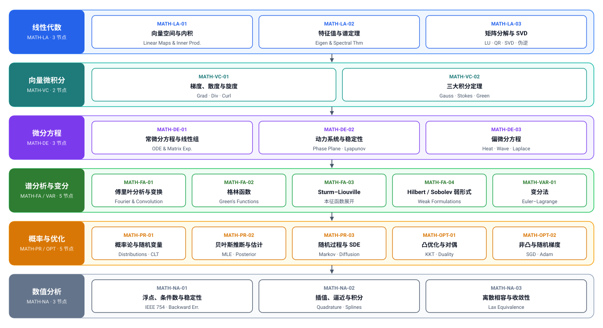

# Mathematics Knowledge Graph｜数学知识图谱

> Layer 1 of the MPCE chain: **Mathematical Principle** → Physical Principle → Mathematical Model → Computational Method → Engineering Application → Research Frontier.
> MPCE 链条第一层：**数学原理**。本文件登记 21 个基础数学节点（`MATH-*`）。
> Master overview / 总览：[`../KNOWLEDGE_GRAPH.md`](../KNOWLEDGE_GRAPH.md) · Sibling layers / 其他层：[physics](physics_graph.md) · [computational](computational_graph.md) · [engineering](engineering_graph.md)

## 1. Sub-domain codes｜子领域代码

| Code | Sub-domain (EN) | 子领域 (中文) | Nodes |
|---|---|---|---|
| `LA` | Linear Algebra | 线性代数 | `MATH-LA-01`–`03` |
| `VC` | Vector Calculus | 向量微积分 | `MATH-VC-01`–`02` |
| `DE` | Differential Equations | 微分方程 | `MATH-DE-01`–`03` |
| `FA` | Fourier & Functional Analysis | 傅里叶与泛函分析 | `MATH-FA-01`–`04` |
| `VAR` | Calculus of Variations | 变分法 | `MATH-VAR-01` |
| `OPT` | Optimization | 最优化 | `MATH-OPT-01`–`02` |
| `PR` | Probability & Stochastics | 概率与随机分析 | `MATH-PR-01`–`03` |
| `NA` | Numerical Analysis | 数值分析 | `MATH-NA-01`–`03` |

## 2. Prerequisite graph｜先修关系图

Arrows point from prerequisite to dependent node (`A --> B` means "A is a prerequisite of B"). This diagram contains exactly the **Prerequisites** edges of the registry below.
箭头由先修节点指向后继节点；图中边与下方登记表的"先修"字段一一对应。

## 3. Node registry｜节点登记表

Field order is fixed (10 fields). "—" means no direct, rigorous link exists; we do not invent one.
字段顺序固定（10 个字段）。"—" 表示不存在直接、严格的联系，不做牵强关联。

---

### MATH-LA-01 · Vector Spaces, Linear Maps and Inner Products｜向量空间、线性映射与内积

- **ID**: `MATH-LA-01`
- **English Name**: Vector Spaces, Linear Maps and Inner Products
- **Chinese Name**: 向量空间、线性映射与内积
- **Definition**: A vector space $V$ over a field $\mathbb{F}$ is closed under addition and scalar multiplication; a linear map satisfies $T(\alpha x+\beta y)=\alpha Tx+\beta Ty$ and, in finite dimensions, is represented by a matrix. Rank–nullity: $\dim V=\operatorname{rank}T+\dim\ker T$. An inner product $\langle\cdot,\cdot\rangle$ induces a norm, orthogonality and orthogonal projections (the four fundamental subspaces).
  释义：线性结构 + 内积几何（正交、投影）是所有离散化模型的"语言"。
- **Prerequisites**: — (foundational / 基础节点)
- **Related Mathematics**: `MATH-LA-02`, `MATH-LA-03`, `MATH-FA-04`, `MATH-DE-01`
- **Related Physics**: `PHYS-QM-01` (state space is a complex inner-product space), `PHYS-CM-01` (forces/velocities as vectors, superposition)
- **Computational Methods**: `COMP-01`, `COMP-02`
- **Engineering Applications**: `ENG-AI-01` (features as vectors, linear layers), `ENG-ROB-02` (Jacobians as linear maps between joint and task velocities)
- **References**: G. Strang, *Introduction to Linear Algebra*, 5th ed., Wellesley-Cambridge Press, 2016; S. Axler, *Linear Algebra Done Right*, 3rd ed., Springer, 2015; MIT OCW 18.06 *Linear Algebra*.

---

### MATH-LA-02 · Eigenvalue Problems and the Spectral Theorem｜特征值问题与谱定理

- **ID**: `MATH-LA-02`
- **English Name**: Eigenvalue Problems and the Spectral Theorem
- **Chinese Name**: 特征值问题与谱定理
- **Definition**: $Ax=\lambda x,\ x\neq 0$. If $A=A^{*}$ (self-adjoint), all eigenvalues are real and there is an orthonormal eigenbasis, $A=Q\Lambda Q^{*}$. Generalized problem $Kx=\lambda Mx$ with $M$ SPD. Courant–Fischer: $\lambda_k=\min_{\dim S=k}\max_{x\in S\setminus 0} x^{*}Ax/x^{*}x$ (Rayleigh quotient).
  释义：自伴算子可被正交对角化；特征值刻画频率、能级、稳定性与条件数。
- **Prerequisites**: `MATH-LA-01`
- **Related Mathematics**: `MATH-LA-03`, `MATH-DE-01`, `MATH-DE-02`, `MATH-FA-03`, `MATH-VAR-01` (Rayleigh quotient is a variational principle)
- **Related Physics**: `PHYS-QM-01` ($\hat H\psi=E\psi$), `PHYS-CM-02` (normal modes $M\ddot q+Kq=0$), `PHYS-SS-01` (band energies $E_n(\mathbf k)$), `PHYS-EL-01` (principal stresses, vibration modes)
- **Computational Methods**: `COMP-03`, `COMP-07` (FEM yields $Kx=\lambda Mx$)
- **Engineering Applications**: `ENG-AI-02` (PCA), `ENG-MAT-02` (Kohn–Sham eigenproblem), `ENG-SEMI-02` (Schrödinger–Poisson subbands), `ENG-MFG-02` (modal analysis)
- **References**: R. A. Horn & C. R. Johnson, *Matrix Analysis*, 2nd ed., Cambridge Univ. Press, 2012; B. N. Parlett, *The Symmetric Eigenvalue Problem*, SIAM, 1998; Strang (2016).

---

### MATH-LA-03 · Matrix Decompositions and the SVD｜矩阵分解与奇异值分解

- **ID**: `MATH-LA-03`
- **English Name**: Matrix Decompositions and the Singular Value Decomposition
- **Chinese Name**: 矩阵分解与奇异值分解
- **Definition**: Factorizations $PA=LU$, $A=LL^{T}$ (Cholesky, SPD), $A=QR$, Schur $A=QTQ^{*}$, and SVD $A=U\Sigma V^{T}$ with $\sigma_1\ge\dots\ge\sigma_r>0$. Eckart–Young: the truncated SVD $A_k$ is the best rank-$k$ approximation in the 2- and Frobenius norms. The pseudo-inverse $A^{+}=V\Sigma^{+}U^{T}$ gives the minimum-norm least-squares solution.
  释义：分解把矩阵拆成结构简单的因子，是求解、压缩、正则化的核心工具。
- **Prerequisites**: `MATH-LA-01`, `MATH-LA-02`
- **Related Mathematics**: `MATH-NA-01`, `MATH-OPT-01` (least squares), `MATH-PR-02` (Gaussian posteriors via Cholesky)
- **Related Physics**: `PHYS-EL-01` (polar decomposition of the deformation gradient, principal axes)
- **Computational Methods**: `COMP-01`, `COMP-03`, `COMP-11` (truncated-SVD regularization)
- **Engineering Applications**: `ENG-AI-02` (PCA/POD), `ENG-MED-02` (regularized reconstruction), `ENG-ROB-02` (Jacobian pseudo-inverse for redundant manipulators)
- **References**: L. N. Trefethen & D. Bau III, *Numerical Linear Algebra*, SIAM, 1997; G. H. Golub & C. F. Van Loan, *Matrix Computations*, 4th ed., Johns Hopkins Univ. Press, 2013; C. Eckart & G. Young, *Psychometrika* 1(3):211–218, 1936.

---

### MATH-VC-01 · Vector Calculus: Gradient, Divergence, Curl｜向量微积分：梯度、散度、旋度

- **ID**: `MATH-VC-01`
- **English Name**: Vector Calculus — Gradient, Divergence, Curl
- **Chinese Name**: 向量微积分：梯度、散度、旋度
- **Definition**: Differential operators on fields in $\mathbb R^3$: $\nabla\phi$, $\nabla\cdot\mathbf F$, $\nabla\times\mathbf F$, Laplacian $\Delta=\nabla\cdot\nabla$; identities $\nabla\times\nabla\phi=0$, $\nabla\cdot(\nabla\times\mathbf F)=0$; extension to tensor fields (e.g. $\nabla\cdot\boldsymbol\sigma$) and curvilinear coordinates.
  释义：场论的微分语言，所有连续介质与电磁方程都用它书写。
- **Prerequisites**: `MATH-LA-01`
- **Related Mathematics**: `MATH-VC-02`, `MATH-DE-03`
- **Related Physics**: `PHYS-EM-01`, `PHYS-FL-01`, `PHYS-TR-01`, `PHYS-EL-01`
- **Computational Methods**: `COMP-06`, `COMP-07`, `COMP-08`
- **Engineering Applications**: `ENG-SEMI-02` (electrostatic potential and current densities), `ENG-MFG-02` (heat flux and stress divergence)
- **References**: J. E. Marsden & A. Tromba, *Vector Calculus*, 6th ed., W. H. Freeman, 2012; H. M. Schey, *Div, Grad, Curl, and All That*, 4th ed., W. W. Norton, 2005.

---

### MATH-VC-02 · Integral Theorems: Gauss, Stokes, Green｜积分定理：高斯、斯托克斯、格林

- **ID**: `MATH-VC-02`
- **English Name**: Integral Theorems (Divergence, Stokes, Green) and Transport Theorem
- **Chinese Name**: 积分定理：散度定理、斯托克斯定理、格林恒等式与输运定理
- **Definition**: $\int_\Omega\nabla\cdot\mathbf F\,dV=\oint_{\partial\Omega}\mathbf F\cdot\mathbf n\,dS$; $\int_S(\nabla\times\mathbf F)\cdot\mathbf n\,dS=\oint_{\partial S}\mathbf F\cdot d\mathbf l$; Green's identities; Reynolds transport theorem. Together they make the integral balance $\frac{d}{dt}\int_\Omega u\,dV=-\oint_{\partial\Omega}\mathbf F\cdot\mathbf n\,dS+\int_\Omega s\,dV$ equivalent (for smooth fields) to the local law $\partial_t u+\nabla\cdot\mathbf F=s$.
  释义：把"体积内的变化 = 边界通量"变成局部微分方程，是守恒律与弱形式的桥梁。
- **Prerequisites**: `MATH-VC-01`
- **Related Mathematics**: `MATH-DE-03`, `MATH-FA-02` (Green's identities), `MATH-FA-04` (integration by parts → weak forms)
- **Related Physics**: `PHYS-CL-01`, `PHYS-EM-01` (integral form of Maxwell), `PHYS-FL-01`
- **Computational Methods**: `COMP-08` (FVM is the discrete divergence theorem), `COMP-07` (weak form)
- **Engineering Applications**: `ENG-MFG-02`, `ENG-SEMI-02` (box-method current balance)
- **References**: Marsden & Tromba (2012); Schey (2005); P. K. Kundu, I. M. Cohen & D. R. Dowling, *Fluid Mechanics*, 6th ed., Academic Press, 2016 (Reynolds transport theorem).

---

### MATH-DE-01 · Ordinary Differential Equations and Linear Systems｜常微分方程与线性系统

- **ID**: `MATH-DE-01`
- **English Name**: Ordinary Differential Equations and Linear Systems
- **Chinese Name**: 常微分方程与线性系统
- **Definition**: Initial value problem $\dot x=f(t,x)$, $x(t_0)=x_0$; Picard–Lindelöf: a unique local solution exists if $f$ is Lipschitz in $x$. Linear systems $\dot x=Ax$ have solution $x(t)=e^{At}x_0$, whose behaviour is governed by the eigenvalues (and Jordan structure) of $A$.
  释义：描述有限维状态随时间演化；线性情形完全由矩阵指数与特征值决定。
- **Prerequisites**: `MATH-LA-02`
- **Related Mathematics**: `MATH-DE-02`, `MATH-FA-03`, `MATH-PR-03`
- **Related Physics**: `PHYS-CM-01`, `PHYS-CM-03`
- **Computational Methods**: `COMP-05`
- **Engineering Applications**: `ENG-ROB-02` (joint-space dynamics), `ENG-ROB-03` (motion models)
- **References**: W. E. Boyce & R. C. DiPrima, *Elementary Differential Equations and Boundary Value Problems*, 11th ed., Wiley, 2017; M. W. Hirsch, S. Smale & R. L. Devaney, *Differential Equations, Dynamical Systems, and an Introduction to Chaos*, 3rd ed., Academic Press, 2013.

---

### MATH-DE-02 · Dynamical Systems and Stability Theory｜动力系统与稳定性理论

- **ID**: `MATH-DE-02`
- **English Name**: Dynamical Systems and Stability Theory
- **Chinese Name**: 动力系统与稳定性理论
- **Definition**: A flow $\varphi_t$ on a state space; equilibria and their linearization (Hartman–Grobman for hyperbolic points); Lyapunov stability: if $V>0$ and $\dot V\le 0$ along trajectories, the equilibrium is stable ($\dot V<0$: asymptotically stable). Also limit cycles, bifurcations, chaos, and structure-preserving (symplectic, volume-preserving) flows.
  释义：研究轨道的长期行为与稳定性，是控制、训练动力学与湍流转捩的共同框架。
- **Prerequisites**: `MATH-DE-01`, `MATH-LA-02`
- **Related Mathematics**: `MATH-PR-03` (stochastic dynamics), `MATH-NA-03` (numerical stability via the test equation $\dot y=\lambda y$), `MATH-OPT-02` (gradient descent as a discretized gradient flow)
- **Related Physics**: `PHYS-CM-03` (Hamiltonian flows, Liouville theorem), `PHYS-FL-01` (hydrodynamic stability, transition to turbulence)
- **Computational Methods**: `COMP-05`, `COMP-10` (observability, error-covariance stability)
- **Engineering Applications**: `ENG-ROB-02` (Lyapunov-based control design), `ENG-ROB-01`, `ENG-AI-01` (training dynamics, neural ODEs)
- **References**: S. H. Strogatz, *Nonlinear Dynamics and Chaos*, 2nd ed., Westview Press, 2015; H. K. Khalil, *Nonlinear Systems*, 3rd ed., Prentice Hall, 2002; Hirsch, Smale & Devaney (2013).

---

### MATH-DE-03 · Partial Differential Equations｜偏微分方程

- **ID**: `MATH-DE-03`
- **English Name**: Partial Differential Equations (classification and well-posedness)
- **Chinese Name**: 偏微分方程（分类与适定性）
- **Definition**: Equations for $u(\mathbf x,t)$ involving partial derivatives. Second-order linear prototypes: elliptic $-\Delta u=f$ (Poisson), parabolic $u_t=\kappa\Delta u$ (heat), hyperbolic $u_{tt}=c^2\Delta u$ (wave). A problem is well-posed (Hadamard) if a solution exists, is unique, and depends continuously on data; well-posedness dictates which initial/boundary conditions are admissible. Nonlinear examples: conservation laws, Navier–Stokes, drift–diffusion.
  释义：连续介质、场与输运的统一数学模型；类型决定解的性质与可用算法。
- **Prerequisites**: `MATH-VC-01`, `MATH-VC-02`, `MATH-DE-01`
- **Related Mathematics**: `MATH-FA-01`, `MATH-FA-02`, `MATH-FA-03`, `MATH-FA-04`, `MATH-NA-03`
- **Related Physics**: `PHYS-EM-01`, `PHYS-FL-01`, `PHYS-TR-01`, `PHYS-EL-01`, `PHYS-QM-01`, `PHYS-SS-03`
- **Computational Methods**: `COMP-06`, `COMP-07`, `COMP-08`, `COMP-12`, `COMP-13`
- **Engineering Applications**: `ENG-SEMI-02`, `ENG-MFG-02`, `ENG-HPC-02`
- **References**: L. C. Evans, *Partial Differential Equations*, 2nd ed., AMS, 2010; W. A. Strauss, *Partial Differential Equations: An Introduction*, 2nd ed., Wiley, 2008.

---

### MATH-FA-01 · Fourier Analysis and Transforms｜傅里叶分析与变换

- **ID**: `MATH-FA-01`
- **English Name**: Fourier Series and Fourier Transform
- **Chinese Name**: 傅里叶级数与傅里叶变换
- **Definition**: $\hat f(\mathbf k)=\int f(\mathbf x)e^{-i\mathbf k\cdot\mathbf x}d\mathbf x$; Fourier series on periodic domains; Plancherel (the transform is unitary on $L^2$ up to normalization); convolution theorem $\widehat{f*g}=\hat f\,\hat g$; differentiation becomes multiplication, $\widehat{\partial_x f}=ik\hat f$; Shannon sampling theorem; the DFT is its finite-dimensional analogue (diagonalizes circulant matrices).
  释义：把平移不变线性算子对角化；卷积 ↔ 乘积，微分 ↔ 乘以 $ik$。
- **Prerequisites**: `MATH-LA-01`
- **Related Mathematics**: `MATH-FA-03`, `MATH-FA-04`, `MATH-DE-03`, `MATH-PR-01` (characteristic functions)
- **Related Physics**: `PHYS-QM-01` (position–momentum representations), `PHYS-SS-01` (reciprocal lattice, Bloch waves), `PHYS-TR-01` (heat kernel), `PHYS-EM-01` (frequency-domain fields)
- **Computational Methods**: `COMP-04`, `COMP-13` (Fourier Neural Operator)
- **Engineering Applications**: `ENG-MED-02` (MRI k-space, CT Fourier-slice theorem), `ENG-MAT-02` (plane-wave basis), `ENG-SEMI-01` (Fourier optics in lithography imaging)
- **References**: E. M. Stein & R. Shakarchi, *Fourier Analysis: An Introduction*, Princeton Univ. Press, 2003; R. N. Bracewell, *The Fourier Transform and Its Applications*, 3rd ed., McGraw-Hill, 2000; A. V. Oppenheim & R. W. Schafer, *Discrete-Time Signal Processing*, 3rd ed., Pearson, 2010.

---

### MATH-FA-02 · Green's Functions｜格林函数

- **ID**: `MATH-FA-02`
- **English Name**: Green's Functions
- **Chinese Name**: 格林函数
- **Definition**: For a linear differential operator $L$ with homogeneous boundary conditions, $G$ solves $L\,G(\mathbf x,\boldsymbol\xi)=\delta(\mathbf x-\boldsymbol\xi)$, so $u(\mathbf x)=\int G(\mathbf x,\boldsymbol\xi)f(\boldsymbol\xi)\,d\boldsymbol\xi$ solves $Lu=f$. Example: for $-\Delta$ in $\mathbb R^3$, $G=1/(4\pi\lVert\mathbf x-\boldsymbol\xi\rVert)$. Boundary data enter through Green's identities.
  释义：线性问题的"脉冲响应"；解 = 格林函数与源项的积分（叠加原理）。
- **Prerequisites**: `MATH-DE-03`, `MATH-VC-02`
- **Related Mathematics**: `MATH-FA-03` (eigenfunction expansion of $G$), `MATH-FA-01` (translation-invariant $G$ via Fourier transform)
- **Related Physics**: `PHYS-EM-01` (Coulomb and retarded potentials), `PHYS-QM-01` (propagator), `PHYS-TR-01` (heat kernel)
- **Computational Methods**: `COMP-11` (integral forward operators), `COMP-13` (neural operators parameterize kernel integral operators)
- **Engineering Applications**: `ENG-MED-02` (point-spread function of an imaging system), `ENG-SEMI-02` (non-equilibrium Green's function quantum transport)
- **References**: I. Stakgold & M. Holst, *Green's Functions and Boundary Value Problems*, 3rd ed., Wiley, 2011; D. G. Duffy, *Green's Functions with Applications*, 2nd ed., CRC Press, 2015; J. D. Jackson, *Classical Electrodynamics*, 3rd ed., Wiley, 1999.

---

### MATH-FA-03 · Sturm–Liouville Theory and Eigenfunction Expansions｜施图姆–刘维尔理论与本征函数展开

- **ID**: `MATH-FA-03`
- **English Name**: Sturm–Liouville Theory and Eigenfunction Expansions
- **Chinese Name**: 施图姆–刘维尔理论与本征函数展开
- **Definition**: $-(p\,y')'+q\,y=\lambda\,w\,y$ on $[a,b]$ with separated boundary conditions ($p,w>0$). The operator is self-adjoint in $L^2_w$; regular problems have real simple eigenvalues $\lambda_1<\lambda_2<\dots\to\infty$ with $w$-orthogonal eigenfunctions forming a complete basis — the rigorous basis of separation of variables.
  释义：谱定理在无穷维微分算子上的体现；分离变量法的理论基础。
- **Prerequisites**: `MATH-DE-01`, `MATH-LA-02`
- **Related Mathematics**: `MATH-FA-01`, `MATH-FA-02`, `MATH-FA-04`, `MATH-DE-03`, `MATH-VAR-01` (Rayleigh-quotient characterization)
- **Related Physics**: `PHYS-QM-01` (1D Schrödinger equation is Sturm–Liouville), `PHYS-TR-01` (conduction modes), `PHYS-EL-01` (vibration of strings and bars)
- **Computational Methods**: `COMP-03`, `COMP-04` (spectral methods)
- **Engineering Applications**: `ENG-SEMI-02` (subbands in MOS inversion layers), `ENG-MFG-02` (modal decomposition of transient conduction)
- **References**: R. Courant & D. Hilbert, *Methods of Mathematical Physics*, Vol. I, Wiley-Interscience, 1953; R. Haberman, *Applied Partial Differential Equations with Fourier Series and Boundary Value Problems*, 5th ed., Pearson, 2013.

---

### MATH-FA-04 · Hilbert and Sobolev Spaces, Weak Formulations｜希尔伯特/索伯列夫空间与弱形式

- **ID**: `MATH-FA-04`
- **English Name**: Hilbert and Sobolev Spaces and Weak Formulations
- **Chinese Name**: 希尔伯特空间、索伯列夫空间与弱形式
- **Definition**: Hilbert space = complete inner-product space (Riesz representation). $H^1(\Omega)=\{u\in L^2:\nabla u\in L^2\}$. Weak form: find $u\in V$ with $a(u,v)=\ell(v)\ \forall v\in V$, obtained by multiplying by a test function and integrating by parts. Lax–Milgram: if $a$ is bounded and coercive and $\ell$ bounded, a unique solution exists with $\lVert u\rVert_V\le\lVert\ell\rVert_{V'}/\alpha$.
  释义：在函数空间中重新表述 PDE，给出存在唯一性，并直接导出有限元法。
- **Prerequisites**: `MATH-LA-01`, `MATH-VC-02`
- **Related Mathematics**: `MATH-DE-03`, `MATH-VAR-01`, `MATH-FA-03`, `MATH-NA-02`
- **Related Physics**: `PHYS-QM-01` (states in $L^2$), `PHYS-EL-01` (principle of virtual work is the weak form)
- **Computational Methods**: `COMP-07`, `COMP-13` (operators between function spaces)
- **Engineering Applications**: `ENG-MFG-02`
- **References**: H. Brezis, *Functional Analysis, Sobolev Spaces and Partial Differential Equations*, Springer, 2011; E. Kreyszig, *Introductory Functional Analysis with Applications*, Wiley, 1978; S. C. Brenner & L. R. Scott, *The Mathematical Theory of Finite Element Methods*, 3rd ed., Springer, 2008.

---

### MATH-VAR-01 · Calculus of Variations｜变分法

- **ID**: `MATH-VAR-01`
- **English Name**: Calculus of Variations
- **Chinese Name**: 变分法
- **Definition**: Extremize a functional $J[u]=\int_\Omega L(\mathbf x,u,\nabla u)\,d\mathbf x$. Necessary condition (Euler–Lagrange): $\partial L/\partial u-\nabla\cdot(\partial L/\partial\nabla u)=0$. Constraints via Lagrange multipliers; existence via the direct method (coercivity + weak lower semicontinuity); Ritz/Galerkin approximation restricts $u$ to a finite-dimensional subspace.
  释义："自然选择极值"——力学、弹性、量子基态与有限元均源于变分原理。
- **Prerequisites**: `MATH-DE-01`, `MATH-VC-02`
- **Related Mathematics**: `MATH-FA-04`, `MATH-OPT-01`, `MATH-FA-03`, `MATH-LA-02`
- **Related Physics**: `PHYS-CM-02` (Hamilton's principle), `PHYS-EL-01` (minimum potential energy), `PHYS-QM-02` (energy-functional minimization), `PHYS-CL-01` (Noether's theorem), `PHYS-TD-01` (free-energy minimization)
- **Computational Methods**: `COMP-07` (Ritz–Galerkin), `COMP-12` (Deep Ritz / energy-based PINN losses)
- **Engineering Applications**: `ENG-ROB-02` (optimal control / trajectory optimization), `ENG-MAT-01` (phase-field models as gradient flows of free energy), `ENG-MED-02` (variational image reconstruction, e.g. total variation)
- **References**: I. M. Gelfand & S. V. Fomin, *Calculus of Variations*, Prentice-Hall, 1963 (Dover reprint 2000); C. Lanczos, *The Variational Principles of Mechanics*, 4th ed., Dover, 1986; Courant & Hilbert (1953).

---

### MATH-OPT-01 · Convex Optimization and Duality｜凸优化与对偶理论

- **ID**: `MATH-OPT-01`
- **English Name**: Convex Optimization and Duality
- **Chinese Name**: 凸优化与对偶理论
- **Definition**: $\min f_0(x)$ s.t. $f_i(x)\le 0$, $Ax=b$, with $f_0,f_i$ convex: every local minimum is global. Lagrangian $\mathcal L=f_0+\sum\lambda_i f_i+\nu^{T}(Ax-b)$, dual function, weak duality; under Slater's condition strong duality holds and the KKT conditions are necessary and sufficient. Standard classes: least squares, LP, QP, SOCP, SDP. Legendre–Fenchel conjugate $f^{*}(y)=\sup_x(y^{T}x-f(x))$.
  释义：可证全局最优、可高效求解的优化类；KKT 与对偶统一了约束问题。
- **Prerequisites**: `MATH-LA-01`, `MATH-LA-03`
- **Related Mathematics**: `MATH-OPT-02`, `MATH-VAR-01`, `MATH-PR-02` (MAP estimation as regularized optimization)
- **Related Physics**: `PHYS-TD-01` (thermodynamic potentials are Legendre transforms; convexity ↔ stability), `PHYS-SM-01` (maximum-entropy principle is a convex program), `PHYS-CM-03` (Legendre transform $L\to H$)
- **Computational Methods**: `COMP-11`, `COMP-15`
- **Engineering Applications**: `ENG-AI-01` (SVM, logistic regression), `ENG-ROB-02` (MPC as QP), `ENG-MED-02` (compressed sensing with $\ell_1$)
- **References**: S. Boyd & L. Vandenberghe, *Convex Optimization*, Cambridge Univ. Press, 2004; R. T. Rockafellar, *Convex Analysis*, Princeton Univ. Press, 1970; Stanford EE364a.

---

### MATH-OPT-02 · Nonconvex and Stochastic Gradient Optimization｜非凸与随机梯度优化

- **ID**: `MATH-OPT-02`
- **English Name**: Nonconvex and Stochastic Gradient-Based Optimization
- **Chinese Name**: 非凸与随机梯度优化
- **Definition**: $\min_\theta F(\theta)=\mathbb E_\xi[f(\theta;\xi)]$. Gradient descent $\theta_{k+1}=\theta_k-\eta\nabla F(\theta_k)$; SGD replaces $\nabla F$ by an unbiased stochastic estimate. For $L$-smooth $F$ with step $\eta\le 1/L$, GD guarantees $\min_{k<K}\lVert\nabla F(\theta_k)\rVert^2=O(1/K)$ (stationarity, not global optimality). Momentum, adaptive methods (Adam), and second-order Newton/quasi-Newton methods.
  释义：深度学习与大规模工程优化的主力；一般只能保证收敛到驻点。
- **Prerequisites**: `MATH-OPT-01`, `MATH-PR-01`
- **Related Mathematics**: `MATH-DE-02` (gradient flow), `MATH-LA-02` (Hessian spectrum governs conditioning)
- **Related Physics**: `PHYS-SM-01` (Langevin dynamics and simulated annealing sample Boltzmann distributions)
- **Computational Methods**: `COMP-15`, `COMP-12`
- **Engineering Applications**: `ENG-AI-01`, `ENG-MFG-01` (gradient-based topology/process optimization)
- **References**: J. Nocedal & S. J. Wright, *Numerical Optimization*, 2nd ed., Springer, 2006; L. Bottou, F. E. Curtis & J. Nocedal, "Optimization Methods for Large-Scale Machine Learning," *SIAM Review* 60(2):223–311, 2018; D. P. Kingma & J. Ba, "Adam: A Method for Stochastic Optimization," ICLR 2015.

---

### MATH-PR-01 · Probability Theory and Random Variables｜概率论与随机变量

- **ID**: `MATH-PR-01`
- **English Name**: Probability Theory and Random Variables
- **Chinese Name**: 概率论与随机变量
- **Definition**: Probability space $(\Omega,\mathcal F,P)$; random variables, distributions, expectation, variance, covariance matrix $\Sigma=\mathbb E[(X-\mu)(X-\mu)^{T}]$ (SPD). Law of large numbers; central limit theorem $\sqrt n(\bar X_n-\mu)\Rightarrow\mathcal N(0,\sigma^2)$.
  释义：不确定性的公理化语言；大数定律与中心极限定理支撑统计与蒙特卡罗。
- **Prerequisites**: — (foundational; assumes calculus / 基础节点)
- **Related Mathematics**: `MATH-PR-02`, `MATH-PR-03`, `MATH-FA-01`
- **Related Physics**: `PHYS-SM-01`, `PHYS-QM-01` (Born rule)
- **Computational Methods**: `COMP-09`
- **Engineering Applications**: `ENG-AI-01`, `ENG-SEMI-01` (process variability and yield)
- **References**: J. K. Blitzstein & J. Hwang, *Introduction to Probability*, 2nd ed., CRC Press, 2019; R. Durrett, *Probability: Theory and Examples*, 5th ed., Cambridge Univ. Press, 2019.

---

### MATH-PR-02 · Bayesian Inference and Estimation｜贝叶斯推断与估计

- **ID**: `MATH-PR-02`
- **English Name**: Bayesian Inference and Estimation
- **Chinese Name**: 贝叶斯推断与估计
- **Definition**: $p(\theta\mid y)\propto p(y\mid\theta)\,p(\theta)$. Point estimates: MAP (mode) and MMSE (posterior mean). For linear-Gaussian models $y=A\theta+\varepsilon$, the posterior is Gaussian in closed form; a Gaussian prior corresponds to Tikhonov regularization in the MAP problem.
  释义：用先验 + 数据得到后验；正则化 = 先验，是反问题、滤波与概率机器学习的共同基础。
- **Prerequisites**: `MATH-PR-01`, `MATH-LA-03`
- **Related Mathematics**: `MATH-OPT-01`, `MATH-PR-03`
- **Related Physics**: `PHYS-SM-01` (Jaynes' maximum-entropy view of statistical mechanics)
- **Computational Methods**: `COMP-09` (MCMC), `COMP-10` (Kalman filter = recursive Bayes), `COMP-11`
- **Engineering Applications**: `ENG-AI-01`, `ENG-ROB-03`, `ENG-MED-02`
- **References**: A. Gelman et al., *Bayesian Data Analysis*, 3rd ed., CRC Press, 2013; C. M. Bishop, *Pattern Recognition and Machine Learning*, Springer, 2006; E. T. Jaynes, "Information Theory and Statistical Mechanics," *Phys. Rev.* 106:620, 1957.

---

### MATH-PR-03 · Stochastic Processes and Stochastic Differential Equations｜随机过程与随机微分方程

- **ID**: `MATH-PR-03`
- **English Name**: Stochastic Processes and Stochastic Differential Equations
- **Chinese Name**: 随机过程与随机微分方程
- **Definition**: Families $\{X_t\}$; Markov chains with transition kernels and stationary distributions; Brownian motion $W_t$; Itô SDE $dX_t=a(X_t)\,dt+b(X_t)\,dW_t$. The density obeys the Fokker–Planck equation $\partial_t p=-\nabla\cdot(a\,p)+\tfrac12\sum_{ij}\partial_i\partial_j[(bb^{T})_{ij}\,p]$.
  释义：随机演化的数学；连接微观随机运动与宏观扩散方程。
- **Prerequisites**: `MATH-PR-01`, `MATH-DE-01`
- **Related Mathematics**: `MATH-DE-02`, `MATH-DE-03` (Fokker–Planck is a PDE), `MATH-PR-02`
- **Related Physics**: `PHYS-SM-01` (Langevin equation, fluctuation–dissipation), `PHYS-SM-02`, `PHYS-TR-01` (diffusion as a random walk), `PHYS-SS-03` (Einstein relation $D=\mu k_BT/q$)
- **Computational Methods**: `COMP-09`, `COMP-10`
- **Engineering Applications**: `ENG-AI-01` (score-based diffusion models), `ENG-ROB-03` (process-noise models), `ENG-MAT-01` (kinetic Monte Carlo, Langevin thermostats)
- **References**: B. Øksendal, *Stochastic Differential Equations*, 6th ed., Springer, 2003; C. W. Gardiner, *Stochastic Methods*, 4th ed., Springer, 2009; Y. Song et al., "Score-Based Generative Modeling through Stochastic Differential Equations," ICLR 2021.

---

### MATH-NA-01 · Floating-Point Arithmetic, Conditioning and Stability｜浮点运算、条件数与数值稳定性

- **ID**: `MATH-NA-01`
- **English Name**: Floating-Point Arithmetic, Conditioning and Backward Stability
- **Chinese Name**: 浮点运算、条件数与后向稳定性
- **Definition**: IEEE 754 arithmetic $\mathrm{fl}(x\circ y)=(x\circ y)(1+\delta)$, $\lvert\delta\rvert\le u$ (unit roundoff, $u\approx1.1\times10^{-16}$ in double). Condition number $\kappa(A)=\lVert A\rVert\,\lVert A^{-1}\rVert$ measures sensitivity of the problem; an algorithm is backward stable if its output is the exact answer for slightly perturbed data. Rule of thumb: forward error $\lesssim\kappa\times$ backward error.
  释义：区分"问题病态"与"算法不稳定"，是所有数值结果可信度的前提。
- **Prerequisites**: `MATH-LA-01`, `MATH-LA-03`
- **Related Mathematics**: `MATH-NA-02`, `MATH-NA-03`
- **Related Physics**: — (no direct physical law; governs the reliability of every `PHYS-*` simulation)
- **Computational Methods**: `COMP-01`, `COMP-02`, `COMP-03`, `COMP-14` (mixed precision)
- **Engineering Applications**: `ENG-HPC-01`, `ENG-AI-01` (low-precision training)
- **References**: N. J. Higham, *Accuracy and Stability of Numerical Algorithms*, 2nd ed., SIAM, 2002; Trefethen & Bau (1997); IEEE Std 754-2019.

---

### MATH-NA-02 · Interpolation, Approximation and Quadrature｜插值、逼近与数值积分

- **ID**: `MATH-NA-02`
- **English Name**: Interpolation, Approximation Theory and Quadrature
- **Chinese Name**: 插值、逼近论与数值积分
- **Definition**: Approximate $f$ from a finite-dimensional space (polynomials, piecewise polynomials, trigonometric polynomials, neural networks). Chebyshev interpolation converges geometrically for analytic $f$; interpolation error is bounded by the Lebesgue constant times the best-approximation error; $n$-point Gauss quadrature is exact for polynomials of degree $2n-1$; universal approximation: one-hidden-layer networks are dense in $C(K)$.
  释义：用有限个参数表示函数；形函数、谱方法与神经网络都是逼近问题。
- **Prerequisites**: `MATH-LA-01`
- **Related Mathematics**: `MATH-FA-01`, `MATH-FA-04`, `MATH-NA-03`
- **Related Physics**: — (methodological node)
- **Computational Methods**: `COMP-07` (shape functions, Gauss quadrature), `COMP-04` (Chebyshev/Fourier spectral), `COMP-12`, `COMP-13`
- **Engineering Applications**: `ENG-AI-01` (function approximation)
- **References**: L. N. Trefethen, *Approximation Theory and Approximation Practice*, extended ed., SIAM, 2019; E. Süli & D. Mayers, *An Introduction to Numerical Analysis*, Cambridge Univ. Press, 2003; G. Cybenko, *Math. Control Signals Systems* 2:303–314, 1989.

---

### MATH-NA-03 · Consistency, Stability and Convergence of Discretizations｜离散格式的相容性、稳定性与收敛性

- **ID**: `MATH-NA-03`
- **English Name**: Consistency, Stability and Convergence of Discretizations
- **Chinese Name**: 离散格式的相容性、稳定性与收敛性
- **Definition**: Lax equivalence theorem: for a consistent finite-difference scheme approximating a well-posed linear initial-value problem, stability ⇔ convergence. Von Neumann (Fourier) stability analysis; CFL condition $\lvert c\rvert\Delta t/\Delta x\le C$ for explicit hyperbolic schemes; A-stability and stiffness for ODE integrators; Céa's lemma for Galerkin methods.
  释义：判断离散解是否收敛到真解的理论框架。
- **Prerequisites**: `MATH-DE-03`, `MATH-NA-01`, `MATH-FA-01`
- **Related Mathematics**: `MATH-DE-02`, `MATH-NA-02`, `MATH-FA-04`
- **Related Physics**: `PHYS-FL-01` (CFL limits in advection-dominated flow), `PHYS-EM-01` (Yee/FDTD stability limit)
- **Computational Methods**: `COMP-05`, `COMP-06`, `COMP-07`, `COMP-08`
- **Engineering Applications**: `ENG-HPC-02`, `ENG-SEMI-02` (Scharfetter–Gummel stability for drift-dominated currents)
- **References**: R. J. LeVeque, *Finite Difference Methods for Ordinary and Partial Differential Equations*, SIAM, 2007; P. D. Lax & R. D. Richtmyer, *Comm. Pure Appl. Math.* 9:267–293, 1956; J. C. Strikwerda, *Finite Difference Schemes and Partial Differential Equations*, 2nd ed., SIAM, 2004.
