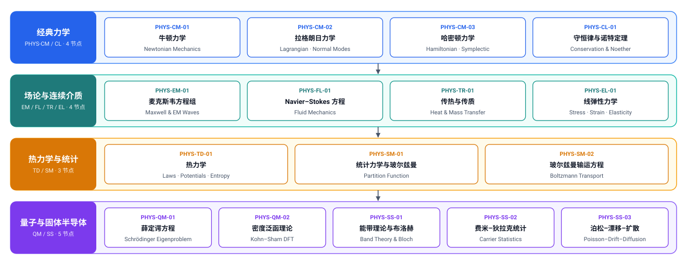

# Physics Knowledge Graph｜物理知识图谱

> Layer 2 of the MPCE chain: Mathematical Principle → **Physical Principle** → Mathematical Model → Computational Method → Engineering Application → Research Frontier.
> MPCE 链条第二层：**物理原理**。本文件登记 16 个基础物理节点（`PHYS-*`）。
> Master overview / 总览：[`../KNOWLEDGE_GRAPH.md`](../KNOWLEDGE_GRAPH.md) · Sibling layers / 其他层：[mathematics](mathematics_graph.md) · [computational](computational_graph.md) · [engineering](engineering_graph.md)

## 1. Sub-domain codes｜子领域代码

| Code | Sub-domain (EN) | 子领域 (中文) | Nodes |
|---|---|---|---|
| `CM` | Classical Mechanics | 经典力学 | `PHYS-CM-01`–`03` |
| `CL` | Conservation Laws | 守恒律 | `PHYS-CL-01` |
| `EM` | Electromagnetism | 电磁学 | `PHYS-EM-01` |
| `FL` | Fluid Mechanics | 流体力学 | `PHYS-FL-01` |
| `TR` | Transport (Heat & Mass) | 输运（传热传质） | `PHYS-TR-01` |
| `EL` | Elasticity / Solid Mechanics | 弹性力学 | `PHYS-EL-01` |
| `TD` | Thermodynamics | 热力学 | `PHYS-TD-01` |
| `SM` | Statistical Mechanics & Kinetic Theory | 统计力学与动理学 | `PHYS-SM-01`–`02` |
| `QM` | Quantum Mechanics | 量子力学 | `PHYS-QM-01`–`02` |
| `SS` | Solid-State & Semiconductor Physics | 固体与半导体物理 | `PHYS-SS-01`–`03` |

## 2. Prerequisite graph｜先修关系图

Solid arrows = **Prerequisites** fields of this registry (including prerequisites drawn from the mathematics layer, shown as grey external nodes).
实线箭头与下方"先修"字段一一对应；灰色节点为来自数学层的外部先修节点。

## 3. Node registry｜节点登记表

Field order is fixed (10 fields). "—" means no direct, rigorous link exists.
字段顺序固定（10 个字段）。"—" 表示不存在直接、严格的联系。

---

### PHYS-CM-01 · Newtonian Mechanics｜牛顿力学

- **ID**: `PHYS-CM-01`
- **English Name**: Newtonian Mechanics
- **Chinese Name**: 牛顿力学
- **Definition**: In an inertial frame, $m\ddot{\mathbf x}=\mathbf F(\mathbf x,\dot{\mathbf x},t)$. For systems of particles, the balance laws of linear and angular momentum follow; conservative forces derive from a potential, $\mathbf F=-\nabla V$, and conserve $E=\tfrac12m\lVert\dot{\mathbf x}\rVert^2+V$.
  释义：以力和加速度描述运动的二阶 ODE 体系。
- **Prerequisites**: `MATH-DE-01`, `MATH-VC-01`
- **Related Mathematics**: `MATH-DE-02`, `MATH-LA-01`
- **Related Physics**: `PHYS-CM-02`, `PHYS-CL-01`
- **Computational Methods**: `COMP-05`
- **Engineering Applications**: `ENG-ROB-02`, `ENG-MAT-02` (molecular dynamics integrates Newton's equations)
- **References**: J. R. Taylor, *Classical Mechanics*, University Science Books, 2005; D. Kleppner & R. Kolenkow, *An Introduction to Mechanics*, 2nd ed., Cambridge Univ. Press, 2014.

---

### PHYS-CM-02 · Lagrangian Mechanics｜拉格朗日力学

- **ID**: `PHYS-CM-02`
- **English Name**: Lagrangian Mechanics
- **Chinese Name**: 拉格朗日力学
- **Definition**: In generalized coordinates $q$, with $L=T-V$, Hamilton's principle $\delta\int_{t_0}^{t_1}L\,dt=0$ yields $\frac{d}{dt}\frac{\partial L}{\partial\dot q}-\frac{\partial L}{\partial q}=Q$ (non-conservative generalized forces $Q$). Linearization about a stable equilibrium gives $M\ddot q+Kq=0$, i.e. the generalized eigenproblem $K\phi=\omega^2M\phi$.
  释义：用能量和变分原理代替力，天然处理约束与广义坐标。
- **Prerequisites**: `PHYS-CM-01`, `MATH-VAR-01`
- **Related Mathematics**: `MATH-LA-02`, `MATH-DE-01`
- **Related Physics**: `PHYS-CM-03`, `PHYS-CL-01` (Noether), `PHYS-EL-01` (Hamilton's principle for elastic continua)
- **Computational Methods**: `COMP-05`, `COMP-03` (normal modes)
- **Engineering Applications**: `ENG-ROB-02` (Euler–Lagrange manipulator dynamics), `ENG-ROB-01`
- **References**: H. Goldstein, C. Poole & J. Safko, *Classical Mechanics*, 3rd ed., Addison-Wesley, 2002; L. D. Landau & E. M. Lifshitz, *Mechanics*, 3rd ed., Pergamon, 1976.

---

### PHYS-CM-03 · Hamiltonian Mechanics｜哈密顿力学

- **ID**: `PHYS-CM-03`
- **English Name**: Hamiltonian Mechanics
- **Chinese Name**: 哈密顿力学
- **Definition**: Legendre transform $H(q,p)=p\cdot\dot q-L$ with $p=\partial L/\partial\dot q$; Hamilton's equations $\dot q=\partial H/\partial p$, $\dot p=-\partial H/\partial q$. The flow is symplectic and preserves phase-space volume (Liouville's theorem); Poisson brackets $\{f,H\}$ give time evolution and become commutators under canonical quantization.
  释义：相空间中的一阶辛结构；通向统计力学、量子力学与辛积分器。
- **Prerequisites**: `PHYS-CM-02`, `MATH-DE-01`
- **Related Mathematics**: `MATH-DE-02`, `MATH-OPT-01` (Legendre–Fenchel transform)
- **Related Physics**: `PHYS-SM-01` (Liouville theorem underlies ensembles), `PHYS-QM-01` (canonical quantization)
- **Computational Methods**: `COMP-05` (symplectic integrators), `COMP-09` (Hamiltonian Monte Carlo)
- **Engineering Applications**: `ENG-MAT-02` (velocity-Verlet MD), `ENG-AI-01` (HMC for Bayesian learning), `ENG-ROB-02` (energy-based/passivity control)
- **References**: V. I. Arnold, *Mathematical Methods of Classical Mechanics*, 2nd ed., Springer, 1989; Goldstein et al. (2002); R. M. Neal, "MCMC Using Hamiltonian Dynamics," in *Handbook of Markov Chain Monte Carlo*, CRC Press, 2011.

---

### PHYS-CL-01 · Conservation Laws and Noether's Theorem｜守恒律与诺特定理

- **ID**: `PHYS-CL-01`
- **English Name**: Conservation Laws and Noether's Theorem
- **Chinese Name**: 守恒律与诺特定理
- **Definition**: Balance law $\partial_t u+\nabla\cdot\mathbf F(u)=s$ for mass, momentum, energy and charge (integral form via `MATH-VC-02`). Noether: every continuous symmetry of the action yields a conserved quantity — time translation → energy, space translation → momentum, rotation → angular momentum, global gauge phase → charge.
  释义：守恒律是所有连续介质与输运模型的骨架；诺特定理把对称性与守恒量一一对应。
- **Prerequisites**: `MATH-VC-02`, `MATH-VAR-01`
- **Related Mathematics**: `MATH-DE-03`
- **Related Physics**: `PHYS-CM-02`, `PHYS-FL-01`, `PHYS-EM-01` (charge continuity), `PHYS-TR-01`, `PHYS-SS-03` (carrier continuity)
- **Computational Methods**: `COMP-08` (conservative discretization)
- **Engineering Applications**: `ENG-MFG-02`, `ENG-SEMI-02`
- **References**: E. Noether, "Invariante Variationsprobleme," *Nachr. Ges. Wiss. Göttingen*, 235–257, 1918 (Engl. transl. M. A. Tavel, *Transport Theory Stat. Phys.* 1:183–207, 1971); R. J. LeVeque, *Finite Volume Methods for Hyperbolic Problems*, Cambridge Univ. Press, 2002.

---

### PHYS-EM-01 · Maxwell's Equations｜麦克斯韦方程组

- **ID**: `PHYS-EM-01`
- **English Name**: Maxwell's Equations
- **Chinese Name**: 麦克斯韦方程组
- **Definition**: $\nabla\cdot\mathbf D=\rho$, $\nabla\cdot\mathbf B=0$, $\nabla\times\mathbf E=-\partial_t\mathbf B$, $\nabla\times\mathbf H=\mathbf J+\partial_t\mathbf D$, with constitutive laws $\mathbf D=\varepsilon\mathbf E$, $\mathbf B=\mu\mathbf H$, $\mathbf J=\sigma\mathbf E$. They imply charge continuity $\partial_t\rho+\nabla\cdot\mathbf J=0$; the electrostatic limit is $-\nabla\cdot(\varepsilon\nabla\phi)=\rho$.
  释义：经典电磁场的完整方程；静电极限即器件仿真中的泊松方程。
- **Prerequisites**: `MATH-VC-01`, `MATH-VC-02`
- **Related Mathematics**: `MATH-DE-03`, `MATH-FA-01`, `MATH-FA-02`
- **Related Physics**: `PHYS-CL-01`, `PHYS-SS-03` (Poisson equation)
- **Computational Methods**: `COMP-06` (FDTD, Yee scheme), `COMP-07` (edge elements), `COMP-04`
- **Engineering Applications**: `ENG-SEMI-02`, `ENG-SEMI-01` (interconnect parasitics, signal integrity), `ENG-MED-01` (MRI RF coils, electrical impedance tomography)
- **References**: D. J. Griffiths, *Introduction to Electrodynamics*, 4th ed., Pearson, 2013; J. D. Jackson, *Classical Electrodynamics*, 3rd ed., Wiley, 1999; K. S. Yee, *IEEE Trans. Antennas Propag.* 14(3):302–307, 1966.

---

### PHYS-FL-01 · Navier–Stokes Equations｜纳维–斯托克斯方程

- **ID**: `PHYS-FL-01`
- **English Name**: Navier–Stokes Equations
- **Chinese Name**: 纳维–斯托克斯方程
- **Definition**: Incompressible Newtonian fluid: $\rho(\partial_t\mathbf u+\mathbf u\cdot\nabla\mathbf u)=-\nabla p+\mu\Delta\mathbf u+\mathbf f$, $\nabla\cdot\mathbf u=0$ (momentum and mass conservation with a linear viscous stress). Reynolds number $Re=UL/\nu$ measures inertia vs. viscosity; the compressible form couples an energy equation and equation of state.
  释义：牛顿流体的动量与质量守恒；非线性对流项导致湍流与多尺度难题。
- **Prerequisites**: `PHYS-CL-01`, `MATH-VC-01`, `MATH-DE-03`
- **Related Mathematics**: `MATH-DE-02` (hydrodynamic stability, turbulence), `MATH-NA-03`
- **Related Physics**: `PHYS-TR-01` (convective heat transfer), `PHYS-SM-02` (Chapman–Enskog derivation from kinetic theory)
- **Computational Methods**: `COMP-08`, `COMP-07`, `COMP-04` (spectral DNS), `COMP-13` (operator-learning benchmarks)
- **Engineering Applications**: `ENG-MFG-02` (conjugate heat transfer, cooling), `ENG-HPC-02` (CFD), `ENG-MED-01` (hemodynamics)
- **References**: G. K. Batchelor, *An Introduction to Fluid Dynamics*, Cambridge Univ. Press, 1967; Kundu, Cohen & Dowling, *Fluid Mechanics*, 6th ed., Academic Press, 2016; J. H. Ferziger, M. Perić & R. L. Street, *Computational Methods for Fluid Dynamics*, 4th ed., Springer, 2020.

---

### PHYS-TR-01 · Heat and Mass Transfer｜传热与传质

- **ID**: `PHYS-TR-01`
- **English Name**: Heat and Mass Transfer (Diffusion–Convection)
- **Chinese Name**: 传热与传质（扩散–对流）
- **Definition**: Fourier's law $\mathbf q=-k\nabla T$ and Fick's law $\mathbf J=-D\nabla c$, combined with conservation: $\rho c_p(\partial_tT+\mathbf u\cdot\nabla T)=\nabla\cdot(k\nabla T)+Q$ and $\partial_tc+\mathbf u\cdot\nabla c=\nabla\cdot(D\nabla c)+R$ — parabolic PDEs with Dirichlet, Neumann, convective (Robin) or radiative boundary conditions.
  释义：本构关系 + 守恒律 = 扩散型抛物方程；工程热管理与工艺扩散的基础。
- **Prerequisites**: `PHYS-CL-01`, `MATH-VC-02`, `MATH-DE-03`
- **Related Mathematics**: `MATH-FA-01`, `MATH-FA-02`, `MATH-FA-03`, `MATH-PR-03`
- **Related Physics**: `PHYS-TD-01`, `PHYS-FL-01`, `PHYS-SS-03` (same diffusion structure), `PHYS-SM-02` (phonon BTE beyond Fourier's law)
- **Computational Methods**: `COMP-06`, `COMP-07`, `COMP-08`
- **Engineering Applications**: `ENG-MFG-02`, `ENG-SEMI-01` (chip thermal management), `ENG-SEMI-02` (dopant-diffusion process modeling), `ENG-MED-01` (Pennes bioheat equation)
- **References**: R. B. Bird, W. E. Stewart & E. N. Lightfoot, *Transport Phenomena*, 2nd ed., Wiley, 2002; T. L. Bergman, A. S. Lavine, F. P. Incropera & D. P. DeWitt, *Fundamentals of Heat and Mass Transfer*, 7th ed., Wiley, 2011; H. S. Carslaw & J. C. Jaeger, *Conduction of Heat in Solids*, 2nd ed., Oxford, 1959.

---

### PHYS-EL-01 · Linear Elasticity｜线弹性力学

- **ID**: `PHYS-EL-01`
- **English Name**: Linear Elasticity (incl. Thermoelasticity)
- **Chinese Name**: 线弹性力学（含热弹性）
- **Definition**: Small strain $\boldsymbol\varepsilon=\tfrac12(\nabla\mathbf u+\nabla\mathbf u^{T})$; Hooke's law $\boldsymbol\sigma=\mathbb C:\boldsymbol\varepsilon$ (isotropic: $\boldsymbol\sigma=\lambda\,\mathrm{tr}(\boldsymbol\varepsilon)\mathbf I+2\mu\boldsymbol\varepsilon$); momentum balance $\nabla\cdot\boldsymbol\sigma+\mathbf f=\rho\ddot{\mathbf u}$. Thermoelastic strain $\alpha\,\Delta T\,\mathbf I$ enters as $\boldsymbol\sigma=\mathbb C:(\boldsymbol\varepsilon-\alpha\Delta T\mathbf I)$. Static equilibrium ⇔ minimum of total potential energy.
  释义：小变形固体的应力–应变–位移关系；有限元的经典应用场景。
- **Prerequisites**: `MATH-VC-01`, `MATH-LA-02`, `PHYS-CL-01`
- **Related Mathematics**: `MATH-VAR-01`, `MATH-FA-04`, `MATH-DE-03`, `MATH-LA-03`
- **Related Physics**: `PHYS-TR-01` (thermal stress coupling), `PHYS-CM-02`
- **Computational Methods**: `COMP-07`, `COMP-03` (modal analysis), `COMP-02`
- **Engineering Applications**: `ENG-MFG-02`, `ENG-SEMI-01` (package warpage, strain engineering), `ENG-MED-01` (tissue biomechanics)
- **References**: S. P. Timoshenko & J. N. Goodier, *Theory of Elasticity*, 3rd ed., McGraw-Hill, 1970; M. E. Gurtin, *An Introduction to Continuum Mechanics*, Academic Press, 1981; T. J. R. Hughes, *The Finite Element Method*, Dover, 2000.

---

### PHYS-TD-01 · Thermodynamics｜热力学

- **ID**: `PHYS-TD-01`
- **English Name**: Equilibrium Thermodynamics
- **Chinese Name**: 平衡态热力学
- **Definition**: Laws 0–3; fundamental relation $dU=T\,dS-p\,dV+\sum_i\mu_i\,dN_i$; potentials $F=U-TS$, $H=U+pV$, $G=H-TS$ obtained by Legendre transforms; equilibrium at fixed $(T,V)$ or $(T,p)$ minimizes $F$ or $G$; stability ⇔ convexity of $U(S,V,N)$. Near equilibrium, Onsager reciprocity governs linear transport coefficients.
  释义：宏观能量、熵与势函数；相平衡与材料稳定性的判据。
- **Prerequisites**: `MATH-VC-01`
- **Related Mathematics**: `MATH-OPT-01` (Legendre transforms, convexity), `MATH-VAR-01`
- **Related Physics**: `PHYS-SM-01`, `PHYS-TR-01`, `PHYS-SS-02` (chemical potential = Fermi level)
- **Computational Methods**: `COMP-09` (sampling thermodynamic ensembles)
- **Engineering Applications**: `ENG-MAT-01` (CALPHAD phase diagrams), `ENG-MFG-01`
- **References**: H. B. Callen, *Thermodynamics and an Introduction to Thermostatistics*, 2nd ed., Wiley, 1985; E. Fermi, *Thermodynamics*, Dover, 1956; L. Onsager, *Phys. Rev.* 37:405–426, 1931.

---

### PHYS-SM-01 · Statistical Mechanics and the Boltzmann Distribution｜统计力学与玻尔兹曼分布

- **ID**: `PHYS-SM-01`
- **English Name**: Statistical Mechanics and the Boltzmann (Canonical) Distribution
- **Chinese Name**: 统计力学与玻尔兹曼（正则）分布
- **Definition**: Ensembles over microstates; canonical distribution $p_i=e^{-\beta E_i}/Z$, $Z=\sum_ie^{-\beta E_i}$, $\beta=1/k_BT$; $F=-k_BT\ln Z$. Equivalently, $p$ maximizes the Gibbs entropy $S=-k_B\sum_ip_i\ln p_i$ subject to fixed $\langle E\rangle$. Fluctuation–dissipation links equilibrium fluctuations to linear response.
  释义：从微观概率推出宏观热力学；最大熵原理与机器学习的 softmax/能量模型同构。
- **Prerequisites**: `PHYS-TD-01`, `MATH-PR-01`
- **Related Mathematics**: `MATH-OPT-01` (maximum entropy), `MATH-PR-03`, `MATH-PR-02`
- **Related Physics**: `PHYS-SS-02`, `PHYS-SM-02`, `PHYS-CM-03`
- **Computational Methods**: `COMP-09` (Metropolis sampling), `COMP-05` (MD with thermostats)
- **Engineering Applications**: `ENG-MAT-02`, `ENG-MAT-01`, `ENG-AI-01` (energy-based models, Boltzmann machines, softmax)
- **References**: M. Kardar, *Statistical Physics of Particles*, Cambridge Univ. Press, 2007; R. K. Pathria & P. D. Beale, *Statistical Mechanics*, 3rd ed., Academic Press, 2011; N. Metropolis et al., *J. Chem. Phys.* 21:1087–1092, 1953.

---

### PHYS-SM-02 · Boltzmann Transport Equation｜玻尔兹曼输运方程

- **ID**: `PHYS-SM-02`
- **English Name**: Boltzmann Transport Equation
- **Chinese Name**: 玻尔兹曼输运方程
- **Definition**: Evolution of the one-particle distribution $f(\mathbf r,\mathbf k,t)$: $\partial_tf+\mathbf v\cdot\nabla_{\mathbf r}f+\frac{\mathbf F}{\hbar}\cdot\nabla_{\mathbf k}f=(\partial_tf)_{\mathrm{coll}}$. Relaxation-time approximation $(\partial_tf)_{\mathrm{coll}}\approx-(f-f_0)/\tau$. Moments yield drift–diffusion and hydrodynamic models (and, for gases, Navier–Stokes via Chapman–Enskog); the phonon BTE governs nanoscale heat conduction.
  释义：介观输运的母方程；取矩得到漂移–扩散、流体与热传导模型。
- **Prerequisites**: `PHYS-SM-01`, `PHYS-CM-03`, `MATH-DE-03`
- **Related Mathematics**: `MATH-PR-03`, `MATH-VC-02`
- **Related Physics**: `PHYS-SS-03`, `PHYS-FL-01`, `PHYS-TR-01`, `PHYS-SS-01` (band velocity $\mathbf v=\hbar^{-1}\nabla_{\mathbf k}E$)
- **Computational Methods**: `COMP-09` (ensemble Monte Carlo, DSMC)
- **Engineering Applications**: `ENG-SEMI-02` (hot-carrier / Monte Carlo device simulation), `ENG-MAT-02` (lattice thermal conductivity)
- **References**: M. Lundstrom, *Fundamentals of Carrier Transport*, 2nd ed., Cambridge Univ. Press, 2000; C. Cercignani, *The Boltzmann Equation and Its Applications*, Springer, 1988; C. Jacoboni & L. Reggiani, *Rev. Mod. Phys.* 55:645–705, 1983.

---

### PHYS-QM-01 · Schrödinger Equation｜薛定谔方程

- **ID**: `PHYS-QM-01`
- **English Name**: Schrödinger Equation
- **Chinese Name**: 薛定谔方程
- **Definition**: $i\hbar\,\partial_t\psi=\hat H\psi$, $\hat H=-\frac{\hbar^2}{2m}\nabla^2+V(\mathbf r)$. Stationary states solve the self-adjoint eigenproblem $\hat H\psi=E\psi$ in $L^2$; the Born rule gives probability density $\lvert\psi\rvert^2$; observables are self-adjoint operators with expectation $\langle\psi,\hat A\psi\rangle$.
  释义：量子态的演化方程；定态问题即无穷维自伴特征值问题。
- **Prerequisites**: `MATH-LA-02`, `MATH-DE-03`, `PHYS-CM-03`
- **Related Mathematics**: `MATH-FA-01`, `MATH-FA-02`, `MATH-FA-03`, `MATH-FA-04`, `MATH-PR-01`
- **Related Physics**: `PHYS-QM-02`, `PHYS-SS-01`
- **Computational Methods**: `COMP-03`, `COMP-04` (split-step Fourier), `COMP-06`
- **Engineering Applications**: `ENG-SEMI-02` (quantum confinement, Schrödinger–Poisson), `ENG-MAT-02`
- **References**: D. J. Griffiths & D. F. Schroeter, *Introduction to Quantum Mechanics*, 3rd ed., Cambridge Univ. Press, 2018; J. J. Sakurai & J. Napolitano, *Modern Quantum Mechanics*, 3rd ed., Cambridge Univ. Press, 2020; MIT OCW 8.04.

---

### PHYS-QM-02 · Density Functional Theory｜密度泛函理论

- **ID**: `PHYS-QM-02`
- **English Name**: Density Functional Theory (Hohenberg–Kohn / Kohn–Sham)
- **Chinese Name**: 密度泛函理论（Hohenberg–Kohn / Kohn–Sham）
- **Definition**: Hohenberg–Kohn: the ground-state density $n(\mathbf r)$ determines the external potential (up to a constant) and hence all ground-state properties; the ground state minimizes an energy functional $E[n]$. Kohn–Sham: introduce a non-interacting reference system $[-\tfrac12\nabla^2+v_{\mathrm{eff}}[n]]\varphi_i=\varepsilon_i\varphi_i$, $n=\sum_i\lvert\varphi_i\rvert^2$, where $v_{\mathrm{eff}}$ contains the Hartree (Poisson) and exchange–correlation potentials; solve self-consistently.
  释义：把多电子问题化为自洽的单粒子特征值问题；计算材料学的主力。
- **Prerequisites**: `PHYS-QM-01`, `MATH-VAR-01`, `MATH-LA-02`
- **Related Mathematics**: `MATH-FA-01` (plane-wave expansions), `MATH-OPT-02` (direct energy minimization)
- **Related Physics**: `PHYS-SS-01`, `PHYS-EM-01` (Hartree potential solves Poisson's equation)
- **Computational Methods**: `COMP-03` (iterative eigensolvers), `COMP-04` (FFT in plane-wave codes), `COMP-15` (SCF fixed-point / mixing), `COMP-14`
- **Engineering Applications**: `ENG-MAT-02`, `ENG-MAT-01`, `ENG-SEMI-01` (materials for gate stacks, channels)
- **References**: P. Hohenberg & W. Kohn, *Phys. Rev.* 136:B864, 1964; W. Kohn & L. J. Sham, *Phys. Rev.* 140:A1133, 1965; R. M. Martin, *Electronic Structure: Basic Theory and Practical Methods*, 2nd ed., Cambridge Univ. Press, 2020.

---

### PHYS-SS-01 · Band Theory and Bloch's Theorem｜能带理论与布洛赫定理

- **ID**: `PHYS-SS-01`
- **English Name**: Band Theory and Bloch's Theorem
- **Chinese Name**: 能带理论与布洛赫定理
- **Definition**: For a lattice-periodic potential $V(\mathbf r+\mathbf R)=V(\mathbf r)$, eigenstates take the Bloch form $\psi_{n\mathbf k}(\mathbf r)=e^{i\mathbf k\cdot\mathbf r}u_{n\mathbf k}(\mathbf r)$ with $u_{n\mathbf k}$ periodic; energies $E_n(\mathbf k)$ form bands over the Brillouin zone. Band gaps separate metals from semiconductors/insulators; near extrema, effective mass $(m^{*})^{-1}_{ij}=\hbar^{-2}\partial^2E/\partial k_i\partial k_j$.
  释义：周期势中的薛定谔方程按晶体动量分块对角化，得到能带、带隙与有效质量。
- **Prerequisites**: `PHYS-QM-01`, `MATH-FA-01`
- **Related Mathematics**: `MATH-LA-02`
- **Related Physics**: `PHYS-SS-02`, `PHYS-QM-02`, `PHYS-SM-02`
- **Computational Methods**: `COMP-03`, `COMP-04`
- **Engineering Applications**: `ENG-SEMI-01`, `ENG-MAT-02`
- **References**: N. W. Ashcroft & N. D. Mermin, *Solid State Physics*, Holt, Rinehart and Winston, 1976; C. Kittel, *Introduction to Solid State Physics*, 8th ed., Wiley, 2005; F. Bloch, *Z. Physik* 52:555–600, 1929.

---

### PHYS-SS-02 · Fermi–Dirac Statistics and Carrier Statistics｜费米–狄拉克统计与载流子统计

- **ID**: `PHYS-SS-02`
- **English Name**: Fermi–Dirac Statistics and Semiconductor Carrier Statistics
- **Chinese Name**: 费米–狄拉克统计与半导体载流子统计
- **Definition**: Occupation $f(E)=1/(1+e^{(E-E_F)/k_BT})$. Carrier densities $n=\int g_c(E)f(E)\,dE$, $p=\int g_v(E)[1-f(E)]\,dE$; in the non-degenerate limit $n=N_ce^{-(E_c-E_F)/k_BT}$ and $np=n_i^2$ (mass-action law). Out of equilibrium, separate quasi-Fermi levels $E_{Fn},E_{Fp}$ describe electrons and holes.
  释义：费米子的平衡占据规律，决定半导体中载流子浓度与掺杂效应。
- **Prerequisites**: `PHYS-SM-01`, `PHYS-SS-01`
- **Related Mathematics**: `MATH-PR-01`
- **Related Physics**: `PHYS-TD-01`, `PHYS-SS-03`
- **Computational Methods**: `COMP-15` (Newton solve for Fermi level under charge neutrality)
- **Engineering Applications**: `ENG-SEMI-02`, `ENG-SEMI-01`
- **References**: S. M. Sze & K. K. Ng, *Physics of Semiconductor Devices*, 3rd ed., Wiley, 2007; R. F. Pierret, *Advanced Semiconductor Fundamentals*, 2nd ed., Prentice Hall, 2003; Ashcroft & Mermin (1976).

---

### PHYS-SS-03 · Poisson–Drift–Diffusion Model｜泊松–漂移–扩散模型

- **ID**: `PHYS-SS-03`
- **English Name**: Poisson–Drift–Diffusion (van Roosbroeck) Model
- **Chinese Name**: 泊松–漂移–扩散（van Roosbroeck）模型
- **Definition**: $-\nabla\cdot(\varepsilon\nabla\psi)=q(p-n+N_D^{+}-N_A^{-})$; $\mathbf J_n=q\mu_nn\mathbf E+qD_n\nabla n$, $\mathbf J_p=q\mu_pp\mathbf E-qD_p\nabla p$; $\partial_tn=\tfrac1q\nabla\cdot\mathbf J_n-R$, $\partial_tp=-\tfrac1q\nabla\cdot\mathbf J_p-R$; Einstein relation $D=\mu k_BT/q$. A strongly nonlinear, coupled elliptic–parabolic system with exponential dependence of $n,p$ on potential.
  释义：半导体器件仿真（TCAD）的标准模型：静电 + 载流子输运 + 连续性方程。
- **Prerequisites**: `PHYS-EM-01`, `PHYS-SS-02`, `PHYS-CL-01`
- **Related Mathematics**: `MATH-DE-03`, `MATH-VC-02`, `MATH-NA-03`, `MATH-PR-03` (Einstein relation)
- **Related Physics**: `PHYS-SM-02` (first two moments of the BTE), `PHYS-TR-01` (same convection–diffusion structure)
- **Computational Methods**: `COMP-08` (Scharfetter–Gummel FVM), `COMP-15` (Newton / Gummel iteration), `COMP-02`, `COMP-12`
- **Engineering Applications**: `ENG-SEMI-02`, `ENG-SEMI-01`
- **References**: W. van Roosbroeck, *Bell Syst. Tech. J.* 29:560–607, 1950; S. Selberherr, *Analysis and Simulation of Semiconductor Devices*, Springer, 1984; D. L. Scharfetter & H. K. Gummel, *IEEE Trans. Electron Devices* 16(1):64–77, 1969; P. A. Markowich, C. A. Ringhofer & C. Schmeiser, *Semiconductor Equations*, Springer, 1990.
