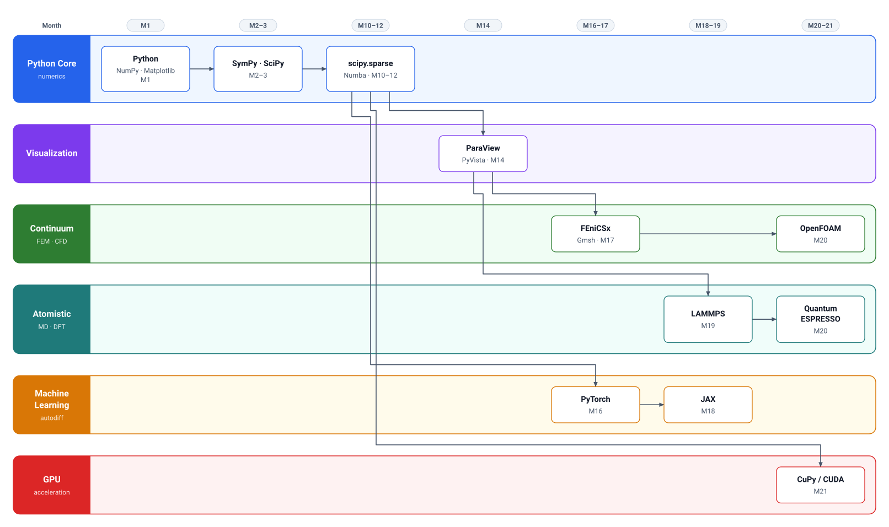

# 科学计算软件栈 Scientific Computing Stack

> 只信官方文档 Use official documentation as the source of truth. Domains below are official project domains. Pin versions per project (`environment.yml` / `requirements.txt`). APIs change, especially for FEniCSx, JAX and OpenFOAM.
> Platform note (Windows 11): Python-stack tools run natively. **FEniCSx, OpenFOAM, LAMMPS and Quantum ESPRESSO are smoothest under WSL2 (Ubuntu) or Docker.** Check each project's current install page before choosing.

## 1. 总表 Overview

| Tool | Official domain / docs | Purpose 用途 | Introduce at | Phase | First exercise 入门练习 |
|---|---|---|---|---|---|
| **Python + Jupyter** | python.org · jupyter.org | Language and notebook environment | M1 | P-I | Reproducible notebook template for the repo |
| **NumPy** | numpy.org | N-d arrays, vectorization, `numpy.linalg`, FFT, random | M1 | P-I | Implement Gaussian elimination; compare with `np.linalg.solve` |
| **Matplotlib** | matplotlib.org | 2-D/3-D plotting, publication figures | M1 | P-I | Plot vector fields (`quiver`, `streamplot`) and level sets |
| **SymPy** | sympy.org | Symbolic algebra/calculus: verify derivations, generate code (`lambdify`) | M2 | P-I | Symbolically verify div/curl identities and Jacobians |
| **SciPy** | scipy.org | `linalg`, `sparse`, `integrate.solve_ivp`, `optimize`, `fft`, `special`, `stats` | M3 (linalg/stats); M7 (`solve_ivp`); M10 (`sparse`) | P-I/P-II | Solve stiff Robertson ODE with `solve_ivp(method="BDF")` vs `RK45` |
| **ParaView** | paraview.org | 3-D scientific visualization of VTK/XDMF output from PDE/CFD/MD | M14 | P-III | Visualize a 3-D heat-equation solution exported via `meshio` |
| **PyTorch** | pytorch.org | Tensors, autograd, GPU training; neural PDE surrogates | M16 | P-III/P-IV | Fit an MLP to a 1-D function; inspect `autograd` derivatives against SymPy |
| **JAX** | docs.jax.dev (source: github.com/jax-ml/jax) | Composable transforms: `grad`, `jit`, `vmap`; differentiable simulation | M18 | P-III/P-IV | Differentiate through an explicit time-stepper; PINN for 1-D Burgers |
| **FEniCSx (DOLFINx, UFL, Basix, FFCx)** | fenicsproject.org · docs.fenicsproject.org | Finite element method from a weak-form description in UFL | M17 | P-III/P-IV | Poisson on unit square, then linear elasticity cantilever |
| **OpenFOAM** | openfoam.org (OpenFOAM Foundation) · openfoam.com (OpenCFD/ESI). Two distinct distributions; choose one and stay with it | Finite-volume CFD: incompressible/compressible, multiphase, heat transfer | M20 | P-IV | Lid-driven cavity (`icoFoam` tutorial), then mesh-convergence study |
| **LAMMPS** | lammps.org · docs.lammps.org | Classical molecular dynamics (pair potentials, EAM, ML potentials) | M19 | P-IV | Lennard-Jones fluid NVE → NVT; compute g(r) and diffusion coefficient |
| **Quantum ESPRESSO** | quantum-espresso.org | Plane-wave pseudopotential DFT (`pw.x`), phonons, band structure | M20 | P-IV | Si: SCF → band structure along high-symmetry path; ecutwfc/k-point convergence |
| **CuPy** | cupy.dev | NumPy-compatible GPU arrays; custom kernels | M21 | P-IV | Port the 2-D heat stencil from NumPy; measure speedup |
| **CUDA Toolkit** | developer.nvidia.com (CUDA Toolkit) · docs.nvidia.com/cuda | GPU programming model, nvcc, profiling | M21 | P-IV | Write a stencil/SpMV kernel in CUDA C++; profile memory bandwidth |

## 2. 可选辅助工具 Optional Supporting Tools

| Tool | Domain | When | Why |
|---|---|---|---|
| Gmsh | gmsh.info | M17 | Geometry and unstructured meshing for FEniCSx/OpenFOAM |
| meshio | github.com/nschloe/meshio | M14 | Convert mesh/solution formats (VTK, XDMF, Gmsh) |
| PyVista | pyvista.org | M14 | Pythonic VTK visualization; a scriptable alternative to ParaView |
| Numba | numba.pydata.org | M12 | JIT-compile Python loops (stencils, particle codes) before going to GPU |
| ASE (Atomic Simulation Environment) | gitlab.com/ase/ase | M19 | Build structures; drive QE/LAMMPS from Python |
| CVXPY | cvxpy.org | M11 | Disciplined convex programming, paired with EE364a |

## 3. 引入顺序与理由 Introduction Order & Rationale

- **Write it yourself first, then use the library.** Implement each algorithm (LU, RK4, FDM Laplacian, CG) by hand in NumPy, then validate against SciPy and switch to the library.
- **Physics before solver.** LAMMPS comes after statistical mechanics, QE after QM and solid state, OpenFOAM after continuum mechanics and FVM.
- **Verification and validation 验证与确认.** Every solver run needs a convergence study (h- or Δt-refinement with an observed order of accuracy) and at least one analytic or benchmark comparison.

## 4. 关键文档入口 Key Documentation Entry Points

Section names below are what to look for on the official docs sites. Exact page paths change between releases, so navigate from the domain.
- NumPy: *User Guide → NumPy fundamentals*; *Reference → Linear algebra (`numpy.linalg`)*.
- SciPy: *User Guide* sections on `integrate`, `sparse.linalg`, `optimize`.
- SymPy: *Tutorial*; *Modules → Code generation (`lambdify`, `codegen`)*.
- JAX: *Tutorials → JIT compilation, Automatic differentiation, Automatic vectorization*; *Sharp bits* (pitfalls).
- PyTorch: *Tutorials → autograd mechanics*.
- FEniCSx: DOLFINx demos (Poisson, elasticity, Navier–Stokes), plus J. S. Dokken's tutorial.
- OpenFOAM: User Guide (tutorial cases), `system/fvSchemes` and `system/fvSolution` documentation.
- LAMMPS: Manual → *Commands*, *Howto* sections; `examples/` directory in the source tree.
- Quantum ESPRESSO: `pw.x` input description (INPUT_PW); official tutorials and hands-on schools.
- CUDA: *CUDA C++ Programming Guide*; *CUDA C++ Best Practices Guide*.
