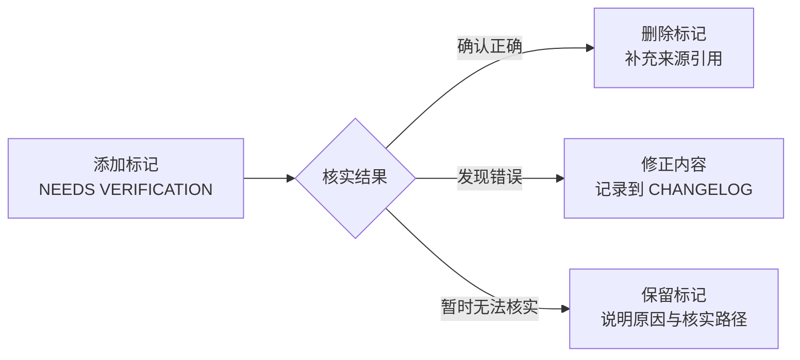

# CONTRIBUTING — 长期维护规则

> 本仓库是一个需要维持 2 年以上的个人知识基础设施。以下规则的目的只有一个：**防止它退化为一堆无序、未经验证、无法复用的笔记。**
> 适用于所有贡献者，包括学习者本人、Claude 与 Gemini。

---

## 1. 新增主题/论文前的 7 个必答问题（The 7 Mandatory Questions）

新增任何主题、论文笔记或实验之前，必须在任务说明（或文档开头的 HTML 注释）中书面回答以下 7 个问题。任何一题无法回答，则暂缓添加，并记录到 `06_knowledge_graph/backlog.md`。

| # | 问题 | 目的 |
|---|---|---|
| 1 | **定位（Where）**：它属于 ROADMAP 的哪个 Phase、哪个 ID？若不在 ROADMAP 中，为何需要新增？ | 防止范围蔓延（scope creep） |
| 2 | **先修（Prerequisites）**：它的硬先修是什么？学习者是否已经 `Completed`？ | 防止在地基未稳时盖楼 |
| 3 | **结构（Structure）**：它与仓库中已有的哪个数学结构是同一件事或其推广？ | 强化"数学作为连接语言"的愿景 |
| 4 | **推导（Derive）**：其中哪些结论属于 L1（必证）？推导是否可以按 10 节模板完成？ | 保证推导深度 |
| 5 | **计算（Compute）**：能设计出什么数值实验？验证基准是什么？ | 保证可计算、可验证 |
| 6 | **应用（Apply）**：它服务于 7 个应用领域中的哪一个或几个？具体对应什么工程问题？ | 保证工程落地 |
| 7 | **代价（Cost）**：预计需要多少小时？会挤占哪个已计划主题的时间？ | 尊重每周 10–15 小时的硬约束 |

对于**研究论文**，第 3 题替换为："它所依赖的经典理论在仓库中是否已有对应文档？"；第 7 题额外回答："它是领域共识还是单篇结论？"

---

## 2. 命名规范（Naming Conventions）

### 2.1 目录与文件

| 对象 | 规则 | 示例 |
|---|---|---|
| 顶层目录 | 两位数字前缀 + `snake_case` | `03_computational_methods/` |
| 子目录 | `snake_case`，英文，不加数字前缀 | `quantum_mechanics/` |
| 推导文档 | `NN_<topic>.md`，NN 表示在该子目录内的建议阅读顺序 | `03_spectral_theorem.md` |
| 实验目录 | `<topic>_<method>`，描述"什么问题 + 什么方法" | `heat1d_explicit_fdm/` |
| Python 文件 | `snake_case.py`，遵循 PEP 8 | `poisson2d_fem.py` |
| 图片 | `<文档或实验名>_<内容>.png`，存放于同级 `figures/` | `heat1d_convergence.png` |
| 治理文件 | 全大写 | `ROADMAP.md`、`GLOSSARY.md` |

**禁止**：文件名中出现空格、中文字符、大写字母（治理文件除外）、`final`/`new`/`v2` 之类的版本后缀（版本由 Git 管理）。

### 2.2 代码中的命名

- 变量名尽量贴合数学符号并附注释：`kappa`（热导率 $\kappa$）、`dt`、`h`、`u_exact`。
- 矩阵用大写单字母或描述性名称：`A`、`K_global`（全局刚度矩阵）、`M_mass`。
- 不使用无意义的名称（`temp`、`data2`、`res_final`）。

---

## 3. 双语写作风格指南（Bilingual Writing Style Guide）

### 3.1 基本规则

1. **中文为主体**：叙述、解释、推导说明使用中文。
2. **术语首次出现时中英对照**，格式为 `中文术语（English Term）`，使用全角括号。同一文档内后续出现可只用中文，或在易混淆时重复对照。
   - ✅ 特征值（eigenvalue）
   - ❌ 特征值 eigenvalue、eigenvalue（特征值）
3. **人名、定理名保留英文原名**：Galerkin 方法、Lax–Milgram 定理、Kohn–Sham 方程。不翻译为"伽辽金"等音译（除非该音译已成为中文标准术语，如"傅里叶"——此时写作 傅里叶（Fourier）变换，后续统一用 Fourier）。
4. **术语必须与 [`GLOSSARY.md`](GLOSSARY.md) 一致**；新术语应同步添加到术语表。
5. **严禁以通俗换严谨**：可以在严格陈述**之后**给出直观解释，但不能用直观解释**替代**严格陈述。
   - ✅ "若 $A$ 实对称，则存在正交矩阵 $Q$ 使 $Q^\top A Q$ 为对角阵。直观上，对称矩阵只沿一组互相垂直的方向做拉伸。"
   - ❌ "对称矩阵就是只做拉伸的矩阵。"

### 3.2 数学排版

| 规则 | 示例 |
|---|---|
| 行内公式 `$...$`，独立公式 `$$...$$` | $\nabla \cdot \mathbf{E} = \rho / \varepsilon_0$ |
| 向量用粗体 `\mathbf{}`，矩阵用大写正体 | $\mathbf{x}$、$A$ |
| 转置用 `^\top`，共轭转置用 `^*` 或 `^\dagger`（量子力学） | $A^\top$、$\hat{H}^\dagger$ |
| 算符用 `\hat{}`（量子力学中） | $\hat{H}$、$\hat{p}$ |
| 微分符号 d 为正体：`\mathrm{d}` | $\int f(x)\,\mathrm{d}x$ |
| 物理量注明单位（SI），用 `\,\mathrm{}` | $9.81\,\mathrm{m/s^2}$ |
| 定义用 `:=` | $\lVert\mathbf{x}\rVert_2 := \sqrt{\mathbf{x}^\top\mathbf{x}}$ |

### 3.3 标点与格式

- 中文段落使用全角标点；公式与英文术语内部使用半角符号。
- 中文与英文/数字之间加一个半角空格：`使用 Python 3.11 进行计算`。
- 列表与表格优先于长段落；每个表格必须有表头。
- Mermaid 图中含括号、方括号、斜杠或其他特殊字符的节点标签必须加引号：`A["Lagrange 力学 (L = T - V)"]`。

---

## 4. 质量与验证检查清单（Quality & Verification Checklist）

提交前逐项勾选。审查者（Gemini 技术审查 / 学习者验证）以此为依据。

### 4.1 推导文档

- [ ] 包含 [`study_workflow.md`](00_getting_started/study_workflow.md) §2 规定的全部 10 节
- [ ] 所有假设已编号（A1, A2, …）并在使用处引用
- [ ] 每一步推导标注了依据；无"显然""易见"式跳步
- [ ] 至少一项一致性检验（量纲、极限情形、对称性、已知特例）
- [ ] 符号与 [`GLOSSARY.md`](GLOSSARY.md) 一致；符号表完整
- [ ] 参考文献精确到章节或页码
- [ ] 所有不确定内容已标记 `[NEEDS VERIFICATION]`
- [ ] 所有链接有效（相对路径）

### 4.2 数值实验

- [ ] `README.md` 包含 [`study_workflow.md`](00_getting_started/study_workflow.md) §3 规定的全部 10 节
- [ ] 具备至少一个独立验证基准
- [ ] 收敛性实验至少 4 个网格层级，并报告拟合收敛阶
- [ ] 随机种子已固定；无绝对路径
- [ ] 一条命令即可从干净环境复现
- [ ] 大型输出未提交（遵守 `.gitignore`）

### 4.3 治理同步

- [ ] [`ROADMAP.md`](ROADMAP.md) 的 **Content** 列已更新（智能体不得修改 **Mastery** 列）
- [ ] [`CHANGELOG.md`](CHANGELOG.md) 已添加条目
- [ ] 新术语已加入 [`GLOSSARY.md`](GLOSSARY.md)
- [ ] `06_knowledge_graph/` 中的跨主题链接已更新（如适用）

---

## 5. `[NEEDS VERIFICATION]` 标记策略

### 5.1 何时必须使用

在以下任一情况下，**必须**在相关语句、公式或代码注释后紧接着添加 `[NEEDS VERIFICATION]`：

1. 数值常数、实验数据或物理参数未经可靠来源核对（如材料参数、器件尺寸、文献中的基准值）。
2. 引用的文献、页码、定理编号未经亲自查证。
3. 推导中某一步的正确性存疑，或依赖未证明的引理。
4. 关于研究前沿的陈述（"目前最好的方法是……""该问题尚未解决"）——这类陈述时效性强。
5. 智能体凭记忆而非核对后给出的任何具体事实。

### 5.2 格式

```markdown
硅在 300 K 时的本征载流子浓度约为 $1.0 \times 10^{10}\,\mathrm{cm^{-3}}$ [NEEDS VERIFICATION: 不同文献取值在 9.65e9–1.5e10 之间，需确认所用来源]
```

- 标记后面可选地附加冒号与说明：`[NEEDS VERIFICATION: 原因]`。
- 代码中使用注释：`# [NEEDS VERIFICATION] 边界条件处理参考了 ..., 尚未与解析解对照`。

### 5.3 生命周期



- 含有该标记的文档在 ROADMAP 中的内容状态须包含 `V?`。
- 可通过 `grep -rn "NEEDS VERIFICATION" .` 列出所有待核实项；每个 Phase 结束时集中清理一次。
- **禁止**在未核实的情况下删除标记。

---

## 6. 其他维护规则

1. **一主题一来源**：同一概念只在一处给出权威定义，其他地方通过链接引用，避免内容分叉。
2. **不删除错误历史**：修正推导错误时，在 CHANGELOG 中说明错在哪里、为何出错。
3. **定期修剪**：每个 Phase 结束时检查是否有偏离 ROADMAP 的主题；对无法回答七问的内容进行归档或删除。
4. **敏感信息**：不提交任何凭据、个人信息或大型二进制文件（见 `.gitignore`）。
