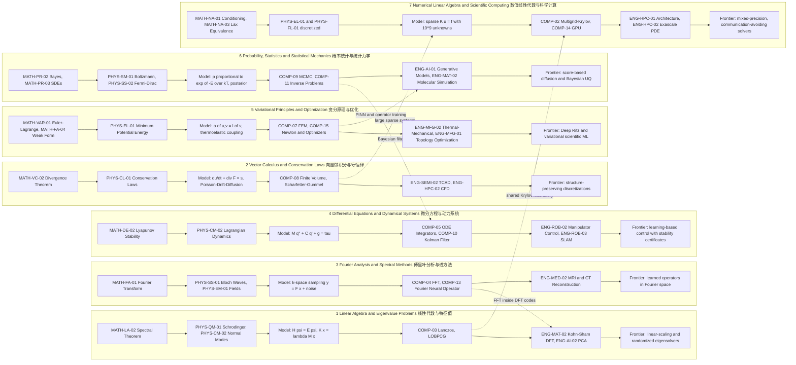

# MPCE Knowledge Graph — Master Overview｜MPCE 知识图谱总览

> The knowledge graph is the intellectual backbone of MPCE, not a directory tree. Every node and every edge encodes a real mathematical or physical connection along the chain
> 知识图谱是 MPCE 的思想主干，而不是目录树。每个节点、每条边都对应真实、严格的数学或物理联系，沿着以下链条展开：
>
> **Mathematical Principle → Physical Principle → Mathematical Model → Computational Method → Engineering Application → Research Frontier**
> **数学原理 → 物理原理 → 数学模型 → 计算方法 → 工程应用 → 研究前沿**

| Layer file / 分层文件 | Prefix | Nodes |
|---|---|---|
| [`06_knowledge_graph/mathematics_graph.md`](06_knowledge_graph/mathematics_graph.md) | `MATH-*` | 21 |
| [`06_knowledge_graph/physics_graph.md`](06_knowledge_graph/physics_graph.md) | `PHYS-*` | 16 |
| [`06_knowledge_graph/computational_graph.md`](06_knowledge_graph/computational_graph.md) | `COMP-*` | 15 |
| [`06_knowledge_graph/engineering_graph.md`](06_knowledge_graph/engineering_graph.md) | `ENG-*` | 15 |
| **Total / 合计** | | **67** |

---

## 1. ID naming convention｜ID 命名规范

| Pattern | Layer | Example | Rule / 规则 |
|---|---|---|---|
| `MATH-<SUB>-<NN>` | Mathematics 数学 | `MATH-LA-02` | `<SUB>` ∈ `LA` linear algebra, `VC` vector calculus, `DE` differential equations, `FA` Fourier & functional analysis, `VAR` variations, `OPT` optimization, `PR` probability, `NA` numerical analysis |
| `PHYS-<SUB>-<NN>` | Physics 物理 | `PHYS-SS-03` | `<SUB>` ∈ `CM` classical mechanics, `CL` conservation laws, `EM` electromagnetism, `FL` fluids, `TR` transport, `EL` elasticity, `TD` thermodynamics, `SM` statistical mechanics, `QM` quantum mechanics, `SS` solid state |
| `COMP-<NN>` | Computational 计算 | `COMP-07` | Flat sequence; families are documented in the layer file (no sub-code) / 扁平编号，分组见分层文件 |
| `ENG-<DOM>-<NN>` | Engineering 工程 | `ENG-SEMI-02` | `<DOM>` ∈ `AI`, `SEMI`, `ROB`, `MFG`, `MAT`, `HPC`, `MED`; `-01` is the domain node, `-02`+ are sub-applications / `-01` 为领域节点，`-02` 起为子应用 |

Rules / 规则:
1. `<NN>` is two digits, assigned sequentially, **never reused** after deletion (retire instead). / 两位数字顺序分配，删除后不复用（改为"退役"）。
2. IDs are immutable; renaming a concept changes only its names, not its ID. / ID 一经分配不可更改。
3. "Mathematical Model" and "Research Frontier" are **annotations on edges/threads**, not registered nodes: models are the equations stated in each node's *Definition*; frontiers are listed in §2. / "数学模型"与"研究前沿"是链条上的注释，不单独编号。

### The 10 mandatory fields｜10 个必填字段

`ID` · `English Name` · `Chinese Name` · `Definition` · `Prerequisites` · `Related Mathematics` · `Related Physics` · `Computational Methods` · `Engineering Applications` · `References`.
ID-valued fields contain only IDs that exist in one of the four layer files; "—" is used when no rigorous link exists (we never invent links to fill a field).
引用类字段只能包含已登记的 ID；没有严格联系时写 "—"，不为填满字段而牵强关联。

---

## 2. Seven unifying threads｜七条统一主线

Each thread is one concrete instance of the full chain. Nodes are labelled with their registry IDs; the "Model" box states the equation that links physics to computation.
每条主线是完整链条的一个具体实例；"模型"框给出连接物理与计算的方程。



### Thread summary table｜主线摘要

| # | Thread / 主线 | Math | Physics | Model (equation) / 模型 | Computation | Engineering | Research frontier / 研究前沿 |
|---|---|---|---|---|---|---|---|
| 1 | Linear Algebra & Eigenvalue Problems 线性代数与特征值 | `MATH-LA-01`, `MATH-LA-02`, `MATH-LA-03` | `PHYS-QM-01`, `PHYS-CM-02`, `PHYS-SS-01` | $\hat H\psi=E\psi$; $Kx=\lambda Mx$ | `COMP-03`, `COMP-01` | `ENG-MAT-02`, `ENG-AI-02`, `ENG-MFG-02` | Linear-scaling electronic structure; randomized NLA |
| 2 | Vector Calculus & Conservation Laws 向量微积分与守恒律 | `MATH-VC-01`, `MATH-VC-02` | `PHYS-CL-01`, `PHYS-EM-01`, `PHYS-FL-01`, `PHYS-SS-03` | $\partial_tu+\nabla\cdot\mathbf F=s$ | `COMP-08`, `COMP-06` | `ENG-SEMI-02`, `ENG-HPC-02` | Structure-preserving (mimetic / FEEC) discretizations |
| 3 | Fourier Analysis & Spectral Methods 傅里叶分析与谱方法 | `MATH-FA-01`, `MATH-FA-03` | `PHYS-SS-01`, `PHYS-TR-01`, `PHYS-EM-01` | $y=F_ux+\varepsilon$ (k-space); Bloch waves | `COMP-04`, `COMP-13` | `ENG-MED-02`, `ENG-MAT-02` | Fourier neural operators; learned MRI reconstruction |
| 4 | Differential Equations & Dynamical Systems 微分方程与动力系统 | `MATH-DE-01`, `MATH-DE-02`, `MATH-DE-03` | `PHYS-CM-01`, `PHYS-CM-02`, `PHYS-CM-03` | $M(q)\ddot q+C\dot q+g=\tau$ | `COMP-05`, `COMP-10` | `ENG-ROB-02`, `ENG-ROB-03` | Learning-based control with Lyapunov certificates |
| 5 | Variational Principles & Optimization 变分原理与优化 | `MATH-VAR-01`, `MATH-FA-04`, `MATH-OPT-01`, `MATH-OPT-02` | `PHYS-CM-02`, `PHYS-EL-01`, `PHYS-QM-02` | $a(u,v)=\ell(v)$; $E[n]\to\min$ | `COMP-07`, `COMP-15`, `COMP-12` | `ENG-MFG-02`, `ENG-MFG-01`, `ENG-AI-01` | Deep Ritz / variational PINNs; large-scale topology optimization |
| 6 | Probability, Statistics & Statistical Mechanics 概率统计与统计力学 | `MATH-PR-01`, `MATH-PR-02`, `MATH-PR-03` | `PHYS-SM-01`, `PHYS-SM-02`, `PHYS-SS-02` | $p\propto e^{-E/k_BT}$; $p(\theta\mid y)\propto p(y\mid\theta)p(\theta)$ | `COMP-09`, `COMP-10`, `COMP-11` | `ENG-AI-01`, `ENG-MAT-02`, `ENG-MED-02` | Score-based diffusion models; Bayesian UQ for digital twins |
| 7 | Numerical Linear Algebra & Scientific Computing 数值线性代数与科学计算 | `MATH-NA-01`, `MATH-NA-02`, `MATH-NA-03` | `PHYS-EL-01`, `PHYS-FL-01` (as discretized) | Sparse $Ku=f$, $10^6$–$10^{12}$ unknowns | `COMP-01`, `COMP-02`, `COMP-14` | `ENG-HPC-01`, `ENG-HPC-02` | Mixed-precision & communication-avoiding solvers |

Research frontiers are pointers for future `07_references/` paper notes, not settled claims. / 研究前沿是后续论文笔记的方向指针，不是定论。

---

## 3. Cross-reference matrix｜交叉引用矩阵

Core mathematical principles (rows) × the 7 engineering application domains (columns). Each cell names a concrete, established use; "—" marks no significant direct use.
行：核心数学原理；列：7 个工程领域。每格写出一个具体、成熟的用法；"—" 表示没有重要的直接应用。

| Principle ↓ / Domain → | AI/DS `ENG-AI-01` | Semiconductors/IC `ENG-SEMI-01` | Robotics `ENG-ROB-01` | Adv. Manufacturing `ENG-MFG-01` | Materials/CompPhys `ENG-MAT-01` | HPC/Arch `ENG-HPC-01` | Medical Imaging/Biomed `ENG-MED-01` |
|---|---|---|---|---|---|---|---|
| Eigenvalues & spectral theorem `MATH-LA-02` | PCA, spectral clustering, Hessian spectrum | Schrödinger–Poisson subbands, band structure | Linearized stability, modal vibration of arms | Modal analysis, machining chatter | Kohn–Sham eigenproblem, phonon dispersion | Large-scale Lanczos / LOBPCG | Diffusion-tensor MRI (eigenvectors give fiber direction) |
| SVD & low rank `MATH-LA-03` | Embeddings, low-rank adaptation, recommender systems | Model-order reduction of interconnect networks | Jacobian pseudo-inverse, manipulability ellipsoid | POD reduced-order process models | Tensor-network (DMRG) truncations | Randomized SVD, communication-avoiding QR | Truncated-SVD regularized reconstruction |
| Vector calculus & integral theorems `MATH-VC-01`, `MATH-VC-02` | Divergence (trace) term in continuous normalizing flows | Gauss's law, current continuity, box-method fluxes | Potential-field path planning | Heat-flux and stress balances | Hartree (Poisson) electrostatics | FVM flux kernels | Bioelectric potentials, impedance tomography |
| ODEs & dynamical systems `MATH-DE-01`, `MATH-DE-02` | Neural ODEs, gradient-flow view of training | SPICE transient DAEs | Lyapunov-based control, trajectory tracking | Process control loops | MD trajectories | Parallel-in-time integration | Pharmacokinetic compartment models |
| PDEs `MATH-DE-03` | PINNs, neural operators | Drift–diffusion TCAD, dopant diffusion | Continuum models of soft robots | Thermal–mechanical coupling, molding flow | Phase-field (Allen–Cahn / Cahn–Hilliard) | Large-scale CFD / EM solvers | Bioheat, hemodynamics |
| Fourier analysis `MATH-FA-01` | Convolution theorem, Fourier neural operators | Fourier-optics lithography imaging | Frequency-domain control design (Bode) | Vibration spectral analysis | Plane-wave DFT, diffraction | Distributed 3D FFT | MRI k-space, CT Fourier-slice theorem |
| Green's functions & Sturm–Liouville `MATH-FA-02`, `MATH-FA-03` | Kernel methods (Green's functions as reproducing kernels) | NEGF quantum transport, confinement subbands | Impulse response of linear systems | Moving point-source (Rosenthal) welding solution | Green's-function electronic structure (KKR, GW) | Fast multipole method | Point-spread function |
| Variational principles & weak forms `MATH-VAR-01`, `MATH-FA-04` | Variational inference (ELBO) | FEM stress analysis of packages | Lagrangian dynamics, optimal control | FEM structural analysis | DFT energy minimization, phase-field free energy | Parallel FEM assembly | Variational image registration, TV denoising |
| Convex & stochastic optimization `MATH-OPT-01`, `MATH-OPT-02` | Training with SGD / Adam, SVM | Device calibration, placement & routing | MPC quadratic programs, trajectory optimization | Topology & process-parameter optimization | Geometry relaxation (BFGS), inverse design | Autotuning of kernels | Compressed-sensing MRI ($\ell_1$), radiotherapy plan optimization |
| Probability & Bayesian inference `MATH-PR-01`, `MATH-PR-02` | Probabilistic ML, uncertainty quantification | Process variability, yield analysis | Bayesian filtering, SLAM | Statistical process control, digital-twin calibration | Bayesian optimization of materials | Ensemble UQ workflows | Bayesian reconstruction with priors |
| Stochastic processes & SDEs `MATH-PR-03` | Score-based diffusion, Langevin sampling | Thermal/shot noise, Monte Carlo transport | Process-noise models | Degradation / reliability models | Kinetic Monte Carlo, Langevin thermostats | Parallel random-number streams | Monte Carlo photon / dose transport |
| Numerical analysis `MATH-NA-01`–`MATH-NA-03` | Stability of low-precision training | Scharfetter–Gummel stability, Newton convergence | Real-time integration error control | Mesh-convergence verification | k-point / cutoff convergence | Mixed-precision error analysis | Discretization of reconstruction operators |

---

## 4. Maintenance protocol｜维护规范

### 4.1 Adding a node｜新增节点

1. **Justify** — answer the 7 questions in [`CONTRIBUTING.md`](CONTRIBUTING.md); if any cannot be answered, record the idea in `06_knowledge_graph/backlog.md` instead. / 先回答 CONTRIBUTING 中的 7 个问题，否则记入 backlog。
2. **Choose the layer and ID** — next unused `<NN>` in the right sub-code (§1). Never reuse a retired ID. / 选择层与下一个未用编号。
3. **Fill all 10 fields** in the layer file, in the fixed order. The definition must be mathematically precise (state the equation or theorem). / 按固定顺序填写 10 个字段，定义须给出方程或定理。
4. **References** must be verifiable: textbook (author, title, edition, publisher, year), paper (journal, volume, pages, year, or venue), or course (institution + code). No unverifiable web summaries. / 参考文献须可核查。
5. **Wire the edges** (§4.2) and update the layer's Mermaid prerequisite graph. / 连边并更新 Mermaid 图。
6. **Update this overview** if the node belongs to a thread (§2) or matrix cell (§3), and update the node counts. / 必要时更新本总览与节点数。
7. **Log the change** in [`CHANGELOG.md`](CHANGELOG.md). / 记录到 CHANGELOG。

### 4.2 Adding or updating an edge｜新增/修改边

- An edge is admissible only if you can state the connection as a **mathematical or physical fact** (an equation, theorem, derivation, or algorithm that uses the other node). Write that fact in parentheses after the ID when it is not obvious. / 只有能写出具体方程、定理、推导或算法依赖时才可连边。
- **Prerequisites** = genuinely needed to *understand* the node (directed, must stay acyclic). **Related** fields = substantive use or derivation in either direction. / "先修"是理解该节点所必需（有向、无环）；"相关"是实质性使用或推导关系。
- Every Prerequisite edge must appear as a solid arrow in the layer's Mermaid graph, and vice versa. / 先修边与 Mermaid 实线一一对应。
- Prefer symmetry where it is real (if `COMP-07` lists `PHYS-EL-01`, consider whether `PHYS-EL-01` should list `COMP-07`), but do not force it. / 真实的对称关系尽量双向登记，但不强求。

### 4.3 Retiring or merging nodes｜退役与合并

Mark the node `**[RETIRED → <new ID>]**` in its heading, keep the entry, and replace all references to it across the four layer files. / 在标题处标注退役与去向，保留条目，并替换所有引用。

### 4.4 Consistency check｜一致性检查

Run before every commit that touches the graph (Git Bash, from the repo root). It lists every referenced ID that has no registry heading; empty output means the graph is consistent.
每次修改图谱后在仓库根目录运行；无输出即表示所有引用的 ID 都已登记。

```sh
cd 06_knowledge_graph
grep -ohE '^### (MATH|PHYS|ENG)-[A-Z]+-[0-9]{2}|^### COMP-[0-9]{2}' *.md | sed 's/^### //' | sort -u > /tmp/kg_defined.txt
grep -ohE '\b((MATH|PHYS|ENG)-[A-Z]+-[0-9]{2}|COMP-[0-9]{2})\b' *.md ../KNOWLEDGE_GRAPH.md | sort -u > /tmp/kg_used.txt
comm -13 /tmp/kg_defined.txt /tmp/kg_used.txt
```

Also render each Mermaid block (GitHub preview or <https://mermaid.live>) after editing: quote every label, avoid HTML tags, and use `_` instead of `-` in Mermaid node identifiers (e.g. `MATH_LA_01["MATH-LA-01 ..."]`).
修改后渲染检查 Mermaid：所有标签加引号、不用 HTML 标签、Mermaid 节点标识符用下划线。
