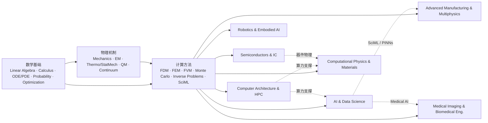
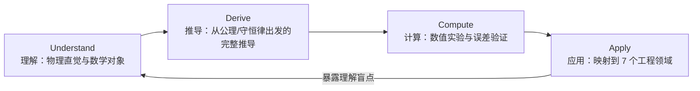

# MPCE — Mathematical Physics & Computational Engineering

> **数学与物理是连接各工程领域的通用语言（Mathematics & Physics as a Connecting Language）。**
> 本仓库不是七门彼此孤立的课程笔记，而是一套可复用、持续演化的知识基础设施（knowledge infrastructure）：
> **抽象数学原理 → 物理机制 → 数学模型 → 计算方法 → 工程应用 → 研究前沿**。

| 项目属性 | 说明 |
|---|---|
| 目标水平 | 高年级本科 → 研究生初年级（senior undergraduate → early graduate） |
| 时间预算 | 每周 10–15 小时，持续 18–24 个月 |
| 学习方法 | Understand → Derive → Compute → Apply（理解 → 推导 → 计算 → 应用） |
| 写作语言 | 中文为主体；英文专业术语首次出现时中英对照；数学严谨性优先于通俗性 |
| 当前版本 | v0.1.0（Milestone 1：治理与架构，见 [`CHANGELOG.md`](CHANGELOG.md)） |

---

## 1. 智识愿景（Intellectual Vision）

同一个数学结构会在截然不同的工程领域中反复出现。识别这些"结构同构（structural isomorphism）"，比记住任何单一领域的公式更有价值：

| 数学结构 | 物理/工程实例（跨领域重现） |
|---|---|
| 椭圆型 PDE $-\nabla\cdot(\kappa\nabla u)=f$ | 稳态热传导、静电势（Poisson 方程）、半导体器件中的电势分布、图像去噪的正则化项 |
| 特征值问题 $A\mathbf{x}=\lambda\mathbf{x}$ | 结构振动模态、定态 Schrödinger 方程、PCA、马尔可夫链稳态、迭代法收敛速度 |
| 变分原理 $\delta S = 0$ | Lagrange 力学、有限元弱形式、最优控制、DFT 中的能量泛函极小化 |
| 傅里叶分析 | 波动方程分离变量、晶格中的倒空间（Bloch 定理）、CT/MRI 重建、谱方法、FFT |
| 概率与贝叶斯推断 | 统计力学配分函数、Kalman 滤波、蒙特卡洛模拟、不确定性量化、生成模型 |
| 稀疏线性系统 $A\mathbf{x}=\mathbf{b}$ | FEM/FVM 离散后的求解核心、电路仿真、GPU 上的迭代求解器与内存层次瓶颈 |

本项目的核心承诺：**每一个主题都要能回答"它从哪里来（数学/物理根源）"与"它到哪里去（计算与工程落地）"。**

## 2. 七个相互关联的应用领域（7 Interconnected Domains）



| # | 领域 | 核心数学/物理支柱 | 代表性计算问题 |
|---|---|---|---|
| 1 | 人工智能与数据科学（AI & Data Science） | 线性代数、概率、优化、泛函分析初步 | PINNs、神经算子（Neural Operators）、随机梯度下降收敛性 |
| 2 | 半导体与集成电路（Semiconductors & IC） | 电磁学、量子/固体物理、椭圆与抛物型 PDE | Poisson–漂移-扩散（drift-diffusion）耦合求解、能带计算 |
| 3 | 机器人与具身智能（Robotics & Embodied AI） | 刚体动力学、李群初步、控制论、概率估计 | 轨迹优化、Kalman 滤波、模型预测控制（MPC） |
| 4 | 先进制造与多物理场（Advanced Manufacturing & Multiphysics） | 连续介质力学、传热传质、流体力学 | FEM/FVM/CFD、热-力耦合仿真 |
| 5 | 计算物理与材料科学（Computational Physics & Materials） | 量子力学、统计物理 | DFT、分子动力学（MD）、蒙特卡洛 |
| 6 | 计算机体系结构与高性能计算（Computer Architecture & HPC） | 数值线性代数、复杂度分析 | GPU 并行算法、Roofline 模型、通信-计算权衡 |
| 7 | 医学成像与生物医学工程（Medical Imaging & Biomedical Eng.） | 傅里叶分析、信号处理、反问题理论 | CT 滤波反投影、MRI k 空间重建、正则化反演 |

## 3. 四维学习闭环（The 4-Dimension Learning Loop）



- **Understand（理解）**：回答"这个对象是什么、为什么需要它"。给出几何/物理图像，明确定义与假设。
- **Derive（推导）**：独立写出关键推导，每一步注明所用定理或假设；不允许"显然可得"跳步。
- **Compute（计算）**：用 Python（NumPy/SciPy/Matplotlib，后期 PyTorch/JAX）实现，并用解析解、收敛阶或守恒量验证。
- **Apply（应用）**：至少映射到一个工程领域，说明模型在何种假设下成立、在何处失效。

详细操作流程见 [`00_getting_started/study_workflow.md`](00_getting_started/study_workflow.md)。

## 4. 仓库地图（Repository Map）

```text
MPCE/
├── README.md                      # 本文件：定位、愿景、导航
├── ROADMAP.md                     # 18–24 个月路线图；内容状态 vs. 个人掌握状态
├── KNOWLEDGE_GRAPH.md             # 跨领域知识图谱总览与节点命名规范
├── CONTRIBUTING.md                # 维护规则、命名规范、双语风格、质量检查清单
├── CHANGELOG.md                   # 版本记录
├── GLOSSARY.md                    # 中英双语术语表（按领域组织）
├── 00_getting_started/            # 入门：学习策略、先修关系图、学习工作流
│   ├── learning_strategy.md
│   ├── prerequisite_map.md
│   └── study_workflow.md
├── 01_mathematics/                # 数学基础
│   ├── linear_algebra/  calculus/  differential_equations/
│   ├── probability_statistics/  optimization/  numerical_analysis/
├── 02_physics/                    # 物理机制
│   ├── classical_mechanics/  electromagnetism/  thermodynamics/
│   ├── quantum_mechanics/  solid_state_physics/  continuum_mechanics/
├── 03_computational_methods/      # 计算方法
│   ├── fdm/  fem/  fvm/  monte_carlo/  inverse_problems/  scientific_ml/
├── 04_engineering_applications/   # 工程应用（领域 1–6 已建目录；领域 7 医学成像待建）
│   ├── ai_data_science/  semiconductor_ic/  robotics/
│   ├── advanced_manufacturing/  materials_science/  hpc_architecture/
├── 05_experiments/                # 可复现数值实验（遵循 10 节实验标准）
│   ├── linear_algebra/  dynamics/  heat_transfer/  electromagnetics/
│   ├── finite_element/  semiconductor/  robotics/  scientific_ml/
├── 06_knowledge_graph/            # 跨主题概念关联图
├── 07_references/                 # 教材、论文、课程与阅读笔记
└── scripts/                       # 仓库工具脚本（校验、构建等）
```

> 注：医学成像领域目前尚无独立目录，计划在 Phase V–VII 期间建立 `04_engineering_applications/medical_imaging/`，其数学基础（Fourier 分析、反问题）已由 `03_computational_methods/inverse_problems/` 承载。

## 5. 快速开始（Quick Start）

1. **阅读顺序**：`README.md` → [`00_getting_started/learning_strategy.md`](00_getting_started/learning_strategy.md) → [`00_getting_started/prerequisite_map.md`](00_getting_started/prerequisite_map.md) → [`ROADMAP.md`](ROADMAP.md) → [`00_getting_started/study_workflow.md`](00_getting_started/study_workflow.md)。
2. **搭建计算环境**（建议 Python ≥ 3.11）：
   ```powershell
   python -m venv .venv
   .\.venv\Scripts\Activate.ps1
   pip install numpy scipy matplotlib sympy jupyterlab
   ```
   Phase VI 前再按需安装 `torch` 或 `jax`。
3. **第一周任务**：完成 [`learning_strategy.md`](00_getting_started/learning_strategy.md) 第 6 节的"诊断性自测"，在 `ROADMAP.md` 中将 Phase I 的个人掌握状态更新为 `In Progress`。
4. **每完成一个主题**：按 [`study_workflow.md`](00_getting_started/study_workflow.md) 的模板产出推导文档 + 数值实验，并在 `ROADMAP.md` 中分别更新**内容状态**与**个人掌握状态**。

## 6. 双智能体协作模型（Dual-Agent Collaboration Model）

| 角色 | 智能体 | 职责 |
|---|---|---|
| 研究 / 推导 / 实现（Research, Derivation, Implementation） | **Claude** | 文献梳理、完整数学推导、数值实验代码、架构设计、初稿撰写 |
| 编排 / 审校 / 编辑润色（Orchestration, Review, Editorial Polish） | **Gemini** | 任务拆解与调度、技术审查（推导正确性、代码可复现性）、语言与排版润色 |
| 最终裁决与掌握验证 | **学习者本人** | 独立复现推导、运行实验、更新个人掌握状态、批准提交 |


**原则**：智能体生成的内容只改变**内容状态（Content Status）**；只有学习者独立完成推导与实验后，才能改变**个人掌握状态（Personal Mastery Status）**。

## 7. 治理文档索引

- [`ROADMAP.md`](ROADMAP.md) — 分阶段计划与双轨状态追踪
- [`KNOWLEDGE_GRAPH.md`](KNOWLEDGE_GRAPH.md) — 跨领域知识图谱总览与 7 大贯穿主线
- [`CONTRIBUTING.md`](CONTRIBUTING.md) — 新增主题的 7 个必答问题、命名与质量规范
- [`GLOSSARY.md`](GLOSSARY.md) — 术语与符号约定
- [`CHANGELOG.md`](CHANGELOG.md) — 版本历史
