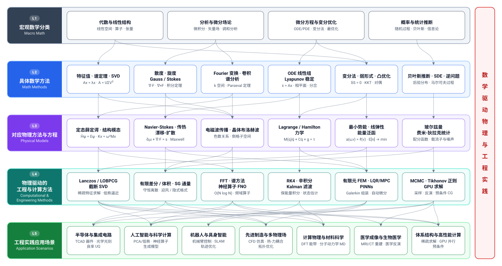
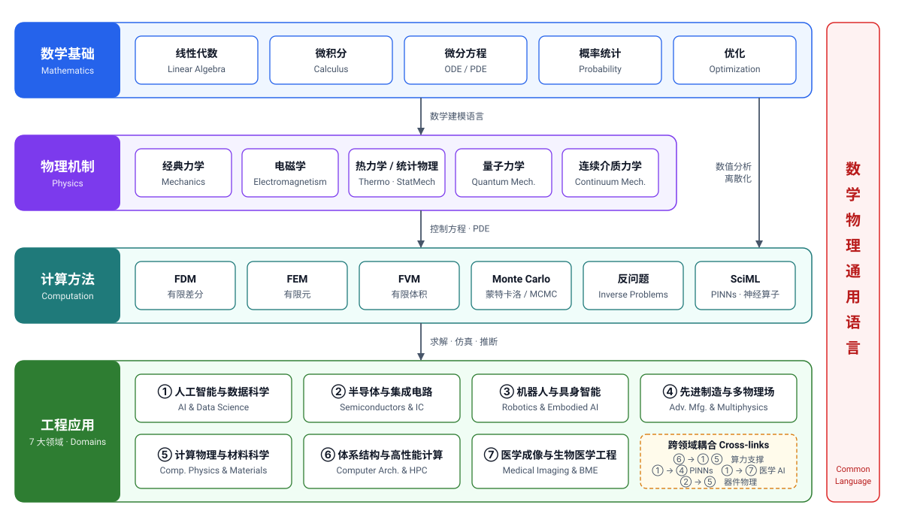
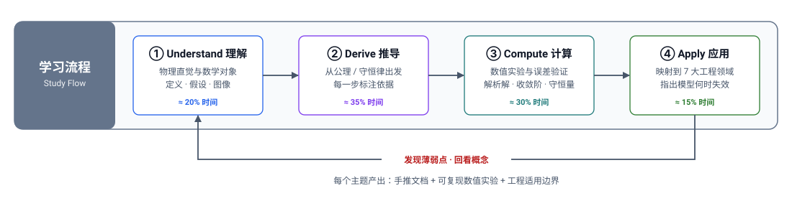

# MPCE — Mathematical Physics & Computational Engineering

个人数学物理与计算工程笔记库。整理这套内容，是想把 AI、半导体器件、机器人控制、多物理场制造、计算材料、高性能计算和医学成像背后共通的数学与物理串起来，不再把它们当成互不相干的课来学。

- **在线浏览**：[**MPCE 知识看板与 Wiki**](https://ziyu.mnilab.cn/MPCE/)（交互看板、进度记录、公式渲染、知识图谱）
- **深度与节奏**：高年级本科到研一水平，每周 10–15 小时，计划持续 18–24 个月
- **做法**：先推懂公式，再写代码算出来验证误差，最后对照具体工程模型
- **当前进度**：v0.2.0（已完成目录框架、67 个知识点、5 篇核心推导、4 个数值实验，详见 [`CHANGELOG.md`](CHANGELOG.md)）

---

## 1. 五层知识框架

不同工程问题底下往往是同一批数学和物理工具。整个仓库按自上而下的五层来组织：

1. **L1 宏观数学基础**：线性代数与算子结构、微积分与泛函分析、变分原理与最优化、概率统计与数值分析理论；
2. **L2 具体数学方法**：线性空间与矩阵分解、向量微积分与积分定理、ODE 与动力系统、偏微分方程与格林函数、傅里叶分析与弱形式、变分法与凸 / 非凸优化、概率论与随机过程、数值分析基础；
3. **L3 物理方法与控制方程**：经典与分析力学、电磁场与波动、连续介质与线弹性、流体力学与传热传质、热力学与统计物理、量子力学与电子结构、固体物理与半导体器件；
4. **L4 数值计算与工程方法**：直接与迭代线性求解、数值特征值与低秩求解、网格离散（FDM / FEM / FVM）、FFT 与谱方法、常微分方程时间积分、非线性优化与控制估计、蒙特卡洛与反问题正则化、科学机器学习与 GPU 计算；
5. **L5 工程应用场景**：面向 AI、半导体、机器人、先进制造、计算材料、高性能计算与医学成像七个方向。

层与层之间是多对多关系：一种数学方法会用在多个物理模型里，一个工程方向也往往依赖好几种计算方法。在[在线看板](https://ziyu.mnilab.cn/MPCE/)里把鼠标放到任意卡片上，就能看到它往上依赖哪些数学、往下对应哪些应用。



---

## 2. 七个应用方向



| # | 方向 | 依赖的数学与物理基础 | 典型计算问题 |
|---|---|---|---|
| 1 | 人工智能与数据科学 | 线性代数、概率、优化、泛函分析初步 | PINNs、神经算子（Neural Operators）、随机优化收敛性 |
| 2 | 半导体与集成电路 | 电磁学、量子与固体物理、椭圆/抛物型 PDE | Poisson–漂移-扩散耦合求解、能带计算 |
| 3 | 机器人与具身智能 | 刚体动力学、李群初步、控制论、概率估计 | 轨迹优化、Kalman 滤波、模型预测控制（MPC） |
| 4 | 先进制造与多物理场 | 连续介质力学、传热传质、流体力学 | FEM/FVM/CFD、热-力耦合仿真 |
| 5 | 计算物理与材料科学 | 量子力学、统计物理 | DFT、分子动力学（MD）、蒙特卡洛 |
| 6 | 体系结构与高性能计算 | 数值线性代数、算法复杂度 | GPU 并行核函数、Roofline 分析、通信-计算权衡 |
| 7 | 医学成像与生物医学工程 | 傅里叶分析、信号处理、反问题 | CT 滤波反投影、MRI k 空间重建、正则化反演 |

---

## 3. 单主题学习流程



每个核心主题都按四步推进，具体模板见 [`00_getting_started/study_workflow.md`](00_getting_started/study_workflow.md)：

1. **理解**：弄清物理背景、数学定义和前置假设，建立几何或物理直觉。
2. **推导**：合上书自己推一遍控制方程或关键定理，每一步写明依据，不跳步。
3. **计算**：用 Python（NumPy / SciPy / Matplotlib，后期视需要用 PyTorch / JAX）写可复现脚本，用解析解、收敛阶或守恒量验证代码正确性。
4. **应用**：对照具体工程问题，说清楚这套模型在哪些假设下有效、超过什么条件会失效。

---

## 4. 目录结构

```text
MPCE/
├── README.md                      # 仓库说明
├── ROADMAP.md                     # 18–24 个月路线图（区分仓库内容进度与个人掌握进度）
├── KNOWLEDGE_GRAPH.md             # 跨领域知识图谱总览与 7 条主线
├── CONTRIBUTING.md                # 写作规范、SVG 图示规范与质量检查清单
├── CHANGELOG.md                   # 更新记录
├── GLOSSARY.md                    # 中英术语与符号表
├── assets/diagrams/               # 全库矢量 SVG 架构与依赖图
├── 00_getting_started/            # 学习策略、先修依赖图、单主题流程
├── 01_mathematics/                # 数学核心（线性代数、微积分、微分方程、概率、优化、数值分析）
├── 02_physics/                    # 物理核心（经典力学、电磁学、热统、连续介质、量子、固体物理）
├── 03_computational_methods/      # 计算方法（FDM、FEM、FVM、蒙特卡洛、反问题、SciML）
├── 04_engineering_applications/   # 工程应用（6 个已建目录 + 计划中的 medical_imaging/）
├── 05_experiments/                # 可独立运行与自验证的 Python 数值实验
├── 06_knowledge_graph/            # 四层节点注册表（共 67 个节点）与待选池
├── 07_references/                 # 教材、公开课、软件文档与论文清单
└── scripts/                       # 自动化脚本（validate_kg.py、gen_panorama_svg.py）
```

---

## 5. 本地运行与开始使用

### 环境准备（Python ≥ 3.10）

```powershell
python -m venv .venv
.\.venv\Scripts\Activate.ps1
pip install numpy scipy matplotlib sympy
```

运行任意数值实验（全部脚本自带断言校验，退出码 `0` 即通过）：

```powershell
python 05_experiments/linear_algebra/01_matrix_decomposition/experiment.py
python 05_experiments/heat_transfer/06_2d_heat_equation/experiment.py
```

校验知识图谱 ID 一致性与先修无环性：

```powershell
python scripts/validate_kg.py
```

修改看板配置后，重新生成 README 里的五层框架图：

```powershell
python scripts/gen_panorama_svg.py          # 加 --check 只校验不写文件
```

### 阅读与上手顺序

1. 先读 [`00_getting_started/learning_strategy.md`](00_getting_started/learning_strategy.md) 做一次摸底自测；
2. 对照 [`00_getting_started/prerequisite_map.md`](00_getting_started/prerequisite_map.md) 和 [`ROADMAP.md`](ROADMAP.md) 确定当前阶段；
3. 按 [`01_mathematics/linear_algebra/curriculum.md`](01_mathematics/linear_algebra/curriculum.md) 开始 Phase I，独立推完再对照仓库里的推导文档与实验代码。

---

## 6. 相关文档

- [`ROADMAP.md`](ROADMAP.md) — 分阶段学习计划与进度表
- [`KNOWLEDGE_GRAPH.md`](KNOWLEDGE_GRAPH.md) — 跨领域知识图谱与 7 条贯穿主线
- [`05_experiments/README.md`](05_experiments/README.md) — 15 个计算实验目录与验证标准
- [`GLOSSARY.md`](GLOSSARY.md) — 常用术语与数学符号约定
- [`CONTRIBUTING.md`](CONTRIBUTING.md) — 维护规则、写作风格与 SVG 图示规范
- [`CHANGELOG.md`](CHANGELOG.md) — 版本更新历史
