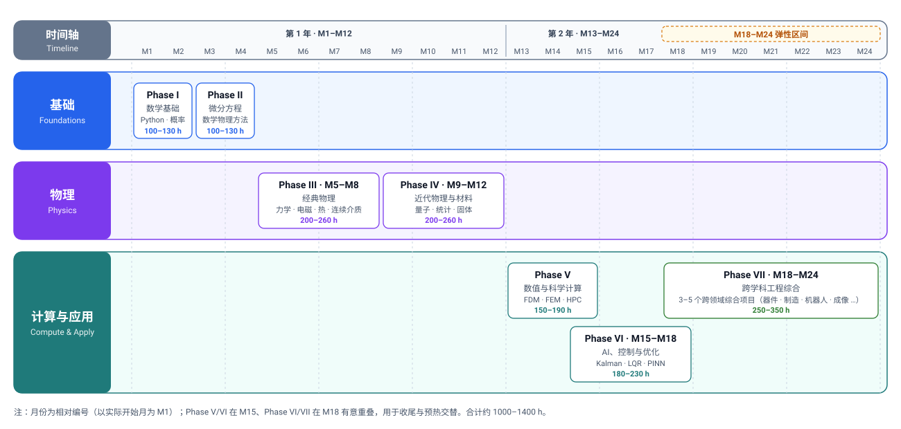

# ROADMAP — 18–24 个月学习路线图

> 预算：每周 10–15 小时 × 约 90–100 周 ≈ **1000–1400 小时**。
> 路线图按 Phase I–VII 组织，相邻阶段存在有意的重叠（如 M15、M18），用于收尾与预热交替进行。
> 先修依赖关系详见 [`00_getting_started/prerequisite_map.md`](00_getting_started/prerequisite_map.md)。

---

## 0. 进度追踪：仓库内容 vs. 个人掌握

**建好文档不等于学会了。** 本表把“仓库里有没有资料”和“自己有没有掌握”拆成两列，互不自动联动：

### 0.1 仓库内容状态（Content）

| 标记 | 含义 |
|---|---|
| `—` | 尚无任何材料 |
| `D` | 已有推导文档（Derivation，符合 10 节推导模板） |
| `E` | 已有数值实验（Experiment，符合 10 节实验标准） |
| `R` | 已通过技术审查（Reviewed） |
| `V?` | 含 `[NEEDS VERIFICATION]` 标记，尚未核实 |

可组合，例如 `D E R` 表示推导与实验齐备且已审查。

### 0.2 个人掌握状态（Mastery）

| 状态 | 判定标准 |
|---|---|
| `Not Started` | 还没开始 |
| `In Progress` | 正在学；能看懂推导，但合上书还写不出来 |
| `Completed` | 同时满足三项：① 白纸独立写出核心推导；② 独立跑通并改写对应数值实验、能解释结果；③ 能说清在工程里怎么用、什么条件下会失效 |
| `Needs Review` | 之前标过 `Completed`，但间隔复习时推不出来了 |

> 约定：协作工具只改 **Content** 列；**Mastery** 列只由我自己手动改。

---

## 1. 总览（Overview）

> 时间轴使用相对月份 M1–M24：以实际开始月份为 M1 平移即可。M18–M24 为弹性区间：进度顺利则 M18 后进入 Phase VII 深化；若前期滞后，Phase VII 可压缩为 2–3 个综合项目。

| Phase | 月份 | 主题 | 估计工时 | 里程碑交付物 |
|---|---|---|---|---|
| I | M1–M2 | 数学基础 + Python 数值计算 + 概率直觉 | 100–130 h | 线性代数/微积分核心推导集；第一批 NumPy 实验 |
| II | M3–M4 | 微分方程与数学物理方法 | 100–130 h | 热/波/Laplace 方程三件套（解析 + 数值对照） |
| III | M5–M8 | 经典物理 | 200–260 h | Lagrange 力学、Maxwell 方程、连续介质与热力学推导集 |
| IV | M9–M12 | 近代物理与材料 | 200–260 h | 量子力学、统计力学、固体物理；一维 Schrödinger 求解器 |
| V | M13–M15 | 数值数学与科学计算 | 150–190 h | FDM/FVM/FEM 自研小型求解器；数值线性代数与 HPC 基础 |
| VI | M15–M18 | AI、控制与优化 | 180–230 h | 优化理论、最优控制、Kalman 滤波、PINN/神经算子实验 |
| VII | M18–M24 | 跨学科工程综合 | 250–350 h | 3–5 个跨领域综合项目（详见 §3.7） |

---

## 2. 每周时间分配模型（Weekly Time Allocation）

### 2.1 基准比例

| 活动 | 比例 | 每周（以 12 h 计） | 具体内容 |
|---|---|---|---|
| 理论与推导（Theory / Derivation） | 40% | ≈ 4.8 h | 主动阅读教材；按推导模板独立写出核心推导 |
| 习题求解（Problem Solving） | 20% | ≈ 2.4 h | 教材习题，优先选证明题与"建模题" |
| 计算实验（Computational Experiment） | 30% | ≈ 3.6 h | 实现算法、与解析解对照、收敛性分析 |
| 综合与知识图谱（Synthesis / Knowledge Graph） | 10% | ≈ 1.2 h | 更新 `06_knowledge_graph/`、跨领域映射、周复盘 |

### 2.2 分阶段调整

| Phase | 理论/推导 | 习题 | 计算实验 | 综合 | 调整理由 |
|---|---|---|---|---|---|
| I–II | 45% | 25% | 20% | 10% | 重建推导习惯与基本功优先 |
| III–IV | 40% | 20% | 30% | 10% | 基准比例 |
| V | 30% | 15% | 45% | 10% | 数值方法必须通过实现来理解 |
| VI | 35% | 15% | 40% | 10% | 理论与实验并重 |
| VII | 20% | 10% | 50% | 20% | 以项目驱动的综合为主 |

### 2.3 节奏建议

- **一周结构**：工作日 3–4 次 × 1.5–2 h（理论/习题），周末 1 次 × 3–4 h 连续块（计算实验）。
- **间隔复习（spaced review）**：每个 `Completed` 主题在完成后第 1、4、12 周各做一次 20 分钟"白纸复现"；失败则标为 `Needs Review`。
- **缓冲**：每个 Phase 末尾预留约 10% 时间作为缓冲与复盘周；不要把缓冲周提前用于新内容。

---

## 3. 分阶段详细计划

> 每张表的 **Content** 列追踪内容状态，**Mastery** 列追踪个人掌握状态。初始均为 `—` / `Not Started`。

### 3.1 Phase I（M1–M2）：数学基础 Mathematical Foundations

**目标**：恢复线性代数与多元微积分的推导能力；从第一周起同步建立 Python 数值计算与概率直觉。

| ID | 主题 | 关键内容 | 目录 | Content | Mastery |
|---|---|---|---|---|---|
| I.1 | 向量空间与线性映射 | 基、维数、秩-零化度定理（rank–nullity theorem）、矩阵作为线性映射的表示 | `01_mathematics/linear_algebra/` | — | Not Started |
| I.2 | 内积、正交性与最小二乘 | Gram–Schmidt、QR 分解、正交投影、正规方程 | `01_mathematics/linear_algebra/` | D E R | Not Started |
| I.3 | 特征值与谱定理 | 对角化、实对称矩阵谱定理、二次型、正定性 | `01_mathematics/linear_algebra/` | D E R | Not Started |
| I.4 | 奇异值分解（SVD） | SVD 存在性证明、低秩逼近（Eckart–Young）、条件数 | `01_mathematics/linear_algebra/` | E R | Not Started |
| I.5 | 多元微分 | 梯度、Jacobian、Hessian、多元 Taylor 展开、链式法则 | `01_mathematics/calculus/` | — | Not Started |
| I.6 | 向量微积分 | 散度、旋度、Gauss/Stokes 定理、曲线坐标系 | `01_mathematics/calculus/` | — | Not Started |
| I.7 | 概率直觉（交织） | 随机变量、期望/方差、常见分布、大数定律与 CLT 的数值演示 | `01_mathematics/probability_statistics/` | — | Not Started |
| I.8 | Python 数值计算（交织） | NumPy 向量化、浮点误差、Matplotlib 可视化、SymPy 符号验证 | `05_experiments/linear_algebra/` | — | Not Started |

**阶段验收**：独立证明谱定理（实对称情形）；用 SVD 完成图像压缩实验并解释误差-秩曲线；用 Monte Carlo 数值验证 CLT。

### 3.2 Phase II（M3–M4）：微分方程与数学物理 Differential Equations & Mathematical Physics

| ID | 主题 | 关键内容 | 目录 | Content | Mastery |
|---|---|---|---|---|---|
| II.1 | 常微分方程（ODE）基础 | 线性 ODE 组、矩阵指数、存在唯一性（Picard–Lindelöf）、相平面 | `01_mathematics/differential_equations/` | E R | Not Started |
| II.2 | 稳定性与动力系统初步 | 平衡点线性化、Lyapunov 函数、极限环 | `01_mathematics/differential_equations/` | — | Not Started |
| II.3 | 偏微分方程（PDE）分类 | 椭圆/抛物/双曲型、特征线、适定性（well-posedness） | `01_mathematics/differential_equations/` | D R | Not Started |
| II.4 | 分离变量与 Sturm–Liouville 理论 | 正交函数展开、自伴算子、特征函数完备性 | `01_mathematics/differential_equations/` | — | Not Started |
| II.5 | Fourier 级数与 Fourier 变换 | 收敛性、Parseval 定理、卷积定理、DFT/FFT | `01_mathematics/differential_equations/` | D R | Not Started |
| II.6 | Green 函数与特殊函数 | Green 函数构造、δ 函数、Bessel 与 Legendre 函数 | `01_mathematics/differential_equations/` | — | Not Started |
| II.7 | 变分法（Calculus of Variations） | Euler–Lagrange 方程、约束变分、Lagrange 乘子 | `01_mathematics/optimization/` | — | Not Started |
| II.8 | 实验：三大经典方程 | 热/波/Laplace 方程的解析解与 FDM 数值解对照 | `05_experiments/heat_transfer/` | D E R | Not Started |

**阶段验收**：从守恒律推导一维热方程并求分离变量解；推导 Euler–Lagrange 方程；完成显式格式稳定性（CFL 条件）的数值演示。

### 3.3 Phase III（M5–M8）：经典物理 Classical Physics

| ID | 主题 | 关键内容 | 目录 | Content | Mastery |
|---|---|---|---|---|---|
| III.1 | Lagrange 力学 | 广义坐标、d'Alembert 原理、Hamilton 原理、约束 | `02_physics/classical_mechanics/` | — | Not Started |
| III.2 | Hamilton 力学 | Legendre 变换、相空间、Poisson 括号、辛结构与守恒律 | `02_physics/classical_mechanics/` | — | Not Started |
| III.3 | 刚体动力学 | 旋转矩阵、SO(3)、惯性张量、Euler 方程、多体系统 | `02_physics/classical_mechanics/` | — | Not Started |
| III.4 | 静电学与静磁学 | Coulomb/Gauss 定律、Poisson 方程、边值问题、Biot–Savart | `02_physics/electromagnetism/` | — | Not Started |
| III.5 | Maxwell 方程组与电磁波 | 微分/积分形式、位势与规范、波动方程、Poynting 定理 | `02_physics/electromagnetism/` | — | Not Started |
| III.6 | 热力学 | 热力学定律、热力学势、Maxwell 关系、熵 | `02_physics/thermodynamics/` | — | Not Started |
| III.7 | 连续介质力学 | 应力/应变张量、本构关系、Cauchy 动量方程、线弹性 | `02_physics/continuum_mechanics/` | — | Not Started |
| III.8 | 流体力学与传热 | Navier–Stokes 方程、无量纲数（Re、Pr、Pe）、对流-扩散 | `02_physics/continuum_mechanics/` | — | Not Started |
| III.9 | 实验 | 辛积分器 vs. 显式 Euler 能量漂移；二维静电场 FDM 求解 | `05_experiments/dynamics/`、`05_experiments/electromagnetics/` | — | Not Started |

**阶段验收**：从 Hamilton 原理推导双摆运动方程并数值模拟；从 Maxwell 方程推导电磁波方程；从守恒律推导 Cauchy 动量方程。

### 3.4 Phase IV（M9–M12）：近代物理与材料 Modern Physics & Materials

| ID | 主题 | 关键内容 | 目录 | Content | Mastery |
|---|---|---|---|---|---|
| IV.1 | 量子力学数学框架 | Hilbert 空间、算符、对易关系、测量公设、Dirac 记号 | `02_physics/quantum_mechanics/` | — | Not Started |
| IV.2 | 一维与三维定态问题 | 方势阱、谐振子（阶梯算符）、隧穿、氢原子 | `02_physics/quantum_mechanics/` | — | Not Started |
| IV.3 | 近似方法 | 微扰论、变分法、WKB 近似 | `02_physics/quantum_mechanics/` | — | Not Started |
| IV.4 | 统计力学 | 系综理论、配分函数、Boltzmann/Fermi–Dirac/Bose–Einstein 分布 | `02_physics/thermodynamics/` | — | Not Started |
| IV.5 | 晶体与能带理论 | 倒格子、Bloch 定理、近自由电子与紧束缚模型、有效质量 | `02_physics/solid_state_physics/` | — | Not Started |
| IV.6 | 半导体物理 | 载流子统计、掺杂、pn 结、漂移-扩散模型 | `02_physics/solid_state_physics/` | — | Not Started |
| IV.7 | 多体计算入门 | Hartree–Fock 思想、Hohenberg–Kohn 定理、Kohn–Sham 方程概要 | `04_engineering_applications/materials_science/` | — | Not Started |
| IV.8 | 实验 | 一维 Schrödinger 方程有限差分求解；紧束缚能带；Ising 模型 Metropolis 模拟 | `05_experiments/semiconductor/` | — | Not Started |

**阶段验收**：独立求解谐振子（阶梯算符法）；推导 Bloch 定理并计算一维紧束缚能带；用 Metropolis 算法复现二维 Ising 相变。

### 3.5 Phase V（M13–M15）：数值数学与科学计算 Numerical Mathematics & Scientific Computing

| ID | 主题 | 关键内容 | 目录 | Content | Mastery |
|---|---|---|---|---|---|
| V.1 | 误差分析基础 | 浮点运算、条件数、后向稳定性（backward stability） | `01_mathematics/numerical_analysis/` | — | Not Started |
| V.2 | 数值线性代数 | LU/Cholesky/QR、Krylov 子空间方法（CG、GMRES）、预条件 | `01_mathematics/numerical_analysis/` | — | Not Started |
| V.3 | ODE 数值解 | Runge–Kutta、多步法、刚性问题与隐式方法、辛积分器 | `01_mathematics/numerical_analysis/` | — | Not Started |
| V.4 | 有限差分法（FDM） | 截断误差、相容性/稳定性/收敛性、Lax 等价定理、von Neumann 分析 | `03_computational_methods/fdm/` | — | Not Started |
| V.5 | 有限体积法（FVM） | 守恒形式、数值通量、迎风格式 | `03_computational_methods/fvm/` | — | Not Started |
| V.6 | 有限元法（FEM） | 弱形式、Galerkin 方法、Lax–Milgram 定理、Céa 引理、组装 | `03_computational_methods/fem/` | — | Not Started |
| V.7 | Monte Carlo 方法 | 方差缩减、MCMC、收敛速率 $O(N^{-1/2})$ | `03_computational_methods/monte_carlo/` | — | Not Started |
| V.8 | HPC 基础 | 内存层次、Roofline 模型、并行范式（MPI/OpenMP/CUDA 概念）、稀疏矩阵格式 | `04_engineering_applications/hpc_architecture/` | — | Not Started |
| V.9 | 实验 | 自研一维/二维 FEM 求解器（含收敛阶验证）；CG 与预条件效果对比 | `05_experiments/finite_element/` | — | Not Started |

**阶段验收**：从强形式推导 Poisson 方程弱形式并证明 Galerkin 正交性；自研 FEM 求解器的 $L^2$ 误差收敛阶与理论一致。

### 3.6 Phase VI（M15–M18）：AI、控制与优化 AI, Control & Optimization

| ID | 主题 | 关键内容 | 目录 | Content | Mastery |
|---|---|---|---|---|---|
| VI.1 | 凸优化 | 凸集/凸函数、KKT 条件、对偶理论 | `01_mathematics/optimization/` | — | Not Started |
| VI.2 | 数值优化算法 | 梯度下降收敛分析、Newton/拟 Newton、SGD、Adam | `01_mathematics/optimization/` | — | Not Started |
| VI.3 | 统计学习基础 | 最大似然、贝叶斯推断、偏差-方差、正则化 | `01_mathematics/probability_statistics/` | — | Not Started |
| VI.4 | 状态估计 | 线性 Kalman 滤波推导、EKF/UKF、粒子滤波 | `04_engineering_applications/robotics/` | — | Not Started |
| VI.5 | 控制理论 | 状态空间、能控/能观性、LQR、Pontryagin 极小值原理、MPC | `04_engineering_applications/robotics/` | — | Not Started |
| VI.6 | 深度学习数学基础 | 反向传播（自动微分）、万能逼近定理的表述与局限 | `04_engineering_applications/ai_data_science/` | — | Not Started |
| VI.7 | 科学机器学习（SciML） | PINNs、神经算子（DeepONet、FNO）、可微物理 | `03_computational_methods/scientific_ml/` | — | Not Started |
| VI.8 | 反问题与正则化 | 不适定性、Tikhonov 正则化、Radon 变换与 CT 重建 | `03_computational_methods/inverse_problems/` | — | Not Started |
| VI.9 | 实验 | Kalman 滤波跟踪；倒立摆 LQR；PINN 求解 Burgers 方程并与 FDM 对比 | `05_experiments/robotics/`、`05_experiments/scientific_ml/` | — | Not Started |

**阶段验收**：从贝叶斯后验推导 Kalman 滤波递推式；从 Riccati 方程推导 LQR；PINN 与传统数值解在精度与成本上的定量对比报告。

### 3.7 Phase VII（M18–M24）：跨学科工程 Cross-Disciplinary Engineering

以项目驱动（project-driven），每个项目必须串起"数学 → 物理 → 模型 → 计算 → 应用"完整链条。从下列候选中选 3–5 个：

| ID | 综合项目 | 涉及领域 | 核心链条 | Content | Mastery |
|---|---|---|---|---|---|
| VII.1 | 二维 MOSFET 器件仿真 | 2, 5, 6 | Poisson + 漂移-扩散 → Scharfetter–Gummel 离散 → Gummel/Newton 迭代 | — | Not Started |
| VII.2 | 增材制造热-力耦合仿真 | 4, 6 | 瞬态传热 + 线弹性 → FEM → 残余应力预测 | — | Not Started |
| VII.3 | 四足/机械臂轨迹优化与估计 | 3, 1 | 刚体动力学 → 直接配点法（direct collocation）→ MPC + EKF | — | Not Started |
| VII.4 | CT/MRI 图像重建 | 7, 1 | Radon/Fourier 变换 → 正则化反演 → 学习型重建（unrolled networks） | — | Not Started |
| VII.5 | 神经算子替代模型 | 1, 4, 5 | PDE 参数族 → FNO/DeepONet → 泛化与误差分析 | — | Not Started |
| VII.6 | 分子动力学与材料性质 | 5, 6 | 势函数 → Verlet 积分 → 统计量提取（扩散系数、径向分布函数） | — | Not Started |
| VII.7 | GPU 加速稀疏求解器 | 6, 4 | CSR 格式 → 预条件 CG → Roofline 性能分析 | — | Not Started |

**阶段验收**：每个项目产出一份技术报告（建模假设、推导、验证、局限性、研究前沿简述）。

---

## 4. 路线图维护规则

1. 每月最后一周更新本文件的状态列，并在 [`CHANGELOG.md`](CHANGELOG.md) 中记录内容变化。
2. 若某 Phase 超期 > 4 周，应**裁剪广度而非降低深度**：优先保留关键路径主题（见 [`prerequisite_map.md`](00_getting_started/prerequisite_map.md) §3）。
3. 新增主题前必须回答 [`CONTRIBUTING.md`](CONTRIBUTING.md) 中的 7 个必答问题。
